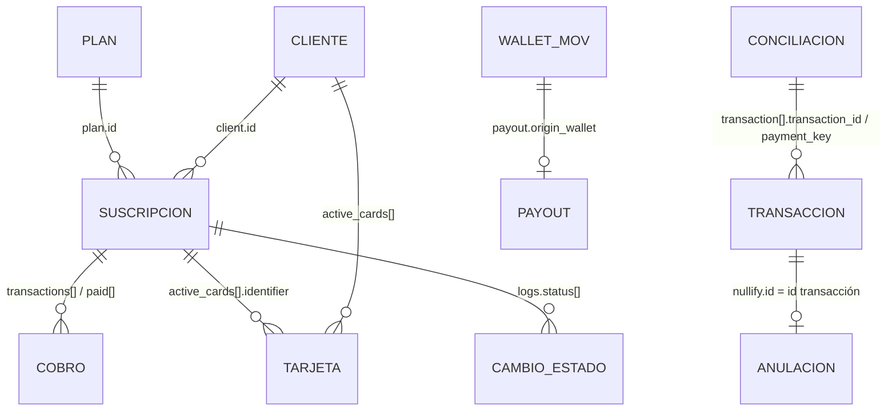

# Modelo de datos: relaciones, identificadores y capas (STG vs normalizado)

Fuentes: secciones de Suscripción, Transacción, Anulación y Conciliación de https://docs.payku.com/cl/

---

## Términos clave

- **Cardinalidad:** cuántos de un recurso se relacionan con cuántos de otro (1:1, 1:N, N:M).
- **Padre / hijo:** el hijo no tiene sentido sin el padre (un cobro sin suscripción, por ejemplo).
- **Clave natural:** un dato del mundo real que identifica algo (email, RUT).
- **Clave de Payku:** el ID que Payku genera (`cl…`, `su…`).
- **ID externo:** nuestro propio identificador guardado dentro de Payku, para encontrar el registro desde nuestro lado.

---

## 1. Mapa de relaciones (validado contra la documentación)



> ⚠️ La relación **COBRO de suscripción ↔ TRANSACCIÓN (`/api/transaction`)** no está documentada. Ver § 2.6.

---

## 2. Relaciones una por una

### 2.1 Plan → Suscripción

| Aspecto | Detalle |
|---|---|
| ID que conecta | `plan.id` (ej. `pl9697fb170834ad42dd00`) ✅ |
| Padre / hijo | Plan es padre; suscripción es hija. ✅ (`POST /api/sususcription` exige `plan`) |
| Cardinalidad | 1 plan : N suscripciones. ✅ (`total_suscription`, `total_suscription_active` en el plan) |
| Desde dónde se obtiene | `GET /api/sususcription/{id}` → `plan{id,name,currency}`; V1 y V3 → `plan{…}`. Dentro del cliente → `subcriptions.plan[]` (**arreglo**). ✅ |
| Qué guardar | `payku_plan_id` en la suscripción. Catálogo de planes con `GET /api/suplan/plans`. |
| Nota | El plan define las URL de notificación (`url_notify_suscription`, `url_notify_payment`). ✅ |

### 2.2 Cliente → Suscripción

| Aspecto | Detalle |
|---|---|
| ID que conecta | `client.id` (ej. `cld0835b9063a5903f4ae7`) dentro de la suscripción ✅; `subscriptions.client` en el callback de cobro ✅ |
| Padre / hijo | Cliente es padre. ✅ (`POST /api/sususcription` exige `client`) |
| Cardinalidad | 💡 1 cliente : N suscripciones. ⚠️ En `GET /api/suclient/{id}` el ejemplo muestra `subcriptions` como **un objeto**, no un arreglo; en el listado de clientes es un **arreglo**. No está confirmado qué pasa si un cliente tiene dos suscripciones. |
| Desde dónde se obtiene | Suscripción → `client{id, name, email, rut, phone, additional_parameters}`; Cliente → `subcriptions` (ojo: escrito así, **sin la segunda "s"**). |
| Qué guardar | `payku_client_id` en la suscripción y en nuestra tabla de personas. |
| Nota | En el ejemplo del listado V1, `client.id` empieza con `su…` (`su7e5e1c0b1bd2e37ec557`). 💡 No uses el prefijo para validar el tipo de ID. |

### 2.3 Suscripción → Cobros

| Aspecto | Detalle |
|---|---|
| ID que conecta | No hay un `subscription_id` dentro del cobro: el cobro **vive dentro** de la suscripción. En el callback de cobro sí viene `subscriptions.id`. ✅ |
| Padre / hijo | Suscripción es padre. ✅ |
| Cardinalidad | 1 : N ✅ |
| Desde dónde se obtiene | **V1 / detalle:** `transactions[]` → `{created_at, amount, transaction, authorization_code, order, description, status}`. **V3:** `paid[]` → `{payment_cycle_day, payment_day, status, amount_paid, try_number, paid_number, transactions[]}`. **Cliente:** `subcriptions.transactions[]` (agrega `date_payment`). **Callback:** `transaction_id`, `verification_key`, `order`, `status`. ✅ |
| Qué guardar | Ver § 3 (IDs) y [subscription-charges.md](subscription-charges.md). |
| Nota | V3 es el único que muestra **ciclos y reintentos** (`try_number`). ⚠️ La estructura de `paid[].transactions[]` no está documentada (el ejemplo viene vacío). |

### 2.4 Suscripción / Cliente → Tarjetas

| Aspecto | Detalle |
|---|---|
| ID que conecta | `active_cards[].identifier` (ej. `surec804a8ed60c747cb8839`) ✅ |
| Padre / hijo | ⚠️ Ambiguo: las tarjetas aparecen en el **cliente** (`active_cards`) y en la **suscripción** (`active_cards` y `cards`). Se agregan con `POST /api/suinscriptionscards` pasando el **ID de suscripción**. 💡 La tarjeta pertenece al cliente y se asocia vía una suscripción. |
| Cardinalidad | 1 : N (`active_cards` es arreglo) ✅ |
| Desde dónde se obtiene | `GET /api/suclient/{id}`, `GET /api/sususcription/{id}`, V3 (`active_cards` como **objeto**, sin `identifier`). |
| Qué guardar | `identifier`, `last_4_digits` (viene enmascarado `XXXXXXXXXXXX6622`), `card_type`, `register`. **Nunca** datos completos de tarjeta (Payku tampoco los entrega). |
| Nota | `cards` (sin `identifier`) parece ser la tarjeta "en uso"; `active_cards` todas las vigentes. 💡 ⚠️ |

### 2.5 Suscripción → Historial de estados

`logs.status[]` → `{change_date, initial_status, final_status}`. ✅ Viene en V1, V3 y detalle. Base para auditoría y para detectar cambios sin depender de webhooks.

### 2.6 Cobro de suscripción ↔ Transacción de pago único

⚠️ **No confirmado en la documentación oficial de Payku.**
- `GET /api/transaction/{id}` acepta "el identificador de la transacción como el identificador de cobro: `payment_key`, `transaction_key`". ✅
- Los cobros de suscripción exponen `transaction` (número, ej. `204444`) y `verification_key`. ✅
- No está documentado si un cobro de suscripción aparece en `GET /api/transaction` ni si se puede consultar con `GET /api/transaction/204444`. Validar en sandbox (Q-06). Es clave para usar **conciliación** con suscripciones.

### 2.7 Transacción → Anulación

`POST /api/nullification` con `id` = identificador de la transacción (ej. `trxpr2a45s1dytg1`). La anulación se consulta con el mismo ID: `GET /api/nullification/{id}`. ✅ La transacción muestra `nullify.status`. ✅ Cardinalidad 💡 1 : 0..1 (⚠️ no sabemos si se permiten varias anulaciones parciales).

### 2.8 Conciliación → Transacciones

`conciliation[].transaction[]` → `{transaction_id, payment_key, order, start, end, deposit_date, amount, fee, amount_deposit, media}`. ✅ Una liquidación (1) agrupa N transacciones. Cruce con nuestras transacciones por `payment_key` (más específico) o por `order` (nuestro). 💡

### 2.9 Wallet → Payout

Movimiento (`wallet_movements[].id`, `wa…`) ↔ payout (`payout.id`, `war…` / `mor…`). El payout trae `origin_wallet`. ✅

---

## 3. Identificadores

> Los prefijos (`cl`, `su`, `pl`…) son **observados en los ejemplos**, no un contrato documentado. 💡 No valides por prefijo.

| Identificador (nombre en Payku) | Recurso | Ejemplo | Dónde se obtiene | Dónde se usa | ¿Estable? | ¿Persistir? |
|---|---|---|---|---|---|---|
| `id` del cliente | Cliente de suscripción | `cl0be4c8e623c167bc8b777` | Respuesta de `POST /api/suclient` ✅ | `GET/PUT/DELETE /api/suclient/{id}`, `client` en `POST /api/sususcription` ✅ | 💡 Sí | **Sí** (`payku_client_id`) |
| `email` | Cliente | `johndoe@example.com` | Nuestro dato | `GET/PUT/DELETE /api/suclient/{email}` (alternativa al ID) ✅ | Cambia si el cliente lo actualiza (`PUT` permite `email`) | Sí, pero **no como clave** |
| `id` del plan | Plan | `pl9697fb170834ad42dd00` | `POST /api/suplan`, `GET /api/suplan/plans` ✅ | `plan` en `POST /api/sususcription`, `GET /api/suplan/{id}` ✅ | 💡 Sí | **Sí** |
| `code` del plan | Plan | `001` | `GET /api/suplan/*` ✅ | ⚠️ No se usa en ningún endpoint como parámetro | 💡 | Sí (informativo) |
| `id` de la suscripción | Suscripción | `sucaab7865dceaff49d8b3` | `POST /api/sususcription` ✅ | `GET/DELETE /api/sususcription/{id}`, `suscription` en `sutransaction` y `suinscriptionscards` ✅ | 💡 Sí | **Sí** (clave principal de sync) |
| `identifier` de tarjeta | Tarjeta | `surec804a8ed60c747cb8839` | `active_cards[]` ✅ | `card` en `POST /api/sutransaction` (consumo) y en eliminar tarjeta ✅ | 💡 Sí | Sí |
| `transaction` / `transaction_id` | Cobro de suscripción | `204444` (número) | `transactions[]`, respuesta de `sutransaction`, callback de cobro ✅ | ⚠️ Ningún endpoint documentado lo recibe como parámetro | 💡 Sí | **Sí** (clave del cobro) |
| `verification_key` | Cobro / transacción | `2ba83615…` | Callback de cobro, `sutransaction`, `payment` de transacción ✅ | "Hash único de transacción". ⚠️ No se documenta cómo verificarlo | 💡 Sí | Sí (auditoría) |
| `order` | Cobro / transacción | `001` | **Nosotros** lo enviamos (`sutransaction`, `transaction`) ✅ | Cruce con conciliación ✅ | Sí (es nuestro) | **Sí** (nuestra referencia) |
| `authorization_code` | Cobro / transacción | `1234` | Respuestas ✅ | Código del banco emisor | Sí | Sí (soporte y contraloría) |
| `id` de transacción | Transacción de pago único | `trx3b4d77b43acd9a720` | `POST /api/transaction` ✅ | `GET /api/transaction/{id}`, `POST /api/nullification` ✅ | 💡 Sí | **Sí** |
| `payment.transaction_id` | Transacción | `107999` (número) | `GET /api/transaction*` ✅ | — | 💡 | Sí |
| `payment_key` | "Identificador del cobro" | `pra934939d607922f9e` | `payment.payment_key`, conciliación, callback `urlnotify` ✅ | `GET /api/transaction/{payment_key}` ✅ | 💡 Sí | **Sí** (cruce con conciliación) |
| `transaction_key` | Transacción | `9916581777599311` / `null` | `payment.transaction_key`, callback ✅ | `GET /api/transaction/{transaction_key}` ✅ | 💡 | Sí |
| `id` de conciliación | Liquidación | `107999` | `POST /api/conciliation` ✅ | — | 💡 | Sí |
| `identifier_wallet` / `current_id` | Movimiento de wallet | `wab5f7232dafff18f9` | Wallet ✅ | `GET /api/wallet/{id}` ✅ | 💡 | Sí (si usamos wallet) |
| `identifier_payout` | Payout | `mor33e36b01e8a11b9ee` | `POST /api/wallet/payout` ✅ | `GET /api/payout(v3)/{id}` ✅ | 💡 | Sí (si usamos wallet) |

### ¿Podemos usar nuestro propio ID dentro de Payku?

| Recurso | Opción | Estado |
|---|---|---|
| Cliente | `additional_parameters` (objeto libre, máx. 4000 caracteres), p. ej. `{"techo_person_id": "12345"}` ✅ | 💡 Se devuelve en `GET` del cliente ✅. ⚠️ **No se puede buscar por él**, y en la suscripción el ejemplo lo muestra vacío (`""`). Sirve como respaldo, no como llave de búsqueda. |
| Cliente | `email` como clave natural | ✅ se puede consultar por email. ⚠️ No está confirmado que Payku impida dos clientes con el mismo email. |
| Suscripción | — | ❌ No hay campo de ID externo documentado. **Debemos guardar el mapeo** `payku_subscription_id ↔ nuestro_id` al crearla. |
| Cobro de consumo (`sutransaction`) | `order` ✅ | Nuestro. Úsalo siempre y hazlo único. |
| Cobro automático | `order` aparece en el callback como "identificador enviado por el comercio" ✅ | ⚠️ En cobros automáticos no enviamos nada: no sabemos quién genera ese `order`. |
| Transacción | `order` + `additional_parameters.order_ext` ✅ | `order_ext` es palabra reservada pensada para asociar la transacción a un ID único del comercio. ✅ |

---

## 4. Tipos de dato inconsistentes (normalizar en el ETL)

| Campo | Variantes en la documentación |
|---|---|
| Montos | `amount` string (`"15000"`) en suscripción, int (`10000`) en cobros, string en `GET /api/transaction/{id}`, int en listado de transacciones. |
| Estado de suscripción | `status` (V1/detalle) vs `estatus` (V3). |
| Tarjetas | `cards` objeto vs arreglo; `active_cards` arreglo (detalle) vs objeto (V3). |
| Suscripciones del cliente | `subcriptions` objeto (detalle cliente) vs arreglo (listado). |
| `plan` | objeto (suscripción) vs arreglo (dentro del cliente). |
| `additional_parameters` | objeto, string vacío `""` o "array of anys". |
| `transaction_id` | número (callback, `payment`) vs string (`sutransaction`, conciliación). |
| Fechas | `YYYY-MM-DD HH:MM:SS` sin zona; `YYYY-MM-DD`; ISO con `Z` en anulación (`2023-05-17T19:12:57.189Z`); `2023-10-2 08:32:52` (día sin cero). |
| Fecha de modificación | `update_at` (no `updated_at`). |

💡 **Regla:** en STG se guarda el JSON tal cual; el ETL convierte todo (montos a entero CLP, fechas a `timestamptz` asumiendo `America/Santiago` cuando no traen zona ⚠️, IDs a string).

---

## 5. Qué va a STG_PAYKU y qué al modelo normalizado

### 5.1 STG_PAYKU (raw, mínima transformación)

Una tabla por **fuente** (endpoint/evento), no por concepto de negocio:

| Tabla | Contenido | Clave |
|---|---|---|
| `stg_payku_subscription_v3` | Cada elemento de `subscriptions[]` de V3 | `payku_id` + `payload_hash` |
| `stg_payku_subscription_v1` | Cada elemento de V1 (trae `last_status_current_payment`) | ídem |
| `stg_payku_subscription_detail` | Respuesta de `GET /api/sususcription/{id}` | ídem |
| `stg_payku_customer` | Respuesta de `GET /api/suclient/{id}` y elementos del listado | ídem |
| `stg_payku_plan` | Elementos de `GET /api/suplan/plans` | ídem |
| `stg_payku_transaction` | `GET /api/transaction` y `/{id}` | ídem |
| `stg_payku_conciliation` | Elementos de `POST /api/conciliation` | ídem |
| `stg_payku_webhook_event` | **Cada** callback recibido (cuerpo, headers, IP, hora) | `event_uuid` nuestro |
| `stg_payku_api_call_log` | Request/response de cada POST/DELETE que hacemos | `request_id` nuestro |

Columnas comunes a todas:

```text
payku_id            texto   -- id del objeto en Payku (si existe)
payload             jsonb   -- JSON original completo, sin tocar
payload_hash        texto   -- sha256 del payload (para detectar cambios)
source_endpoint     texto   -- p.ej. "GET /api/sususcriptionv3"
query_params        jsonb   -- page, per_page, date_init, date_end, filtros
environment         texto   -- "sandbox" | "production"
sync_run_id         uuid    -- corrida que lo trajo
fetched_at          timestamptz
```

Reglas:
- **Append-only** o upsert por (`payku_id`, `payload_hash`): si el payload no cambió, no insertes otra fila.
- Nunca "arreglar" datos en STG (ni tipos, ni estados, ni nombres de campos).
- Guardar también respuestas de error (con `status: failed`) en el log de llamadas.

### 5.2 Modelo normalizado (BD_CENTRAL)

| Entidad | Campos clave | Origen |
|---|---|---|
| `persona` / `socio` | id interno, RUT, email | Nuestro sistema |
| `payku_cliente_map` | `persona_id`, `payku_client_id`, email al momento del vínculo | Alta + `stg_payku_customer` |
| `suscripcion` | id interno, `proveedor='payku'`, `payku_subscription_id`, `payku_plan_id`, `estado_normalizado`, `estado_origen`, `inicio`, `termino`, `monto`, `moneda` | V3 + detalle |
| `suscripcion_estado_hist` | `suscripcion_id`, `fecha`, `estado_origen_desde`, `estado_origen_hasta` | `logs.status[]` + webhooks |
| `cobro` | id interno, `suscripcion_id`, `payku_transaction_id`, `order`, `ciclo` (`payment_cycle_day`), `fecha_pago`, `intento` (`try_number`), `monto`, `estado_normalizado`, `estado_origen`, `authorization_code`, `verification_key` | V3 `paid[]` + detalle `transactions[]` + webhook de cobro |
| `liquidacion` | `payku_conciliation_id`, fecha depósito, monto bruto, comisión, neto | Conciliación |
| `tarjeta_resumen` | `payku_card_identifier`, `ultimos_4`, `tipo`, `fecha_registro`, `vigente` | `active_cards` |

💡 El campo `estado_origen` (valor literal de Payku) se conserva **también** en el modelo normalizado para trazabilidad.
