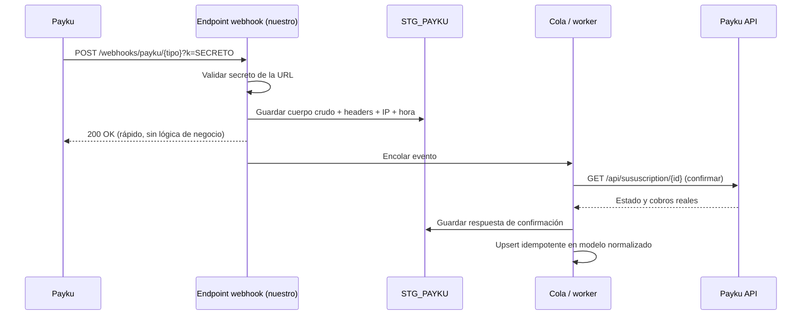

# Notificaciones (webhooks / callbacks)

Documentación oficial:
- Suscripción y cobro: https://docs.payku.com/cl/api/subscriptions/ ("url Callback notificación suscripción", "url Callback notificación cobro")
- Transacción: https://docs.payku.com/cl/api/transaction/ (campo `urlnotify`)
- Anulación: https://docs.payku.com/cl/api/refunds/ ("Generar callback")
- Wallet: https://docs.payku.com/cl/api/wallet/ (campo `url_notify`)

---

## Términos clave

- **Webhook / callback:** Payku hace un `POST` a **nuestra** URL para avisarnos de un cambio.
- **Idempotente:** procesar el mismo aviso dos veces deja el mismo resultado que procesarlo una vez.

🎨 **Analogía:** el webhook es el **timbre**. Te avisa que llegó alguien, pero antes de abrir miras por la mirilla (consultas la API) para confirmar quién es.

---

## 1. Inventario de notificaciones

| Notificación | Dónde se configura | Cuándo llega | Payload documentado |
|---|---|---|---|
| **Estado de suscripción** | `url_notify_suscription` del **plan** ✅ (ver contradicción en [plans.md](plans.md)) | "Luego de realizar la activación de la suscripción por parte del usuario" ✅ (💡 probablemente también en otros cambios ⚠️) | `{id, status}` |
| **Cobro de suscripción** | `url_notify_payment` del **plan** ✅ | "Luego de realizado el cobro de la suscripción de forma automática" ✅ | `{transaction_id, verification_key, order, status, subscriptions{id, client}}` |
| **Pago único** | `urlnotify` al crear la transacción ✅ | Cuando el pagador termina en su banco ✅ | `{transaction_id, payment_key, transaction_key, verification_key, order, status}` |
| **Anulación** | Panel Payku → sección de configuración ✅ | ⚠️ No especificado | `{id, id_transaction, ordencompra, fecha, monto, status}` |
| **Payout (pago a terceros)** | `url_notify` al crear el payout ✅ | Al terminar el pago a terceros ✅ | `{id, identifier_payout, order, status, update_at, customer{…}}` |

> `url_success_payment` y `url_failed_payment` del plan **no** son webhooks: son redirecciones del navegador del usuario. ✅

---

## 2. Payloads

### 2.1 Estado de suscripción ✅

```http
POST {url_notify_suscription}
```

```json
{ "id": "su74866857980c7d2b4306", "status": "active" }
```

| Campo | Tipo | Descripción |
|---|---|---|
| `id` | string | ID de la suscripción. |
| `status` | string | `register` / `active` / `finish` / `delete` / `cancel` / `suspended`. |

### 2.2 Cobro de suscripción ✅

```http
POST {url_notify_payment}
```

```json
{
  "transaction_id": 9123123,
  "verification_key": "2ba83615f863e72sdca5dfd0a6df2782",
  "order": 1568041684,
  "status": "success",
  "subscriptions": { "id": "su3ce571420e90b600eafb", "client": "cl795704ece0a3690baaf" }
}
```

| Campo | Tipo | Descripción |
|---|---|---|
| `transaction_id` | number | ID del cobro en Payku. |
| `verification_key` | string | "Hash único de transacción". |
| `order` | string (el ejemplo es número) | "Identificador único de transacción enviado por el comercio". |
| `status` | string | `pending` / `success` / `rejected` / `refunded partial` / `refunded`. |
| `subscriptions.id` | string | Suscripción. |
| `subscriptions.client` | string | Cliente. |

⚠️ **No trae el monto** ni la fecha. Hay que consultarlos.

### 2.3 Pago único (`urlnotify`) ✅

```json
{
  "transaction_id": "9916587765599311",
  "payment_key": "trx32cb779c0a777fc68",
  "transaction_key": "9916581777599311",
  "verification_key": "8b3e2202fb086a7de93777ae34d5e18c",
  "order": "199",
  "status": "success"
}
```

`status`: `success` o `failed`.

### 2.4 Anulación ✅

```json
{
  "id": "morexxzxxx",
  "id_transaction": "morexxzxxx",
  "ordencompra": "367734544",
  "fecha": "24-08-2023 12:29:35",
  "monto": 7000,
  "status": "complete"
}
```

⚠️ Campos en español y fecha en formato **`DD-MM-YYYY`** (distinto al resto de la API).

### 2.5 Payout ✅

```json
{
  "id": "morexzxxxx",
  "identifier_payout": "morexzxxxx",
  "order": "367734544",
  "status": "success",
  "update_at": "2023-08-24 12:29:35",
  "customer": { "name": "Jhon Doe", "phone": "978456879", "document": "111111111", "number": "978456879" }
}
```

Rechazado: `status: "banking_error"`.

---

## 3. Lo que Payku NO documenta ⚠️

| Tema | Estado |
|---|---|
| **Firma o autenticación** del webhook (header con HMAC, token) | ⚠️ No documentado. Hay que asumir que **cualquiera** podría llamar a nuestra URL. |
| `Content-Type` del POST (JSON o formulario) | ⚠️ No documentado. Aceptar ambos. |
| Respuesta esperada (¿HTTP 200?, ¿cuerpo?) | ⚠️ No documentado. 💡 Responder `200` rápido. |
| **Reintentos** si fallamos | ⚠️ No documentado. Asumir que un aviso **puede perderse**. |
| Orden de llegada / duplicados | ⚠️ No documentado. Asumir que pueden llegar duplicados o desordenados. |
| IPs de origen | ⚠️ No documentado. |
| ¿Se notifican `suspended`, `cancel`, `finish`? | ⚠️ La doc solo menciona la activación. |
| ¿Se notifican los cobros **rechazados** y los reintentos? | ⚠️ La doc dice "luego de realizado el cobro"; la lista de estados incluye `rejected`. |
| ¿Se notifican cobros de **consumo** (`sutransaction`)? | ⚠️ No documentado. |

---

## 4. Diseño recomendado del receptor 💡



Reglas:
1. **Una URL por tipo** (`/webhooks/payku/subscription`, `/payment`, `/transaction`, `/nullification`, `/payout`) con un **secreto aleatorio** en el query string (`?k=…`). Rechaza (401) si no coincide.
2. **HTTPS** obligatorio.
3. **Guardar primero, procesar después.** El endpoint solo persiste el evento crudo y responde 200.
4. **Aceptar JSON y `application/x-www-form-urlencoded`.**
5. **No confiar en el contenido.** El webhook dispara una **consulta a la API** (`GET /api/sususcription/{id}` o `GET /api/transaction/{payment_key}`). Lo que se guarda como verdad es la respuesta de la API.
6. **Idempotencia:** clave de deduplicación por tipo:
   - suscripción: (`id`, `status`)
   - cobro: (`transaction_id`, `status`)
   - pago único: (`payment_key` o `transaction_id`, `status`)
   - anulación: (`id_transaction`, `status`)
7. **Desorden:** si llega `active` después de `suspended`, no retrocedas el estado por el webhook; usa el `logs.status[]` de la API (con `change_date`) para decidir.
8. **Red de seguridad:** como los avisos pueden perderse, la sincronización periódica ([sync-payku.md](workflows/sync-payku.md)) debe poder reconstruir todo sin webhooks.

### Esqueleto (FastAPI)

```python
@router.post("/webhooks/payku/{kind}")
async def payku_webhook(kind: WebhookKind, request: Request, k: str = Query(...)):
    if not hmac.compare_digest(k, settings.PAYKU_WEBHOOK_SECRET):
        raise HTTPException(status_code=401)

    raw_body = await request.body()
    content_type = request.headers.get("content-type", "")
    payload = parse_json_or_form(raw_body, content_type)  # tolerante a ambos formatos

    event_id = await stg.save_webhook_event(
        kind=kind,
        payload=payload,
        raw_body=raw_body.decode("utf-8", "replace"),
        headers=dict(request.headers),
        source_ip=request.client.host if request.client else None,
    )
    await queue.enqueue("payku.process_webhook", event_id=event_id)
    return {"received": True}
```

---

## 5. ¿Para qué sirve `verification_key`?

Payku la describe como "hash único de transacción" / "código de verificación creado por payku". ✅
⚠️ **No está documentado cómo calcularla ni cómo validarla.** 💡 Úsala como dato de auditoría y para cruzar el webhook con la respuesta de la API (deben coincidir), no como firma.
