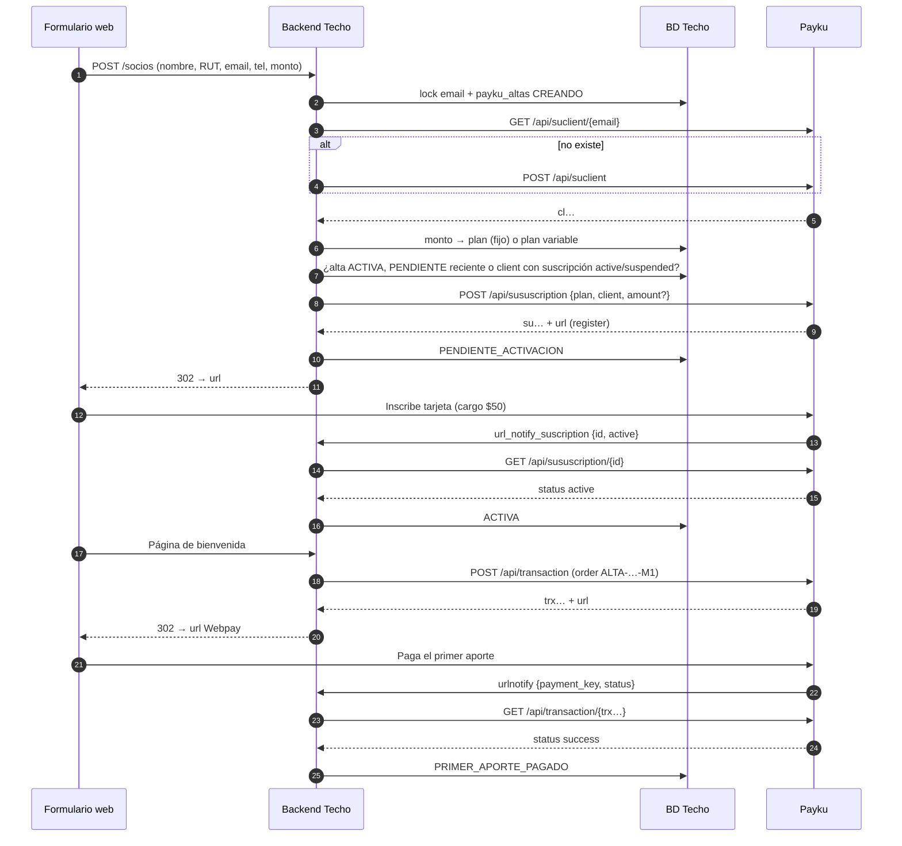

# Flujo: alta de un nuevo socio desde un formulario web

**Objetivo:** un socio completa el formulario web → queda con su **cliente** en Payku (sin duplicados), con una **suscripción** al plan de su monto (fijo o variable) y su tarjeta inscrita, y con su **primer aporte cobrado de inmediato** con una transacción única.
**Recursos:** Cliente (`cl…`) · Plan (`pl…`) · Suscripción (`su…`) · Transacción (`trx…`) · **Postman:** carpeta `00 · Alta de socio (flujo)`
**Relacionados:** [create-customer.md](create-customer.md) · [create-subscription.md](create-subscription.md) · [plans.md](../plans.md) · [transactions.md](../transactions.md) · [webhooks.md](../webhooks.md) · [open-questions.md](../open-questions.md)

> **Modelo de montos (decisión 2026-10-12):**
> - **Montos predefinidos** → un plan de **monto fijo** por monto, creado en el **panel de Payku** (⚠️ la API no documenta creación de planes con monto; solo lectura confirmada) y registrado en nuestro catálogo `payku_plans_catalog`.
> - **"Otro monto"** → un único plan de **monto variable**; el monto se envía al crear la suscripción ✅ (⚠️ validar Q-07).
>
> **Primer cobro (decisión 2026-10-12):** un plan fijo cobra recién "a partir del mes siguiente" ✅. Para no esperar un mes, cobramos el **primer aporte** aparte, con una **transacción única por Webpay** apenas la suscripción queda activa. ⚠️ Antes de producción, validar Q-27: si el plan **variable** cobra el primer mes al activarse, esa transacción duplicaría el cobro.

## 1. Idea clave

El alta en Payku tiene **dos pasos de pago** para el socio:

| Paso | Qué paga | Dónde | Resultado |
| --- | --- | --- | --- |
| 1 | **$50** de validación de la tarjeta ✅ | `url` de la suscripción | Suscripción `active`; Payku cobra solo desde el mes siguiente |
| 2 | **Primer aporte** (monto completo) | `url` de la transacción única (Webpay) | Mes 1 pagado |

Payku **no tiene un campo de ID externo** en la suscripción ✅. La unión entre nuestro socio y Payku la hacemos **nosotros**:

```text
Socio Techo (id interno) ──email──> Cliente (cl…)  [additional_parameters.techo_person_id]
        │                              │
        └── id_alta ──> Suscripción (su…) ──plan──> Plan (pl…)  ← catálogo: monto → plan
                └────── order ALTA-{id_alta}-M1 ──> Transacción (trx…)  [order_ext = id_alta]
```

**Por qué suscripción primero y primer aporte después:** si el socio abandona entre ambos pasos, preferimos un socio con tarjeta inscrita y el primer mes pendiente (recuperable con un link) a una donación suelta sin suscripción. 💡

## 2. Flujo completo

```text
PASO 0 · Formulario recibido en TU backend
↓  Validar y normalizar: RUT → "123456789" (sin puntos ni guion), email en minúsculas, teléfono 9XXXXXXXX
↓  Validar monto: ¿predefinido o "otro monto" (≥ mínimo de negocio, entero CLP)?
↓  Lock por email (Payku identifica al cliente por email)
↓  Crear fila en payku_altas (id_alta, estado CREANDO)
↓
PASO 1 · ¿Existe el cliente?                         TU tabla payku_cliente_map → GET /api/suclient/{email}
↓  ├─ Existe → cl…
↓  └─ No existe (404 o HTTP 200 con status: failed) → POST /api/suclient → cl…
↓      (timeout del POST → volver a buscar por email ANTES de reintentar)
↓
PASO 2 · Elegir el plan
↓  ├─ Monto en payku_plans_catalog (tipo FIJO) → plan_id, sin amount
↓  └─ No está → plan VARIABLE (PAYKU_PLAN_VARIABLE_ID) + amount (string)
↓  (Cada día: GET /api/suplan/plans → ¿plan active y url_notify_* apuntando a nuestro backend?)
↓
PASO 3 · Antidoble cobro
↓  TU tabla: ¿hay un alta ACTIVA, o PENDIENTE_ACTIVACION de hace menos de 30 min, para este email/RUT?
↓  ├─ ACTIVA → NO crear ("ya eres socio" o flujo de cambio de monto)
↓  ├─ PENDIENTE_ACTIVACION reciente (< 30 min) → reutilizar su url de activación
↓  └─ Ninguna → PASO 4
↓
↓  Respaldo en Payku: GET /api/suclient/{cl…} → subcriptions.status:
↓     active    → NO crear: ya es socio activo
↓     suspended → NO crear: iniciar flujo cambio de tarjeta ([link-inscripcion.md])
↓     register  → reutilizar url si el alta es reciente (< 30 min); si no, DELETE + nueva suscripción
↓     (sin suscripción o status: failed) → PASO 4
↓
PASO 4 · Crear suscripción                           POST /api/sususcription
↓  {plan, client} (+ amount si el plan es variable) → {status: register, id: su…, url}
↓  → GUARDAR su… + url como PENDIENTE_ACTIVACION en la MISMA transacción de BD
↓  (timeout → NO reintentar: marcar VERIFICAR y buscar la suscripción nueva del cliente)
↓
PASO 5 · Redirección                                 cookie alta_id + HTTP 302 → url (el socio inscribe su tarjeta, cargo $50)
↓
PASO 6 · Confirmación de la suscripción (tres vías)  GET /api/sususcription/{su…}
↓  a) Webhook url_notify_suscription {id, status: active}
↓  b) Navegador → url_success_payment / url_failed_payment del PLAN (⚠️ Q-28)
↓  c) Respaldo: consultas a los 15 min, 1 h y 24 h mientras siga register
↓  ├─ active → ACTIVA → PASO 7
↓  └─ register > 7 días → ABANDONADA (recordatorio con la misma url o DELETE)
↓
PASO 7 · Primer aporte                               POST /api/transaction
↓  {email, order: ALTA-{id_alta}-M1, subject, amount, currency: CLP, payment: 1 (Webpay),
↓   urlreturn, urlnotify, additional_parameters {order_ext: id_alta, payer_rut}}
↓  → trx… + url → guardar PRIMER_APORTE_PENDIENTE → 302 → url (desde la página de bienvenida)
↓
PASO 8 · Confirmación del primer aporte             GET /api/transaction/{trx…}
↓  a) Webhook urlnotify {transaction_id, payment_key, order, status}
↓  b) Navegador → urlreturn
↓  ├─ success → PRIMER_APORTE_PAGADO
↓  └─ failed / abandonado → link de pago por correo (transacción NUEVA, order …-M1-2)
↓
RESULTADO: socio ⇄ cl… ⇄ su… ⇄ pl…, tarjeta inscrita, mes 1 pagado y cobro automático desde el mes 2
```



## 3. Endpoints, métodos e IDs

| Paso | Método | Endpoint | Firma `Sign` | IDs y datos clave | Obtiene |
| --- | --- | --- | --- | --- | --- |
| 1 | `GET` | `/api/suclient/{email}` | ✅ | email (⚠️ firma con `@` o `%40`: Q-03) | `id` (`cl…`) |
| 1 | `POST` | `/api/suclient` | ✅ | `email`, `name`, `phone`, `rut`, `additional_parameters` | `id` (`cl…`) |
| 2 | `GET` | `/api/suplan/plans` | ✅ | — | `plans[]` (estado y URL de notificación) |
| 3 | `GET` | `/api/suclient/{cl…}` | ✅ | `cl…` | `subcriptions` (objeto ⚠️ Q-23) |
| 4 | `POST` | `/api/sususcription` | ✅ | `plan`, `client`, `amount` (solo variable, **string**) | `id` (`su…`), `url` |
| 6 | `GET` | `/api/sususcription/{su…}` | ✅ | `su…` | `status`, `active_cards`, `logs` |
| 7 | `POST` | `/api/transaction` | No ✅ | `order` único, `amount`, `urlnotify`, `order_ext` | `id` (`trx…`), `url` |
| 8 | `GET` | `/api/transaction/{trx…}` | No ✅ | `trx…` o `payment_key` | `status`, `payment` |

## 4. Requests de ejemplo

**Paso 1. Crear cliente** (solo si no existe):

```json
POST /api/suclient
{
  "email": "socio@mail.com",
  "name": "Ana Pérez",
  "rut": "123456789",
  "phone": "912345678",
  "additional_parameters": { "techo_person_id": "SOCIO-000123" }
}
```

**Paso 4. Crear suscripción**, plan fijo (monto predefinido):

```json
POST /api/sususcription
{ "plan": "pl9697fb170834ad42dd00", "client": "cl0be4c8e623c167bc8b777" }
```

Plan variable ("otro monto"):

```json
POST /api/sususcription
{ "plan": "pl<variable>", "client": "cl0be4c8e623c167bc8b777", "amount": "8300" }
```

**Respuesta:**

```json
{ "status": "register", "id": "sucaab7865dceaff49d8b3", "url": "https://des.payku.cl/gateway/registrosuscripcion?tipoplan=2&plan=true&token=219&validacion=e6c50ba0e0" }
```

**Paso 7. Primer aporte:**

```json
POST /api/transaction
{
  "email": "socio@mail.com",
  "order": "ALTA-000456-M1",
  "subject": "Primer aporte socio TECHO",
  "amount": 7500,
  "currency": "CLP",
  "payment": 1,
  "urlreturn": "https://www.techo.org/socios/bienvenido?alta=000456",
  "urlnotify": "https://api.techo.org/webhooks/payku/transaction?k=<secreto>",
  "additional_parameters": { "order_ext": "000456", "payer_rut": "123456789" }
}
```

```json
{ "status": "pending", "id": "trx3b4d77b43acd9a720", "url": "https://des.payku.cl/…" }
```

## 5. Implementación backend (Python, referencia)

```python
def alta_socio_payku(form: FormAlta) -> str:
    email, rut = form.email.strip().lower(), normalizar_rut_compacto(form.rut)  # "123456789"
    with lock(f"alta-payku:{email}"):                         # advisory lock en Postgres / Redis SETNX
        viva = repo.altas.find_viva(email=email, rut=rut)     # ACTIVA, o PENDIENTE_ACTIVACION < 30 min
        if viva and viva.estado == "ACTIVA":
            raise YaEsSocio(viva.id_alta)
        if viva:
            return viva.activation_url

        alta = repo.altas.insert(email=email, rut=rut, socio_id=form.socio_id, monto=form.monto, estado="CREANDO")
        client_id = ensure_payku_customer(form.persona)       # ver create-customer.md

        plan = repo.planes.find_fijo(amount=form.monto, currency="CLP")
        body = {"plan": plan.plan_id, "client": client_id} if plan else {
            "plan": settings.PAYKU_PLAN_VARIABLE_ID, "client": client_id, "amount": str(form.monto)}

        try:
            r = payku.post("/api/sususcription", body)        # firma Sign
        except Timeout:
            repo.altas.update(alta.id_alta, estado="VERIFICAR")   # NO reintentar: puede haberla creado
            jobs.enqueue("payku.alta.verificar", id_alta=alta.id_alta)
            raise IntentaMasTarde()
        if r.get("status") == "failed" or not r.get("id"):
            repo.altas.update(alta.id_alta, estado="ERROR", error=r)
            raise ErrorPayku(r)

        repo.altas.update(alta.id_alta, client_id=client_id, plan_id=body["plan"], plan_tipo="FIJO" if plan else "VARIABLE",
                          subscription_id=r["id"], activation_url=r["url"], estado="PENDIENTE_ACTIVACION")
        jobs.schedule("payku.alta.check", id_alta=alta.id_alta, at=["15m", "1h", "24h"])
        return r["url"]                                       # el controlador pone la cookie alta_id y responde 302


def confirmar_suscripcion(id_alta: str) -> str:
    """Lo llaman el webhook url_notify_suscription, la página de retorno y el job de respaldo."""
    alta = repo.altas.get(id_alta)
    if alta.estado != "PENDIENTE_ACTIVACION":
        return alta.estado                                    # idempotente
    s = payku.get(f"/api/sususcription/{alta.subscription_id}")
    if s.get("status") == "active":
        repo.altas.update(id_alta, estado="ACTIVA", activated_at=now(),
                          card_last4=(s.get("cards") or {}).get("last_4_digits"))
        return "ACTIVA"
    return "PENDIENTE_ACTIVACION"


def crear_primer_aporte(id_alta: str) -> str:
    """Desde la página de bienvenida, cuando el alta ya está ACTIVA."""
    alta = repo.altas.get(id_alta)
    if alta.estado != "ACTIVA" or alta.primer_aporte_estado == "PAGADO":
        raise EstadoInvalido(alta.estado)
    if alta.primer_aporte_url and not alta.primer_aporte_vencido():
        return alta.primer_aporte_url                         # reutilizar: no crear dos órdenes

    intento = repo.altas.siguiente_intento_aporte(id_alta)    # 1, 2, …
    order = f"ALTA-{id_alta}-M1" + (f"-{intento}" if intento > 1 else "")
    t = payku.post("/api/transaction", {
        "email": alta.email, "order": order, "subject": "Primer aporte socio TECHO",
        "amount": alta.monto, "currency": "CLP", "payment": 1,
        "expired": santiago_now_plus(hours=24),               # > 5 min; exige urlreturn
        "urlreturn": url_alta("bienvenido", id_alta),
        "urlnotify": f"{settings.API_BASE}/webhooks/payku/transaction?k={settings.PAYKU_WEBHOOK_SECRET}",
        "additional_parameters": {"order_ext": id_alta, "payer_rut": alta.rut},
    })
    repo.altas.update(id_alta, primer_aporte_order=order, primer_aporte_trx=t["id"],
                      primer_aporte_url=t["url"], primer_aporte_estado="PENDIENTE")
    return t["url"]
```

**Página de retorno:** Payku redirige a la URL del **plan** (fija para todos los socios), así que el alta se identifica con la cookie `alta_id` que pusimos antes del 302. La página consulta `confirmar_suscripcion` unos segundos; si queda `ACTIVA`, muestra "¡Ya eres socio!" y el botón **Pagar mi primer aporte** (→ `crear_primer_aporte`).

**Handlers de webhook:** validan el secreto `?k=` del query string, guardan el cuerpo crudo, responden `200` y encolan. El worker **relee por API** antes de cambiar estados (Payku no firma los webhooks ✅). Ver [webhooks.md](../webhooks.md#4-diseño-recomendado-del-receptor-).

## 6. Qué guardar

| Tabla | Campos | Clave |
| --- | --- | --- |
| `payku_plans_catalog` | amount, currency, tipo (`FIJO`/`VARIABLE`), plan_id, activo, creado_en_panel_at | `UNIQUE(amount, currency, tipo)`; un solo `VARIABLE` activo |
| `payku_cliente_map` | persona_id, payku_client_id, email_al_vincular, source, environment | `UNIQUE(persona_id)`, `UNIQUE(payku_client_id)` |
| `payku_altas` | id_alta, email, rut, socio_id, monto, client_id, plan_id, plan_tipo, subscription_id, activation_url, estado, activated_at, card_last4, primer_aporte_order, primer_aporte_trx, primer_aporte_url, primer_aporte_estado | PK `id_alta`; índices `(email, estado)`, `(rut, estado)`; `UNIQUE(primer_aporte_order)` |
| `stg_payku_api_call_log` / `stg_payku_webhook_event` | request/response y webhooks crudos | ver [data-model.md](../data-model.md) |

Estados de `payku_altas`: `CREANDO` → `PENDIENTE_ACTIVACION` → `ACTIVA` | `ABANDONADA` | `VERIFICAR` | `ERROR`.
Estados del primer aporte: `PENDIENTE` → `PAGADO` | `FALLIDO` | `VENCIDO`.

## 7. Manejo de errores

| Paso | Error / estado | Qué hacer |
| --- | --- | --- |
| Todos | HTTP 200 con `status: failed` | **Es un error** ✅: revisar siempre `status` del JSON ([errors.md](../errors.md)) |
| Todos | `401` | Token o firma `Sign` mal calculada (Q-01, Q-03) |
| 1 | No existe (404 o `failed`) | Crear el cliente |
| 1 | Timeout del `POST /api/suclient` | Volver a buscar por email antes de reintentar |
| 2 | Monto fuera de catálogo y menor al mínimo | Rechazar en el formulario |
| 2 | Plan `inactive` o sin `url_notify_*` | Alerta operativa: no se recibirán avisos |
| 4 | Timeout | **No** reintentar a ciegas: estado `VERIFICAR` y buscar una suscripción nueva del cliente (`GET /api/suclient/{cl…}` o V3 del día) |
| 4 | `failed` con `amount` en plan variable | Revisar formato (string, sin puntos) y Q-07 |
| 6 | Sigue `register` > 7 días | Recordatorio con la misma `url` (⚠️ vigencia Q-16) o `DELETE` y alta nueva |
| 3 | `subcriptions.status == suspended` detectado en Payku | NO crear: enviar al flujo de cambio de tarjeta ([link-inscripcion.md]) |
| 3 | `subcriptions.status == register` detectado en Payku | Reutilizar url si el alta tiene < 30 min; si no, DELETE + nueva suscripción |
| 6 | `cancel` o `finish` antes de `active` | Revisión manual: el estado terminal llegó muy rápido |
| 7 | `order` repetido | Usar el sufijo de intento (`-M1-2`); nunca reutilizar un `order` |
| 7 | Timeout | Buscar por fecha con `GET /api/transaction?date_init=hoy` y `order` antes de crear otra |
| 8 | `failed` | Mostrar error y ofrecer reintentar (transacción **nueva**) |
| 8 | Sin pago a las 24 h | Correo con link nuevo; la suscripción sigue activa y cobra desde el mes 2 |

## 8. Riesgos de duplicidad

| Riesgo | Mitigación |
| --- | --- |
| Doble clic o doble envío | Lock por email + reutilizar el alta `PENDIENTE_ACTIVACION` reciente |
| Dos clientes con el mismo email | Buscar antes de crear + `payku_cliente_map` (⚠️ Q-18) |
| Dos suscripciones completadas = **doble cobro mensual** | Paso 3 bloquea `active` Y `suspended` (PA-4 corregido) + control diario: ≥ 2 suscripciones `active` por cliente → alerta |
| Reintento de `POST /api/sususcription` tras timeout crea otra | No reintentar: estado `VERIFICAR` (no hay idempotencia documentada ✅) |
| Dos primeros aportes pagados | `UNIQUE(primer_aporte_order)` + reutilizar la `url` vigente + no crear si ya está `PAGADO` |
| **Plan variable cobra el mes 1 y además la transacción** | Validar Q-27 antes de producción; si cobra al activarse, omitir el paso 7 para `plan_tipo = VARIABLE` |
| Webhook perdido (sin reintentos documentados) | Consultas de respaldo a los 15 min, 1 h y 24 h + [sync-payku.md](sync-payku.md) |

## 9. Catálogo de planes

| Decisión | Implementación | Consecuencia |
| --- | --- | --- |
| Montos predefinidos | Crear en el **panel de Payku** un plan de monto fijo por monto, con `url_notify_suscription`, `url_notify_payment`, `url_success_payment` y `url_failed_payment` hacia nuestro backend; registrarlo en `payku_plans_catalog`. | La API no expone el monto del plan (Q-22): el catálogo es nuestra fuente de verdad. |
| "Otro monto" | Un único plan de **monto variable**; el monto va en `amount` al crear la suscripción. | Sirve para cualquier monto sin crear planes nuevos. |
| Cambio de monto | Fuera de este flujo: baja de la suscripción actual y alta nueva al plan de destino (el socio inscribe de nuevo su tarjeta). | Pendiente de documentar como workflow propio. |
| Control diario | `GET /api/suplan/plans`: plan `active` y URL de notificación correctas; comparar `total_suscription_active` con nuestro conteo. | Detecta planes desactivados o mal configurados en el panel. |

## 10. Probarlo en Postman

Carpeta **`00 · Alta de socio (flujo)`** de `Payku API v2.postman_collection.json`, pensada para **Run folder** (Collection Runner) con el entorno **sandbox** (`des.payku.cl`).

| Request | Qué hace | Siguiente |
| --- | --- | --- |
| PA-1 Buscar cliente por email | Busca `client_email` | Existe → PA-3 · No → PA-2 |
| PA-2 Crear cliente | Crea el cliente | PA-3 |
| PA-3 Elegir plan del monto | Busca `alta_monto` en `alta_planes_fijos`; si no está, usa `alta_plan_variable_id` y arma el body | PA-4 |
| PA-4 Verificar suscripción del cliente | Antidoble cobro: `active` → **FIN** (ya es socio) · `suspended` → **FIN** (flujo cambio de tarjeta) · `register` reciente → **FIN** (reutilizar url) · sin suscripción → PA-5 | PA-5 |
| PA-5 Crear suscripción | Crea la suscripción y muestra la `url` en consola | PA-6 |
| PA-6 Confirmar suscripción | Muestra el estado | `active` → PA-7 · Otro → **FIN** |
| PA-7 Crear primer aporte | Crea la transacción única y muestra la `url` de Webpay | PA-8 |
| PA-8 Confirmar primer aporte | Muestra el estado de la transacción | FIN |

**Variables de entorno:** `client_email`, `alta_id`, `alta_rut`, `alta_nombre`, `alta_phone`, `alta_monto`, `alta_planes_fijos` (JSON `{"5000":"pl…","10000":"pl…"}`), `alta_plan_variable_id` y `webhook_base_url`.

**Pasos manuales:**
1. Tras PA-5, abre la `url` de la consola e inscribe una tarjeta de prueba ([authentication.md](../authentication.md#tarjetas-de-prueba-sandbox)). Luego envía **PA-6** a mano.
2. Tras PA-7, abre la `url` de Webpay, paga con la tarjeta de prueba y envía **PA-8** a mano.

> El test genérico de la colección marca "Payku no devolvió status = failed" como fallido en PA-1 cuando el cliente no existe: es esperado.
> `setNextRequest` (el salto entre pasos) solo funciona en el Collection Runner. Si envías los requests a mano, la consola te indica cuál sigue.
