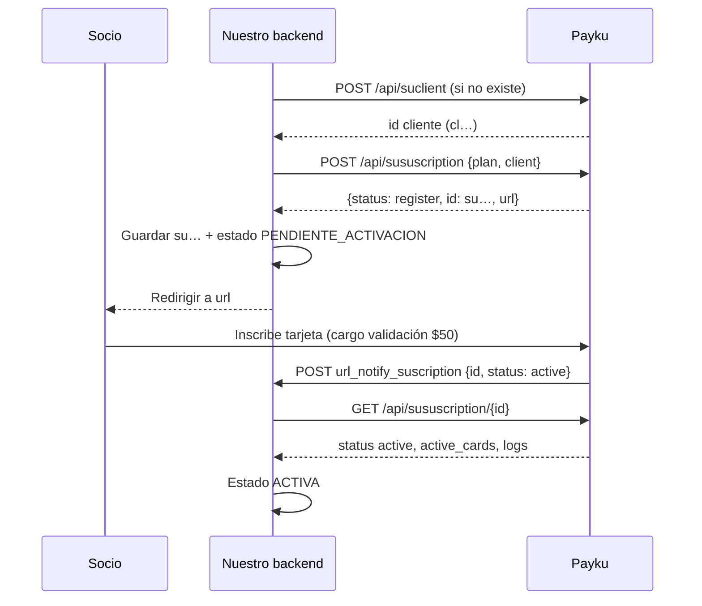

# Flujo: alta de una suscripción

## 1. Qué necesitamos hacer
Suscribir a un socio a un plan para que Payku le cobre de forma recurrente.

## 2. Endpoints necesarios (en orden)

| Paso | Endpoint | Para qué |
|---|---|---|
| 0 | `GET /api/suplan/plans` | Tener el `plan.id` correcto y verificar URL de notificación (una vez, cacheado). |
| 1 | `GET /api/suclient/{email}` / `POST /api/suclient` | Cliente. Ver [create-customer.md](create-customer.md). |
| 2 | `POST /api/sususcription` | Crear la suscripción → `id` + `url`. |
| 3 | (Cliente abre la `url`) | Inscribe su tarjeta; Payku cobra **$50** de validación. ✅ |
| 4 | Webhook `url_notify_suscription` | Payku avisa `active`. ✅ |
| 5 | `GET /api/sususcription/{id}` | Confirmar estado real. 💡 |



## 3. Recursos involucrados
Plan → Cliente → Suscripción → Tarjeta. Ver [data-model.md](../data-model.md).

## 4. Parámetros necesarios
`plan` (ID `pl…`), `client` (ID `cl…`); `amount` solo para planes de monto variable; `coupon` si aplica. ⚠️ (Q-07)

## 5. Ejemplo de request

```json
POST /api/sususcription
{ "plan": "pl9697fb170834ad42dd00", "client": "cl0be4c8e623c167bc8b777" }
```

## 6. Ejemplo de response

```json
{ "status": "register", "id": "sucaab7865dceaff49d8b3", "url": "https://des.payku.cl/gateway/registrosuscripcion?tipoplan=2&plan=true&token=219&validacion=e6c50ba0e0" }
```

## 7. Cómo implementarlo en backend 💡

1. Crear en nuestra BD una `suscripcion` en estado `CREANDO` con un `alta_id` propio (antes de llamar a Payku).
2. Llamar `POST /api/sususcription`.
3. Si responde OK → guardar `payku_subscription_id`, `url`, estado `PENDIENTE_ACTIVACION`, en **la misma transacción de BD**.
4. Si hay timeout → **no reintentar**. Marcar `VERIFICAR` y que un job consulte `GET /api/suclient/{id}` (o V3 del día) para encontrar una suscripción nueva de ese cliente y plan.
5. Al recibir el webhook `active` → encolar → `GET /api/sususcription/{id}` → actualizar a `ACTIVA`.
6. Job diario: suscripciones en `register` con más de N días → recordatorio con la misma `url` (⚠️ vigencia desconocida) o generar una nueva con `POST /api/suinscriptionscards`.

## 8. Qué datos guardar

| Dato | Dónde |
|---|---|
| `payku_subscription_id`, `payku_plan_id`, `payku_client_id` | `suscripcion` |
| `url` de activación + fecha de emisión | `suscripcion` (para recordatorios) |
| `status` literal + normalizado | `suscripcion` |
| Request/response completos | `stg_payku_api_call_log` |
| Webhook crudo | `stg_payku_webhook_event` |

## 9. Consideraciones importantes
- **Cobro de validación de $50** al inscribir la tarjeta ✅. ⚠️ No sabemos si se reembolsa: avisar al socio y a contabilidad.
- **Primer cobro de un plan fijo: el mes siguiente** ✅. Si queremos cobrar el primer mes de inmediato, ⚠️ no hay mecanismo documentado (💡 se podría combinar con una transacción única).
- Un socio puede abandonar la `url`: la suscripción queda `register`.
- ⚠️ Idempotencia: ver [errors.md § 5](../errors.md#5-reintentos-e-idempotencia).
