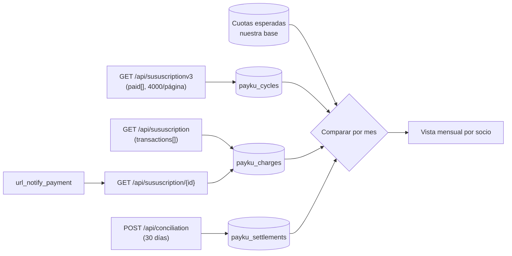

# Flujo: seguimiento de los cobros recurrentes (ciclos, cobros y conciliación)

**Objetivo:** saber, para cada socio y cada mes, **qué se le debía cobrar**, **si Payku lo cobró**, **en cuántos intentos** y **cuándo se liquidó**, sabiendo que Payku **no tiene un objeto de deuda** y que sus cobros viven dentro de la suscripción.
**Recursos:** Suscripción (V3 `paid[]`, detalle `transactions[]`) · Callback de cobro · Conciliación · **Postman:** carpeta `04 · Seguimiento de cobros`
**Relacionados:** [subscription-charges.md](../subscription-charges.md) · [get-transactions.md](get-transactions.md) · [sync-payku.md](sync-payku.md) · [reconciliation.md](../reconciliation.md) · [statuses.md](../statuses.md) · [capa común](../../../../Transversal/docs/transversal/workflows/seguimiento-cobros.md)

## 1. Cómo modela Payku la cuota y la transacción

| Concepto TECHO | En Payku | Dónde | Campos clave |
| --- | --- | --- | --- |
| **Cuota** (deuda del mes) | ❌ **No existe** como objeto ✅ | — | La calculamos **nosotros** (§ 3) |
| **Ciclo cobrado** (lo más parecido a la cuota) | Elemento de `paid[]` | `GET /api/sususcriptionv3` | `payment_cycle_day` (día del ciclo), `payment_day`, `status`, `amount_paid`, `try_number`, `paid_number` |
| **Transacción** (cobro a la tarjeta) | Elemento de `transactions[]` | `GET /api/sususcription/{id}` y V1 | `transaction` (número), `authorization_code`, `order`, `amount`, `status` (Lista B), `created_at` |
| **Aviso de cobro** | Callback `url_notify_payment` | Webhook | `transaction_id`, `verification_key`, `order`, `status`, `subscriptions{id, client}` (**sin monto**) |
| **Intentos** | `paid[].try_number` y estados `retry` / `maximum attempt limit` (Lista A) | V3 / cliente | **Sin motivo de rechazo** por cobro ✅ |
| **Liquidación** | Conciliación | `POST /api/conciliation` | `transaction[].payment_key`, `order`, `fee`, `amount_deposit`, `deposit_date` |
| *Pago único* (no es cuota) | Transacción | `GET /api/transaction` | Mundo **separado**: donaciones puntuales, primer aporte del alta |

```text
Suscripción (su…)
  ├── V3: paid[]          → un registro por ciclo / intento   (payment_cycle_day, try_number, amount_paid)
  │      └── transactions[]  ⚠️ estructura no documentada (Q-08)
  └── detalle: transactions[] → un registro por cobro       (transaction, authorization_code, order)
                     │ order / payment_key ⚠️ (Q-06)
                     ▼
               Conciliación (fee, neto, fecha de depósito)
```

**Diferencias con VirtualPOS y Toku:**
- No hay "cuota pendiente" que consultar: Payku solo muestra **lo que intentó cobrar**. Una cuota que nunca se intentó **no aparece en ninguna parte**: hay que esperarla nosotros.
- **No hay motivo de rechazo** por cobro (a diferencia de `/attempts` en VirtualPOS o `response_code` en Toku). Solo el `status`.
- No hay `GET` por cobro: se buscan dentro de la suscripción por `transaction` u `order`.

## 2. ¿Masivo o uno a uno?

| Necesito… | Endpoint | ¿Masivo? | Notas |
| --- | --- | --- | --- |
| **Ciclos de todas las suscripciones**, con estado e intentos | `GET /api/sususcriptionv3?date_init=&date_end=&page=&per_page=4000` | ✅ Sí, **hasta 4000 por página** ✅ | Sin fechas trae **solo hoy** ✅. ⚠️ No se sabe sobre qué fecha filtra (Q-11): usar ventanas desde el inicio de la cuenta |
| Cobros con número y código de autorización | `GET /api/sususcription?page=&per_page=` (V1) → `transactions[]` | ✅ Sí | `per_page` máximo no documentado; trae `last_status_current_payment` |
| Cobros de **una** suscripción | `GET /api/sususcription/{id}` → `transactions[]` | ❌ Uno a uno | Solo para las que cambiaron o tienen un webhook pendiente |
| Estado de los reintentos (`retry`, `maximum attempt limit`) | `GET /api/suclient/{id}` → `subcriptions.transactions[]` (Lista A) | ❌ Uno a uno | Para suscripciones en riesgo |
| Avisos en tiempo real | Callback `url_notify_payment` | Push | ⚠️ No se sabe si notifica rechazos (Q-14) |
| Liquidaciones | `POST /api/conciliation` (ventanas ≤ 30 días) | ✅ Sí | ⚠️ No se sabe si incluye los cobros de suscripción (Q-06) |
| Pagos únicos | `GET /api/transaction?date_init=&date_end=&per_page=4000` | ✅ Sí | **No sumar** con los cobros de suscripción hasta resolver Q-06 |

## 3. La cuota esperada la calculamos nosotros

Como Payku no expone la deuda, el seguimiento compara **lo esperado** (nuestra base) con **lo cobrado** (V3):

```text
Para cada suscripción active (o suspended) en nuestra base:
  primer_periodo = mes siguiente a start             ✅ "a partir del mes siguiente de la fecha de suscripción" (plan fijo)
  día del ciclo  = día observado en paid[].payment_cycle_day (⚠️ la periodicidad no se expone: Q-22)
  monto          = monto vigente en NUESTRA base (subcriptions.amount como control)
  → una cuota esperada por mes: (socio, su…, periodo, monto)
```

Luego, para cada cuota esperada, se busca en `paid[]` un ciclo del mismo mes (`payment_cycle_day`):

| Resultado en `paid[]` | Estado de la cuota |
| --- | --- |
| Ciclo `success` con `amount_paid` = monto | **PAGADA** ✅ |
| Ciclo `success` con otro monto | PAGADA con **diferencia** (revisar cambios de monto) |
| Ciclo con `status` de rechazo y `try_number` creciente | **EN REINTENTO** |
| Suscripción `suspended` (`maximum attempt limit`) | **RECHAZADA DEFINITIVA** → link de cambio de tarjeta ([link-inscripcion.md](link-inscripcion.md)) |
| Sin ciclo y el día del ciclo ya pasó (+2 días) | **SIN INTENTO** → alerta |
| Sin ciclo y el día aún no llega | **POR COBRAR** |

## 4. Job diario de seguimiento

```text
PASO 1 · Ciclos (masivo)                           GET /api/sususcriptionv3 por ventanas, per_page=4000, todas las páginas
↓  Upsert payku_cycles (su…, payment_cycle_day, try_number, status, amount_paid, paid_number, payment_day)
↓  Upsert estado de la suscripción (estatus) y logs.status[]
↓
PASO 2 · Cobros (masivo o por cambios)             GET /api/sususcription (V1)  o  GET /api/sususcription/{id} solo si el hash cambió
↓  Upsert payku_charges (transaction, authorization_code, order, amount, status, created_at)
↓  Enlazar ciclo ↔ cobro por (su…, fecha, monto)  ⚠️ no hay clave común documentada (Q-08)
↓
PASO 3 · Cuotas esperadas vs ciclos (§ 3)          en NUESTRA base
↓  PAGADA · EN REINTENTO · RECHAZADA DEFINITIVA · SIN INTENTO · POR COBRAR
↓
PASO 4 · Conciliación (masivo)                     POST /api/conciliation, últimos 30 días (el status cambia: pending → paid_out)
↓  Enlazar por order / payment_key  ⚠️ Q-06
↓
Tiempo real: callback url_notify_payment → GET /api/sususcription/{id} (el aviso no trae monto ni fecha)
↓
RESULTADO: por socio y mes → cuota esperada · ciclo (estado, intentos, monto pagado) · cobro (n.º, autorización) · liquidación
```



## 5. Estados (normalización)

Ver [statuses.md § normalización](../statuses.md). Para el cobro:

| Normalizado | Valores de Payku |
| --- | --- |
| `PAGADO` | `success` |
| `PENDIENTE` | `pending` |
| `REINTENTANDO` | `retry` |
| `RECHAZADO` | `rejected`, `first payment rejected`, `payment consumes failed`, `maximum attempt limit` |
| `CANCELADO` | `canceled by customer`, `canceled by paymaster`, `canceled by paymáster`, `canceled by payku` |
| `REEMBOLSADO` | `refunded`, `refunded partial` |
| `DESCONOCIDO` | cualquier otro → alertar |

⚠️ Los valores de `paid[].status` (V3) no están documentados (Q-05): mapear con la misma tabla y alertar los desconocidos.

## 6. Vista mensual por socio

```sql
CREATE VIEW v_payku_cuotas_mensuales AS
SELECT e.socio_id, e.payku_subscription_id, e.periodo, e.monto AS monto_esperado,
       c.status AS estado_ciclo, c.amount_paid, c.try_number, c.payment_day,
       ch.transaction AS n_transaccion, ch.authorization_code, ch."order",
       s.amount_deposit AS neto_liquidado, s.deposit_date,
       CASE WHEN c.status = 'success' THEN 'PAGADA'
            WHEN c.status IS NOT NULL THEN 'EN_REINTENTO_O_RECHAZADA'
            WHEN e.dia_esperado + 2 < current_date THEN 'SIN_INTENTO'
            ELSE 'POR_COBRAR' END AS estado_cuota
FROM payku_cuotas_esperadas e
LEFT JOIN LATERAL (SELECT * FROM payku_cycles x
                   WHERE x.subscription_id = e.payku_subscription_id
                     AND date_trunc('month', x.payment_cycle_day) = e.periodo
                   ORDER BY x.try_number DESC LIMIT 1) c ON true
-- ⚠️ Q-08: clave de enlace ciclo ↔ cobro no documentada; usar transaction (número) como clave primaria
-- cuando esté disponible, NO solo order (puede repetirse en reintentos)
LEFT JOIN payku_charges ch     ON ch.subscription_id = e.payku_subscription_id AND ch.cycle_date = c.payment_cycle_day
LEFT JOIN payku_settlement_lines s ON s."order" = ch."order";
```

## 7. Qué guardar

| Tabla | Clave | Notas |
| --- | --- | --- |
| `payku_cuotas_esperadas` | (`payku_subscription_id`, `periodo`) | La generamos nosotros cada mes |
| `payku_cycles` | (`subscription_id`, `payment_cycle_day`, `try_number`) | Desde V3 (Q-08) |
| `payku_charges` | `transaction` (número Payku) | Desde detalle/V1/callback; `cycle_date` cuando se pueda enlazar |
| `payku_settlement_lines` | (`conciliation_id`, `payment_key`) | Desde conciliación |

## 8. Preguntas abiertas que afectan este flujo

Q-05 (estados de `paid[]`), **Q-06** (¿los cobros de suscripción aparecen en conciliación y en `/api/transaction`?), **Q-08** (clave estable del cobro; ¿qué trae `paid[].transactions[]`?), **Q-11** (sobre qué fecha filtra V3), Q-14 (¿el callback avisa rechazos?), Q-17 (calendario de reintentos) y Q-22 (periodicidad). Ver [open-questions.md](../open-questions.md).

## 9. Probarlo en Postman

Carpeta **`04 · Seguimiento de cobros`** de `Payku API v2.postman_collection.json` (sandbox), para **Run folder**:

| Request | Qué hace | Siguiente |
| --- | --- | --- |
| SP-1 Ciclos de las suscripciones (V3) | Recorre V3 por la ventana `sp_desde`…`sp_hasta` y resume `paid[]` por estado, mes e intentos | SP-2 |
| SP-2 Cobros de una suscripción | `transactions[]` del detalle de una suscripción con ciclos; compara con sus `paid[]` (Q-08) | SP-3 |
| SP-3 Pagos únicos del período | `GET /api/transaction`: ¿aparecen cobros de suscripción? Si sí, ¿coinciden por número de transacción (`transaction`) o solo por `order`? (Q-06, Q-08) | SP-4 |
| SP-4 Conciliación del período | `POST /api/conciliation`: ¿aparecen los `order` de los cobros de suscripción? (Q-06) | FIN |

**Variables de entorno:** `sp_desde`, `sp_hasta` (ventana de V3 y pagos únicos), `sp_conc_desde`, `sp_conc_hasta` (≤ 30 días). Los scripts llenan `sp_page`, `sp_resumen`, `sp_subscription_id`, `sp_cycles` y `sp_orders`.
