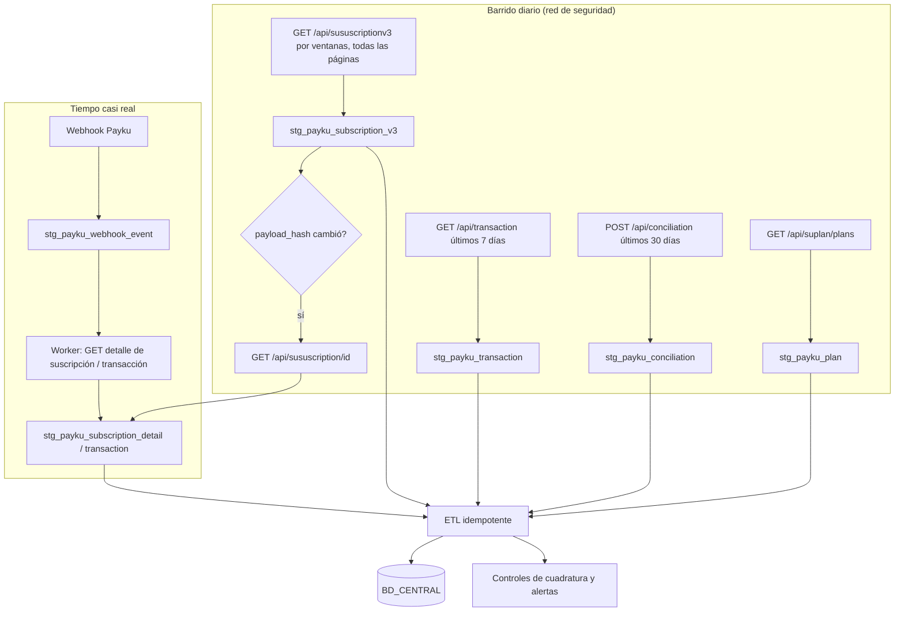

# Flujo: sincronizar Payku con nuestra base de datos

Objetivo: tener en `BD_CENTRAL` el estado correcto de clientes, suscripciones, cobros, pagos únicos y depósitos de Payku, **aunque falle un webhook**.

```text
Payku API  →  STG_PAYKU (raw)  →  ETL / normalización  →  BD_CENTRAL
```

---

## 0. Restricciones de Payku que definen el diseño

| Restricción | Estado | Consecuencia |
|---|---|---|
| Sin fechas, los listados devuelven **solo hoy** | ✅ | Toda lectura masiva lleva `date_init` / `date_end`. |
| No hay filtro por **fecha de actualización** | ✅ (no existe) | No se puede pedir "lo que cambió desde ayer". |
| No hay metadatos de paginación | ✅ (no existen) | Cortar por página incompleta. |
| Webhooks sin firma, sin política de reintentos documentada | ⚠️ | Los webhooks son **acelerador**, no fuente de verdad. |
| No hay borrado notificado ni "deleted feed" | ✅ (no existe) | Detectar ausencias por snapshot. |
| V3 trae hasta **4000** por página | ✅ | Un snapshot completo cuesta pocas llamadas. |
| `logs.status[]` con `change_date` | ✅ | Permite reconstruir el historial de estados. |
| Conciliación: ventanas de **≤ 30 días** | ✅ | Barrido diario de los últimos 30 días. |

💡 **Conclusión:** como no hay filtro por "modificado desde", la estrategia más simple y robusta es **snapshot completo diario** de suscripciones (barato por el límite de 4000) + **webhooks** para tiempo casi real + **detalle puntual** solo de lo que cambió.

---

## 1. Visión general



---

## 2. Carga inicial

| Paso | Endpoint | Método | IDs | Paginación / ventanas |
|---|---|---|---|---|
| 1 | `/api/suplan/plans` | GET | → `plan.id` | No paginado |
| 2 | `/api/sususcriptionv3` | GET | → `subscription.id`, `client.id`, `plan.id` | Ventanas desde la fecha de inicio de la cuenta hasta hoy; `per_page=4000` (empezar con 1000); todas las páginas |
| 3 | `/api/sususcription` (V1) | GET | → `last_status_current_payment`, `transactions[].authorization_code` | Mismas ventanas; `per_page=100` hasta conocer su máximo ⚠️ |
| 4 | `/api/sususcription/{id}` | GET | por cada suscripción | Solo si V1/V3 no traen algo necesario (`active_cards[].identifier`) |
| 5 | `/api/suclient/customers` | GET | → `client.id` | `per_page=100`; para detectar clientes **sin** suscripción |
| 6 | `/api/transaction` | GET | → `id`, `payment_key` | Ventanas; `per_page=4000` |
| 7 | `/api/conciliation` | POST | → `payment_key`, `order` | Ventanas de 30 días |

Tamaño de ventana 💡: empezar con **un mes**, con **1 día de solape**. Si una ventana devuelve una página llena en la página 1, no hay problema (se pagina); el riesgo es un timeout → reducir la ventana.

⚠️ Q-11: no sabemos sobre qué fecha filtra V3. Si filtra por fecha de **creación**, la carga inicial completa (desde el inicio de la cuenta) trae todo correctamente. Si filtrara por otra fecha, habría que revisar.

---

## 3. Sincronización incremental

### 3.1 Webhooks (minutos)
Ver [webhooks.md § 4](../webhooks.md#4-diseño-recomendado-del-receptor-). Cada evento → guardar crudo → `GET` de confirmación → ETL.

### 3.2 Barrido diario (red de seguridad)

| Job | Qué hace | Por qué |
|---|---|---|
| `payku_plans_daily` | `GET /api/suplan/plans` | Catálogo + verificar URL de notificación + totales de control. |
| `payku_subscriptions_snapshot_daily` | V3 completo (todas las ventanas) | No existe "modificado desde"; el snapshot detecta cambios por `payload_hash`. 💡 Con miles de socios son pocas llamadas. |
| `payku_subscription_details_changed` | `GET /api/sususcription/{id}` solo para las suscripciones cuyo hash cambió o que tienen webhook sin confirmar | Trae `active_cards[].identifier`, `authorization_code` de los cobros. |
| `payku_transactions_daily` | `GET /api/transaction` de los últimos **7 días** | Las transacciones cambian de `pending` a `success`/`rejected`. |
| `payku_conciliation_daily` | `POST /api/conciliation` de los últimos **30 días** | Las liquidaciones cambian de `pending` a `paid_out`. |
| `payku_customers_weekly` | `GET /api/suclient/customers` (ventanas) | Clientes creados desde el panel o sin suscripción. |

💡 Si el snapshot completo diario se vuelve pesado, alternativa: snapshot con filtro de estado de lo "abierto" (`active=true`, `suspended=true`, `register=true`) a diario + snapshot completo semanal.

### 3.3 Cambios de estado, cancelaciones y suspensiones
- Fuente principal: `estatus` (V3) + `logs.status[]` (`change_date`, `initial_status`, `final_status`).
- El ETL inserta en `suscripcion_estado_hist` cada entrada nueva de `logs.status[]` (clave: `subscription_id` + `change_date` + `final_status`).
- Si el webhook dice un estado y la API otro, **gana la API**.
- No retroceder un estado por un dato más antiguo: comparar por `change_date`.

### 3.4 Cobros
- Desde V3 `paid[]` (por ciclo, con `try_number`) y desde el detalle `transactions[]` (con `transaction`, `authorization_code`).
- Clave del cobro: `payku_transaction_id` si existe; si no, (`subscription_id`, `payment_cycle_day`, `try_number`). ⚠️ Q-08.
- Upsert: si el estado del cobro cambia (p. ej. `success` → `refunded`), se actualiza y se registra el cambio.

---

## 4. Registros eliminados

Payku no avisa borrados. 💡 Regla:
1. Si una suscripción conocida **no aparece** en el snapshot completo → contador `missing_count += 1` y `last_seen_at` queda fijo.
2. Con `missing_count >= 3` snapshots seguidos → `GET /api/sususcription/{id}`:
   - 200 con estado → actualizar normalmente (el filtro de fechas la estaba dejando fuera → revisar ventanas).
   - 404 / `failed` → marcar `NO_ENCONTRADA_EN_ORIGEN` (no borrar nuestro registro).
3. Los estados `delete`, `cancel` y `finish` son terminales: se conservan para siempre.

---

## 5. Duplicados e idempotencia

| Riesgo | Mitigación 💡 |
|---|---|
| Ventanas solapadas devuelven el mismo registro | Upsert por `payku_id`; en STG, no insertar si `payload_hash` es igual. |
| Webhook repetido | Clave de deduplicación por tipo (ver [webhooks.md](../webhooks.md)). |
| Mismo cobro visto en V3, detalle y webhook | Clave de cobro única; columna `source` y prioridad: `detail` > `webhook` > `v3`. |
| Dos jobs corriendo a la vez | Lock por job (advisory lock en Postgres o similar). |
| Reprocesar un día | El ETL lee de STG y hace upsert: correrlo dos veces da el mismo resultado. |

---

## 6. Reprocesamiento

- Tabla `payku_sync_run`: `id`, `job`, `params` (ventanas, filtros), `started_at`, `finished_at`, `status`, `pages`, `records`, `errors`.
- Todo dato en STG lleva `sync_run_id`.
- Para reprocesar: (a) re-ETL desde STG sin llamar a Payku, o (b) re-ejecutar el job para una ventana concreta.
- Guardar las respuestas con error (`status: failed`) para poder diagnosticar.

---

## 7. Controles de cuadratura (detectan sincronizaciones incompletas)

| Control | Cómo | Estado |
|---|---|---|
| Activas por plan | `plans[].total_suscription_active` vs `COUNT(*)` de nuestras suscripciones `ACTIVA` por plan | ✅ los totales existen en Payku |
| Total por plan | `total_suscription` vs nuestro total por plan | ✅ |
| Cobros vs depósitos | Suma de cobros `success` del periodo vs suma `amount` en conciliación | 💡 ⚠️ depende de Q-06 |
| Webhooks sin confirmar | Eventos con más de 1 h sin `GET` de confirmación | 💡 |
| Estados desconocidos | Valores que caen en `DESCONOCIDO` del mapping | 💡 → alerta |

---

## 8. Llamadas que se pueden evitar

- **No** llamar `GET /api/suclient/{id}` por cada socio en el barrido: V3 ya trae el cliente embebido.
- **No** llamar el detalle de **todas** las suscripciones a diario: solo las que cambiaron.
- **No** consultar transacciones de más de 7 días a diario (salvo carga inicial o reproceso).
- Reutilizar el catálogo de planes en memoria durante la corrida.

---

## 9. Manejo de errores en la sincronización

| Situación | Acción |
|---|---|
| 401 | Abortar la corrida y alertar (credenciales o firma). |
| 429 / 5xx | Backoff exponencial; si persiste, abortar la ventana y continuar con la siguiente; la corrida queda `PARTIAL`. |
| HTTP 200 + `status: failed` | Tratar como error (ver [errors.md](../errors.md)). |
| Página que repite la anterior | Cortar la ventana y alertar (protección de bucle). |
| JSON con forma inesperada | Guardar crudo en STG, marcar error de parseo, no romper la corrida. |

---

## 10. Estructura de código sugerida (Python)

```text
app/
├── integrations/
│   └── payku/
│       ├── client.py          # HTTP: base URL, timeouts, retries, logging, parseo de errores
│       ├── signing.py         # firma Sign (ver authentication.md)
│       ├── exceptions.py      # PaykuError, PaykuAuthError, PaykuNotFound, PaykuRateLimited…
│       ├── customers.py       # suclient
│       ├── plans.py           # suplan
│       ├── subscriptions.py   # sususcription, v3, detalle, delete
│       ├── charges.py         # sutransaction
│       ├── cards.py           # suinscriptionscards, suscriptionsdeletecards
│       ├── transactions.py    # transaction
│       ├── conciliation.py    # conciliation
│       └── webhooks.py        # parseo tolerante de callbacks
├── sync/
│   └── payku/
│       ├── jobs.py            # carga inicial, diarios, semanales
│       ├── staging.py         # escritura en STG_PAYKU (payload, hash, sync_run_id)
│       ├── etl.py             # STG → BD_CENTRAL (mapping de estados, tipos, fechas)
│       └── controls.py        # cuadraturas y alertas
└── api/
    └── webhooks_payku.py      # endpoint receptor (guardar + encolar)
```

Separación de capas:
- `integrations/payku`: **solo** habla HTTP con Payku y devuelve dicts validados. Sin BD, sin reglas de negocio.
- `sync/payku`: orquesta, persiste y normaliza.
- Reglas de negocio (qué es "socio al día") en el dominio, no en el cliente HTTP.

---

## 11. Calendario sugerido 💡

| Frecuencia | Job |
|---|---|
| Continuo | Receptor de webhooks + worker de confirmación |
| Cada hora | Reintento de webhooks sin confirmar |
| Diario 03:00 (Chile) | Planes → snapshot V3 → detalles cambiados → transacciones 7 días → conciliación 30 días → ETL → controles |
| Semanal | Clientes; V1 (si se usa `last_status_current_payment`) |
| Mensual | Revisión de valores `DESCONOCIDO` y de [open-questions.md](../open-questions.md) |
