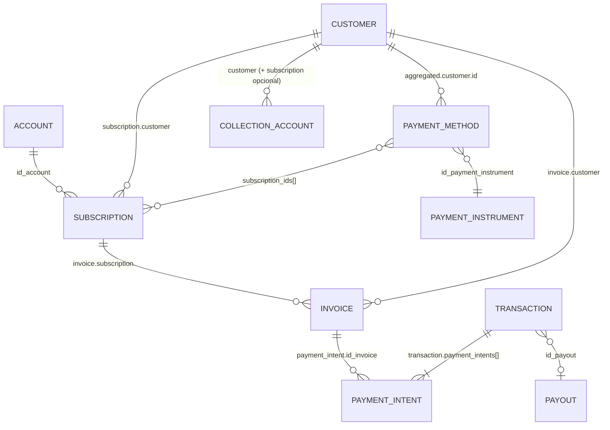

# Modelo de datos: relaciones, identificadores y mapping

## 1. Relaciones validadas

| Relación | Padre → Hijo | Cardinalidad | ID que conecta | Cómo obtenerla | Estado |
|---|---|---|---|---|---|
| Customer → Subscription | Customer | 1:N | `subscription.customer` | `GET /subscriptions/customer/{cus}` | [Confirmado] |
| Subscription → Invoice | Subscription | 1:N | `invoice.subscription` | `GET /invoices?subscription_id=` | [Confirmado] ("toda Invoice depende de una Subscription") |
| Customer → Invoice | Customer | 1:N | `invoice.customer` | `GET /invoices?customer_id=` | [Confirmado] |
| Account → Subscription / Invoice | Account | 1:N | `id_account` / `account` | Filtro `account_id` en invoices | [Confirmado] |
| Invoice → Payment Intent | Invoice | 1:N | `payment_intent.id_invoice` | `GET /transactions?id_invoice=` | [Confirmado] ("cada intento está ligado a exactamente una Invoice") |
| Transaction → Payment Intent | Transaction | 1:N | anidado en `payment_intents[]` | `GET /transactions` | [Confirmado] |
| **Transaction ↔ Invoice** | — | **N:M** | vía Payment Intent | ídem | [Confirmado] (la Transaction "puede agrupar múltiples invoices") |
| Customer → Payment Method | Customer | 1:N | `customer.id` (forma agregada) | `GET /payment-methods?id_customer=` | [Confirmado] |
| Payment Method ↔ Subscription | — | **N:M** | `subscription_ids[]` | Forma agregada / asociación | [Confirmado] |
| Payment Method → Payment Instrument | Instrument | N:1 | `id_payment_instrument` | — | [Confirmado] |
| Customer → Collection Account | Customer | 1:N (máx. 1 por Subscription + 1 general) | `customer`, `subscription` | `GET /customer-collection-accounts?customer=` | [Confirmado] (idempotente por customer+subscription) |
| Transaction → Payout | Payout | N:1 | `id_payout` | `GET /transactions?id_payout=` | [Confirmado] |
| Transaction → Customer | Customer | N:1 | `customer.id` del agregado | — | [Confirmado] |

**Consecuencia clave:** para saber "qué Transactions pagaron la Invoice X" se usa `GET /transactions?id_invoice=in_X`. Para lo inverso, se leen los `payment_intents[].id_invoice` de la Transaction. No hace falta llamar a `/invoices` para cada Transaction: el Payment Intent ya trae `id_invoice`, `id_subscription`, `product_id`, `invoice_external_id` e `invoice_metadata`.

## 2. Identificadores

| ID | Recurso | Dónde se obtiene | Dónde se usa | ¿Estable? | ¿Persistir? | ID externo equivalente |
|---|---|---|---|---|---|---|
| `cus_…` | Customer | Respuesta de `POST /customers`, listados | Path de customers, `customer` en subs/invoices, filtros | [Inferencia] Sí | **Sí** (UNIQUE) | `external_id` (nuestro; **inmutable** una vez creado) |
| `sub_…` | Subscription | `POST /subscriptions`, listados | Path de subs, `subscription` en invoices, asociación de PM | [Inferencia] Sí | **Sí** | `product_id` (nuestro; único por Account) |
| `in_…` | Invoice | `POST /invoices`, listados | Path de invoices, `id_invoice` en payment intents | [Inferencia] Sí | **Sí** | `invoice_external_id` (nuestro; único por Subscription) |
| `acc_…` | Account | En subs, invoices y transactions | `x-account-key` usa otra cosa (la **key** de la cuenta, no el ID) | Sí | Sí (dimensión) | — |
| `pm_…` | Payment Method | Listado de PM, webhooks | Asociación, `id_payment_method` en transactions | Sí | **Sí** | `external_id` del PM |
| Transaction `id` | Transaction | Listado de transactions, webhooks | `id_transaction_payment`/`id_transaction_refund` en `refund_data` | Sí | **Sí** | `external_id`, `provider_external_id` |
| Payment Intent `id` | Payment Intent | Dentro de la Transaction | — | [Inferencia] Sí | **Sí** (tabla puente) | — |
| `whe_…` | Webhook Endpoint | `POST /webhook_endpoints` | `PUT /webhook_endpoints/{id}` | Sí | Config | — |
| `wheve_…` | Entrega de webhook | Body del webhook | Deduplicación | — | Sí, en STG | — |
| `id_payout` | Payout | En la Transaction | Conciliación bancaria | Sí | Sí | — |
| `pac_mandate_id` | Mandato PAC | Customer / Subscription | Conciliación PAC | Sí | Sí | — |

Notas:
- Toku llama a sus IDs "encrypted" en los nombres de los path params (`encrypted_customer_id`, `encrypted_invoice_id`…). Son los mismos IDs públicos `cus_`/`in_`/`sub_`, no otro valor. [Confirmado por los ejemplos]
- **[No confirmado]** Que los IDs nunca cambien. Ningún texto lo garantiza, pero todo el diseño de la API los usa como referencia permanente.

### Uso de nuestros propios IDs como referencia [Recomendación]

| Recurso Toku | Campo Toku | Nuestro valor sugerido | Por qué |
|---|---|---|---|
| Customer | `external_id` | ID de socio de BD_CENTRAL (o el RUT normalizado, según cómo esté configurada la organización en Toku: `customer_external_id_parameter`) | Upsert idempotente + lookup directo |
| Subscription | `product_id` | `SOCIO-{id_socio}-{id_compromiso}` | Único por Account; upsert idempotente |
| Invoice | `invoice_external_id` | `CUOTA-{id_cuota}` (globalmente único) | `/invoices/lookup` sin ambigüedad |
| Payment Method | `external_id` | (lo define Toku en la inscripción) | — |

Toku pide lo mismo en *Buenas prácticas*: IDs únicos, permanentes y trazables al sistema interno. [Confirmado]

## 3. Idempotencia

| Operación | Clave de idempotencia (Toku) | Estado |
|---|---|---|
| `POST /customers` | `external_id` (dentro de la organización) | [Confirmado] |
| `POST /subscriptions` | `(Account, product_id)` | [Confirmado] |
| `POST /invoices` | `product_id + due_date`, o `product_id + invoice_external_id` | [Confirmado] |
| `POST /customer-collection-accounts` | `(customer, subscription)` | [Confirmado] |
| `POST /webhook_endpoints` | `url` | [Confirmado] |
| `DELETE /payment-methods` | Repetirlo no tiene efecto | [Confirmado] |
| Checkout Session | `unique_external_id` (≤128) | [Confirmado] |
| `POST /subscriptions/associate/payment-method` | — | **[No confirmado]**: verificar con GET antes de reintentar |
| `POST /subscriptions/{id}/status` | Mismo estado → **[No confirmado]** si devuelve 200 o 409 | |
| Header `Idempotency-Key` | **No existe** en la doc | [Confirmado por ausencia] |

⚠️ **Trampa de `POST /invoices`:** si se envía `product_id + due_date` **sin** `invoice_external_id`, dos cuotas distintas del mismo producto con la misma fecha se **pisan**. **Enviar siempre `invoice_external_id`.**

En la sincronización (lectura) [Recomendación]:
- STG: `UPSERT` por el `id` de Toku. Releer el mismo registro dos veces no duplica.
- Webhooks: `event_id` UNIQUE más relectura del recurso (ver [webhooks.md](webhooks.md)).
- Payment Intents: PK `payment_intent.id`.

## 4. Mapping Toku → modelo interno (hipótesis validadas)

| Toku | Modelo interno | Validación |
|---|---|---|
| Customer | **CLIENTE / SOCIO** | ✅ Correcto |
| Subscription | **SUSCRIPCION / COMPROMISO** | ✅ Correcto, con matiz: en Toku también existen Subscriptions **no recurrentes** (se crean solas al cargar una Invoice con un `product_id` nuevo). Agregar un campo `es_recurrente` |
| Invoice | **COBRO / CUOTA** | ✅ Correcto. Es la deuda, no el pago |
| Payment Intent | **APLICACION_PAGO** (pago ↔ cuota) | 🆕 Faltaba en la hipótesis inicial. Es la tabla puente N:M |
| Transaction | **PAGO / TRANSACCION** | ✅ Es el movimiento de dinero (incluye rechazos, reversas y contracargos) |
| Payment Method | **MEDIO_PAGO** | ✅ Sin datos sensibles crudos |
| Payout | **LIQUIDACION** | 🆕 Opcional, para conciliar con el banco |

### Diferencias con VirtualPOS (solo conceptuales, sin forzar simetría)

| Concepto | Toku | VirtualPOS |
|---|---|---|
| La deuda | Invoice (objeto propio, con estados) | "Cargo programado" (deuda + ejecución) |
| El pago | Transaction + Payment Intent (N:M con las deudas) | Transacción ligada al cargo |
| El plan | Subscription (por `product_id`) | Suscripción |
| Identificación externa | `external_id` / `product_id` / `invoice_external_id` | Propios de VirtualPOS |

**[Recomendación]** En BD_CENTRAL, modelar la deuda y el pago por separado, con la tabla puente desde el inicio. VirtualPOS cabe en ese modelo como un caso 1:1, pero Toku no cabe en un modelo 1:1.

## 5. RAW / STAGING vs MODELO NORMALIZADO

| Capa | Qué guarda | Ejemplo |
|---|---|---|
| **STG_TOKU** (raw) | El JSON de Toku con la menor transformación posible + metadatos de captura | `stg_toku_invoices(id PK, payload JSONB, payload_hash, source, fetched_at, api_version)` |
| | Una tabla por recurso: customers, subscriptions, invoices, transactions (agregado completo), payment_methods (enmascarado), webhook_events | |
| | Las columnas "promovidas" solo para indexar: `customer`, `subscription`, `status`, `due_date` | |
| **Normalizado** | Entidades internas, tipos correctos, FKs, estados mapeados, PII según política | `cuota(id, toku_invoice_id UNIQUE, suscripcion_id FK, vencimiento, monto, estado_general, en_cobro, …)` |
| | Tabla puente `aplicacion_pago(toku_payment_intent_id PK, pago_id FK, cuota_id FK, monto, estado)` | |
| | Campos calculados: `fecha_pago_efectiva` (desde la Transaction), `estado_socio` | |

Reglas [Recomendación]:
1. STG **nunca** se edita a mano; solo se inserta o actualiza desde la API o los webhooks.
2. Guardar `api_version` en STG: si cambia el contrato, sabemos con qué versión se leyó cada fila.
3. La normalización es **re-ejecutable** desde STG (sin volver a llamar a Toku).

## 6. Datos sensibles

| Campo | Recurso | Riesgo | Recomendación |
|---|---|---|---|
| `bank_account.account_number` | Payment Method, Collection Account | Número de cuenta completo | **No guardar en BD_CENTRAL.** En STG, enmascarar (últimos 4) antes de insertar |
| `card.token` | Payment Method | Permite cobrar con el procesador | **No guardar** |
| `card.bin`, `card.last_digits`, `card_holder`, vencimiento | Payment Method | PCI parcial / PII | Guardar solo `card_brand`, `card_type` y `last_digits` si el negocio lo necesita |
| `pix.*` (QR, códigos, `tax_id`) | Payment Method | Brasil, no aplica | No guardar |
| `government_id`, `mail`, `phone_number`, `name` | Customer, agregados | PII (Ley 19.628 / 21.719 en Chile) | Guardar con control de acceso; no en logs |
| `secret` de webhook | Webhook Endpoint (incluso en el listado) | Permite falsificar webhooks | Secret manager; nunca en logs ni en Sheets |
| Payload crudo de webhooks de Payment Method | — | Trae datos bancarios | Enmascarar antes de persistir |

La implementación actual en Apps Script ya reduce `bank_account`, `pix` y `boleto` a un resumen seguro. Mantener ese criterio en el backend. [Confirmado en `Toku_API_Documentacion.md`]
