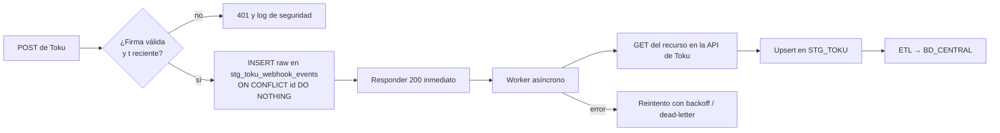

# Webhooks

Docs oficiales:
- Guía: <https://docs.trytoku.com/docs/webhooks>
- Objeto Webhook Endpoint: <https://docs.trytoku.com/reference/webhook-endpoint-object>
- Catálogo de eventos: sección "Webhooks (eventos)" de <https://docs.trytoku.com/llms.txt>

## 1. Cómo funcionan [Confirmado]

1. Registramos una URL (**Webhook Endpoint**) y los eventos que nos interesan.
2. Cuando pasa algo, Toku hace un `POST` a esa URL con el evento en el body.
3. Respondemos `2xx` en menos de **120 segundos**.
4. Si no respondemos a tiempo o respondemos con error, Toku reintenta.

Los endpoints son **de la organización**. Cada evento llega a **todos** los endpoints habilitados que estén suscritos a él.

## 2. Gestión de endpoints

| Operación | Endpoint | Doc |
|---|---|---|
| Listar | `GET /webhook_endpoints` (array, **incluye `secret`**) | [get_webhook_endpoints](https://docs.trytoku.com/reference/get_webhook_endpoints) |
| Crear (upsert por URL) | `POST /webhook_endpoints` | [create_webhook_endpoint](https://docs.trytoku.com/reference/create_webhook_endpoint) |
| Obtener | listado en la referencia | [get_webhook_endpoint](https://docs.trytoku.com/reference/get_webhook_endpoint) (**ruta no verificada**) |
| Editar | `PUT /webhook_endpoints/{webhook_endpoint_id}` | [edit_webhook_endpoint](https://docs.trytoku.com/reference/edit_webhook_endpoint) |

No hay un endpoint `DELETE` documentado. Para apagar uno se usa `status: "disabled"`.

### Crear: body
```json
{
  "url": "https://nuestro-backend.techo.org/webhooks/toku",
  "enabled_events": ["invoice.paid", "transaction.success", "transaction.bulk_success"],
  "status": "enabled",
  "webhook_version": "2026-10-08",
  "custom_headers": { "X-Techo-Source": "toku" }
}
```

Respuesta: `{ id: "whe_…", secret: "whesec_…", enabled_events, url, status, webhook_version, custom_headers_keys }`.

Reglas [Confirmado]:
- Si ya existe un endpoint con la misma URL, **se actualiza** en vez de duplicarse.
- No se pueden declarar eventos deprecados. Un endpoint que ya los tiene no admite cambios de eventos, URL ni estado mientras los conserve.
- `disabled` **descarta los reintentos pendientes**: esos eventos se pierden y no se acumulan. → Por eso la sincronización periódica es obligatoria.
- Los valores de `custom_headers` nunca se devuelven; solo los nombres.
- ⚠️ El `422` dice "más de un evento habilitado" entre sus causas. **[No confirmado]** si de verdad limita a un evento por endpoint (sería raro, porque `enabled_events` es un array). Verificarlo al crear el primero.

**[Recomendación]** Suscribir solo los eventos que procesamos (Toku lo recomienda).

## 3. Payload [Confirmado]

No hay un sobre genérico con `data` ni `created_at`. Cada evento tiene:

```json
{
  "id": "wheve_…",
  "event_type": "invoice.paid",
  "<recurso>": { … }
}
```

| Evento | Campos del payload |
|---|---|
| `invoice.*` (ej. `invoice.paid`) | `invoice` (DTOInvoiceV4), `transactions[]` (DTOTransactionV10) |
| `subscription.*` | `subscription` (incluye `recurring.start_date`) |
| `customer.*` | `customer` |
| `transaction.success` / `.failed` / … | `transaction`, `payment_intents[]`, `customer`, `payment_instrument`, `wallet_movements[]`, `applied_adjustment_documents[]` |
| `transaction.bulk_success` / `.bulk_failed` | `events[]`: un array de transacciones agregadas (una por ítem del lote) |
| `payment_method.*` | Forma agregada del Payment Method, con `updated_fields` |

Toku recomienda **leer los campos por nombre e ignorar los campos nuevos desconocidos**. [Confirmado]

## 4. Firma y validación [Confirmado]

Header: `Toku-Signature: t=<timestamp>,s=<firma>`

```text
mensaje = "{timestamp}.{id del evento}"         # id = body["id"]
firma   = HMAC_SHA256(key = secret_del_endpoint, mensaje).hexdigest()
válida si compare_digest(firma, s)
```

```python
import hmac, hashlib

def verify_toku_signature(header: str, event_id: str, secret: str) -> bool:
    parts = dict(p.split("=", 1) for p in header.split(","))
    t, s = parts.get("t"), parts.get("s")
    if not t or not s:
        return False
    expected = hmac.new(secret.encode(), f"{t}.{event_id}".encode(), hashlib.sha256).hexdigest()
    return hmac.compare_digest(expected, s)
```

> ⚠️ **La firma solo cubre `timestamp` + `id`, no el body.** [Confirmado por el formato del mensaje firmado]
> **[Inferencia]** Alguien que capture un webhook legítimo podría reenviar el mismo `id` y `t` con un body alterado, y la firma seguiría siendo válida.
> **[Recomendación]** Nunca actualizar BD_CENTRAL con los datos del body sin más. Usar el webhook como **aviso** y **releer el recurso por API** (`GET /invoices/{id}`, `GET /transactions/{id}`…) antes de aplicar cambios de pago. Además, rechazar `t` con más de 5 minutos de antigüedad (la doc no define ventana de tolerancia; **[No confirmado]** que `t` sea Unix en segundos, aunque el ejemplo lo parece).

## 5. Reintentos y respuesta [Confirmado]

| Intento | Cuándo |
|---|---|
| Reintento 1 | Inmediatamente después del fallo |
| Reintento 2 | +1 min |
| Reintento 3 | +10 min |
| Reintento 4 | +30 min |
| Reintento 5 | +1 h |

- Máximo **5** intentos (la doc no aclara si el envío original cuenta dentro de esos 5).
- Timeout: **120 s**.
- ⚠️ Inconsistencia: una sección dice "responder `200` si fue exitoso o `400` si hubo error"; otra dice "cualquier `2xx` confirma". **[Recomendación]** Responder siempre `200`.
- **Ventana total ≈ 1 h 41 min.** Si nuestro servidor está caído más tiempo, el evento se pierde. → Sincronización periódica obligatoria.

## 6. Orden, duplicados e idempotencia

| Tema | Estado |
|---|---|
| Orden de entrega garantizado | **[No confirmado]**: no documentado. Asumir que puede llegar desordenado |
| Duplicados | **[Inferencia]**: los reintentos implican que puede llegar más de una vez |
| `id` (`wheve_…`) | La doc lo describe como "ID único de esta entrega". **[No confirmado]** si un reintento conserva el mismo `id` |

**[Recomendación] Clave de deduplicación:**
1. Primaria: `id` del evento (UNIQUE en `stg_toku_webhook_events`).
2. Secundaria, por si los reintentos traen otro `id`: `(event_type, id_del_recurso, hash_del_payload)`.
3. Como releemos el recurso por API antes de actualizar, **procesar un duplicado es inocuo**: deja el mismo estado. Esa es la verdadera idempotencia.
4. **Desorden:** como releemos el estado actual, un evento viejo que llega tarde no pisa un estado más nuevo.

## 7. Pipeline recomendado (compatible con lo documentado)



Es compatible con Toku: responde rápido (≪ 120 s), guarda el evento crudo antes de procesar y desacopla el procesamiento. [Recomendación]

Tabla sugerida:

```sql
CREATE TABLE stg_toku_webhook_events (
  event_id        TEXT PRIMARY KEY,          -- body.id (wheve_…)
  event_type      TEXT NOT NULL,
  resource_id     TEXT,                      -- invoice.id / transaction.id / …
  signature_t     TEXT,
  received_at     TIMESTAMPTZ NOT NULL DEFAULT now(),
  payload         JSONB NOT NULL,            -- ⚠️ enmascarar datos sensibles antes de guardar
  payload_hash    TEXT NOT NULL,
  processed_at    TIMESTAMPTZ,
  process_status  TEXT NOT NULL DEFAULT 'pending',  -- pending|done|error|skipped
  attempts        INT NOT NULL DEFAULT 0,
  last_error      TEXT
);
```

## 8. Qué eventos suscribir (propuesta para TECHO) [Recomendación]

| Evento | Por qué |
|---|---|
| `transaction.success` | Pagos instantáneos (tarjeta, transferencia, portal). Toku lo recomienda |
| `transaction.bulk_success` | Pagos por lotes: **PAC**, PatPass. Toku lo recomienda |
| `transaction.failed`, `transaction.bulk_failed` | Rechazos → gestión de cobranza |
| `transaction.status_update` | Cambios posteriores (por ejemplo, `INITIALIZED` → `SUCCESS`) |
| `invoice.paid` | Cierre de cuota |
| `invoice.voided`, `invoice.updated`, `invoice.created` | Mantener las cuotas al día |
| `subscription.created`/`updated`/`deleted` | Altas, cambios y bajas de planes |
| `customer.created`/`updated`/`deleted` | Datos del socio |
| `payment_method.attached_products`, `payment_method.status_update`, `payment_method.deleted` | Inscripción y caída de medios de pago |
| `chargeback.status_update`, `transaction.refund`, `invoice.refund` | Reversas |

Lista completa de los 48 eventos permitidos: ver el enum de `enabled_events` en [create_webhook_endpoint](https://docs.trytoku.com/reference/create_webhook_endpoint).

> Nota: `customer.send_mail` habla del webhook `invoice.no_payment_method`, pero **ese evento no está** en el enum de `enabled_events`. **[No confirmado]** si existe.

## 9. Pruebas
- Toku no documenta un "enviar evento de prueba". **[No confirmado]**.
- **[Recomendación]** Probar el receptor localmente con un body de ejemplo firmado con un secret de prueba, y luego en producción con una Invoice `TEST-` de monto mínimo marcada como pagada externamente (`is_paid: true`). **[Inferencia]** Eso debería disparar `invoice.paid`/`invoice.updated`.
