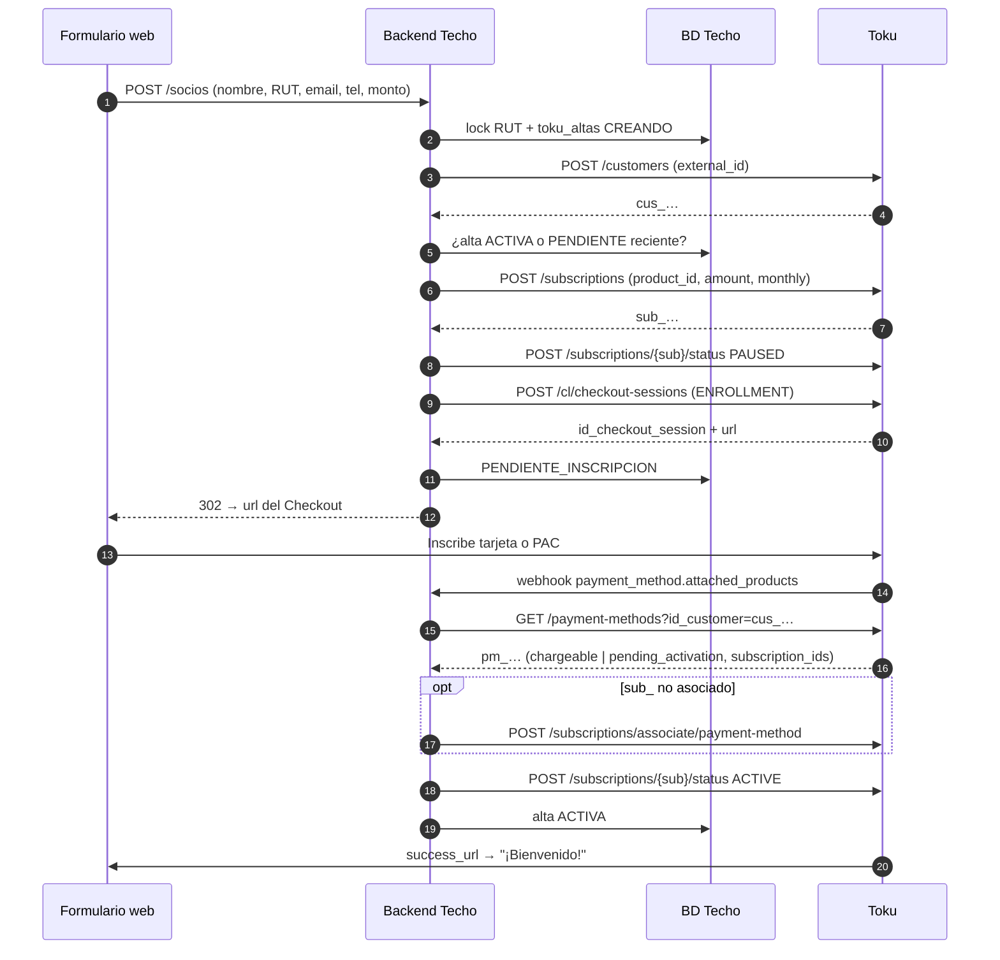

# Flujo: alta de un nuevo socio desde un formulario web

**Objetivo:** un socio completa el formulario web → queda con su **Customer** (sin duplicados), con una **Subscription** recurrente por el monto elegido y con un **medio de pago** (tarjeta o PAC) inscrito en el **Checkout de Toku** y asociado a esa Subscription.
**Recursos:** Customer · Subscription · Checkout Session · Payment Method · **Postman:** carpeta `00 · Alta de socio (flujo)`
**Relacionados:** [create-customer.md](create-customer.md) · [create-subscription.md](create-subscription.md) · [enroll-payment-method.md](enroll-payment-method.md) · [payment-methods.md](../payment-methods.md) · [webhooks.md](../webhooks.md)

> **🔴 Bloqueante:** el Checkout de Toku en modo `ENROLLMENT` necesita que **Toku configure un flujo de inscripción** (`flow_name`) en nuestra cuenta. Hoy no está configurado ([enroll-payment-method.md](enroll-payment-method.md#2-caminos-posibles)). Hasta que lo esté, los pasos 1 a 4 funcionan, pero el socio no puede inscribir su medio de pago. **Acción:** pedir a Toku el flujo con tarjeta (`transbank_oneclick`) y la URL de éxito y fracaso que acepta.
> **Alternativa mientras esté bloqueado:** usar el **Customer Portal** (`POST /v2/customer-portal-sessions`, `flow_name: "0"`) para que el socio inscriba su tarjeta directamente. El Portal no requiere configuración adicional, pero no admite `ids_subscription` ni `unique_external_id` — la confirmación debe hacerse por webhook `payment_method.created`.
>
> **Todo es producción.** Toku no tiene sandbox: cada prueba crea objetos reales. Usar siempre `external_id` y `product_id` con prefijo `TEST-`, `skip_message_trigger: true` y limpiar al terminar ([authentication.md](../authentication.md#3-ambientes-confirmado)).

## 1. Idea clave

En Toku **no hay planes por monto**: el monto vive en la propia Subscription. Por eso el alta no necesita un catálogo de planes (a diferencia de VirtualPOS y Payku). [Confirmado]

Toda la idempotencia la dan **nuestras claves de negocio**, no un header [Confirmado]:

| Objeto | Clave de upsert | Cómo la armamos [Recomendación] |
| --- | --- | --- |
| Customer | `external_id` | ID del socio en BD_CENTRAL (ver [customers.md](../customers.md#crear-customer-upsert): confirmar si la organización usa el RUT) |
| Subscription | `(Account, product_id)` | `SOCIO-{id_socio}-{id_alta}` |
| Checkout Session | `unique_external_id` | `ALTA-{id_alta}` |

```text
Socio Techo (id interno) ──external_id──> Customer (cus_…)
        │                                    │
        └── id_alta ──product_id──> Subscription (sub_…) <──asociado── Payment Method (pm_…)
                     └─unique_external_id─> Checkout Session ──inscribe──┘
```

**Por qué la Subscription se crea en pausa:** Toku genera Invoices solo según `due_day` y `creation_lead_days`, tenga o no medio de pago. Si el socio abandona el Checkout, quedaría una Subscription generando cuotas impagas (y posibles comunicaciones de cobranza). La pausamos al crearla y la reactivamos cuando el medio de pago queda inscrito. [Recomendación]

## 2. Flujo completo

```text
PASO 0 · Formulario recibido en TU backend
↓  Validar y normalizar: RUT "12.345.678-9" → "12345678-9", email en minúsculas, teléfono "+569XXXXXXXX"
↓  Validar monto (≥ mínimo de negocio, entero CLP)
↓  Lock por RUT (evita que un doble clic cree todo dos veces)
↓  Crear fila en toku_altas (id_alta, estado CREANDO)
↓
PASO 1 · Upsert del Customer                         POST /customers
↓  external_id = id del socio, send_mail = false → cus_…
↓  (Idempotente: si ya existía, lo actualiza y responde 200)
↓
PASO 2 · Antidoble cobro
↓  TU tabla: ¿hay un alta ACTIVA, o PENDIENTE_INSCRIPCION de hace menos de 30 min, para este RUT?
↓  ├─ ACTIVA → NO crear ("ya eres socio" o flujo de cambio de monto)
↓  ├─ PENDIENTE reciente → reutilizar su checkout_url
↓  └─ Ninguna → PASO 3
↓  (Respaldo: GET /subscriptions/customer/{cus_id} → ¿alguna recurrente ACTIVE con medio de pago?)
↓
PASO 3 · Crear Subscription                          POST /subscriptions
↓  product_id = SOCIO-{id_socio}-{id_alta}, amount, is_recurring: true, frequency: monthly,
↓  interval: 1, due_day: 5, creation_lead_days: 5, max_active_invoices: 3 → sub_…
↓
PASO 4 · Pausarla hasta tener medio de pago          POST /subscriptions/{sub_id}/status {PAUSED}
↓  Verificar: GET /invoices?subscription_id={sub_id} → si Toku ya generó una, anularla
↓
PASO 5 · Crear Checkout Session de inscripción       POST /cl/checkout-sessions
↓  mode: ENROLLMENT, billing_data {id_account, id_customer, ids_subscription: [sub_…]},
↓  redirection_data {success_url, failure_url}, unique_external_id: ALTA-{id_alta},
↓  expiration_datetime: ahora + 48 h, skip_message_trigger: true
↓  → id_checkout_session + url → GUARDAR como PENDIENTE_INSCRIPCION ANTES de redirigir
↓
PASO 6 · Redirección                                 HTTP 302 → url del Checkout (el socio inscribe tarjeta o PAC)
↓
PASO 7 · Confirmación (tres vías)                    GET /cl/checkout-sessions/{id} + GET /payment-methods?id_customer=
↓  a) Webhook payment_method.attached_products / payment_method.status_update
↓  b) Navegador → success_url / failure_url (página de resultado)
↓  c) Respaldo: consultas a los 15 min, 1 h y 24 h mientras siga PENDIENTE_INSCRIPCION
↓  ├─ pm_ en chargeable o pending_activation (PAC) → PASO 8
↓  ├─ state OPEN → seguir esperando
↓  └─ state EXPIRED sin pm_ → ABANDONADA: DELETE /subscriptions/{sub_id} (está en pausa, sin cuotas)
↓
PASO 8 · Asociar (si hace falta)                     POST /subscriptions/associate/payment-method
↓  Solo si el sub_ no aparece en subscription_ids del pm_. Revisar success en el body.
↓
PASO 9 · Reactivar                                   POST /subscriptions/{sub_id}/status {ACTIVE}
↓
RESULTADO: socio ⇄ cus_ ⇄ sub_ ⇄ pm_, con cuotas mensuales que Toku cobra solo
```



## 3. Endpoints, métodos e IDs

| Paso | Método | Endpoint | IDs y datos clave | Obtiene |
| --- | --- | --- | --- | --- |
| 1 | `POST` | `/customers` | `external_id`, `government_id`, `mail`, `phone_number`, `send_mail: false` | `id` (`cus_…`) |
| 2 | `GET` | `/subscriptions/customer/{customer_id}` | `cus_…` | Subscriptions del socio (sin paginar) |
| 3 | `POST` | `/subscriptions` | `customer`, `product_id`, `amount`, recurrencia **en la raíz** | `id` (`sub_…`), `recurring.status` |
| 4 | `POST` | `/subscriptions/{id}/status` | `{"status": "PAUSED"}` | — |
| 4b | `GET` | `/invoices?subscription_id=` | `sub_…` | Invoices ya generadas |
| 5 | `POST` | `/cl/checkout-sessions` | `mode: ENROLLMENT`, `billing_data`, `unique_external_id` | `id_checkout_session`, URL |
| 7 | `GET` | `/cl/checkout-sessions/{id}` | `id_checkout_session` | `state`: `OPEN` / `COMPLETED` / `EXPIRED` |
| 7 | `GET` | `/payment-methods?id_customer=` | `cus_…` | `pm_…`, `status`, `subscription_ids[]` |
| 8 | `POST` | `/subscriptions/associate/payment-method` | `id_subscription`, `id_payment_method`, `payment_scope` | `success` |
| 9 | `POST` | `/subscriptions/{id}/status` | `{"status": "ACTIVE"}` | — |
| Abandono | `DELETE` | `/subscriptions/{id}` | `sub_…` | `204` |

## 4. Requests de ejemplo

**Paso 1. Upsert del Customer:**

```json
POST /customers
{
  "external_id": "SOCIO-000123",
  "government_id": "12345678-9",
  "name": "Ana Pérez",
  "mail": "socio@mail.com",
  "phone_number": "+56912345678",
  "default_receipt_type": "no_receipt",
  "send_mail": false
}
```

**Paso 3. Crear Subscription** (tipos reales: booleano y enteros, nunca strings):

```json
POST /subscriptions
{
  "customer": "cus_…",
  "product_id": "SOCIO-000123-ALTA-000456",
  "amount": 7500,
  "currency_code": "CLP",
  "is_recurring": true,
  "frequency": "monthly",
  "interval": 1,
  "due_day": 5,
  "creation_lead_days": 5,
  "max_active_invoices": 3
}
```

**Paso 5. Crear Checkout Session:**

```json
POST /cl/checkout-sessions
{
  "mode": "ENROLLMENT",
  "billing_data": {
    "id_account": "acc_…",
    "id_customer": "cus_…",
    "currency": "CLP",
    "ids_subscription": ["sub_…"]
  },
  "flow_name": "<el que configure Toku>",
  "allowed_payment_options": ["transbank_oneclick"],
  "redirection_data": {
    "success_url": "https://www.techo.org/socios/bienvenido?alta=ALTA-000456",
    "failure_url": "https://www.techo.org/socios/error?alta=ALTA-000456"
  },
  "unique_external_id": "ALTA-000456",
  "expiration_datetime": "2026-10-14T15:00:00Z",
  "skip_message_trigger": true
}
```

**Respuesta (resumida):** `{ "id_checkout_session": "…", "state": "OPEN", "url": "https://…" }`. **[No confirmado]** El nombre exacto del campo con la URL: la ruta de creación se **infiere** del patrón de actualizar y expirar ([postman-audit.md](../postman-audit.md#carpeta-checkout-session)). Verificarlo en la primera prueba.

## 5. Implementación backend (Node, referencia)

```js
// POST /socios
async function altaSocioToku(form) {
  const rut = normalizarRut(form.rut);                        // "12345678-9"
  return withLock(`alta:${rut}`, async () => {                // advisory lock en Postgres / Redis SETNX
    const viva = await db.tokuAltas.findViva(rut);            // ACTIVA, o PENDIENTE_INSCRIPCION < 30 min
    if (viva?.estado === 'ACTIVA') throw new YaEsSocio(viva.id_alta);
    if (viva) return viva.checkout_url;

    const alta = await db.tokuAltas.insert({ rut, socio_id: form.socioId, monto: form.monto, estado: 'CREANDO' });

    const cus = await toku.post('/customers', {
      external_id: form.socioId, government_id: rut, name: `${form.nombre} ${form.apellido}`,
      mail: form.email.toLowerCase(), phone_number: form.telefono, default_receipt_type: 'no_receipt',
      send_mail: false,
    });

    const sub = await toku.post('/subscriptions', {
      customer: cus.id, product_id: `SOCIO-${form.socioId}-${alta.id_alta}`, amount: form.monto,
      currency_code: 'CLP', is_recurring: true, frequency: 'monthly', interval: 1,
      due_day: 5, creation_lead_days: 5, max_active_invoices: 3,
    });
    if (sub.recurring?.status !== 'ACTIVE') throw new Error(`Subscription ${sub.id} no quedó recurrente`);

    await toku.post(`/subscriptions/${sub.id}/status`, { status: 'PAUSED' });
    await anularInvoicesGeneradas(sub.id);                    // por si Toku generó una al crear (no confirmado)

    const cs = await toku.post('/cl/checkout-sessions', {
      mode: 'ENROLLMENT', flow_name: process.env.TOKU_ENROLLMENT_FLOW,
      billing_data: { id_account: process.env.TOKU_ACCOUNT_ID, id_customer: cus.id, currency: 'CLP', ids_subscription: [sub.id] },
      allowed_payment_options: ['transbank_oneclick'],   // solo PAT activo; agregar 'pac_inscription' cuando se habilite el PAC
      redirection_data: { success_url: urlAlta('bienvenido', alta.id_alta), failure_url: urlAlta('error', alta.id_alta) },
      unique_external_id: `ALTA-${alta.id_alta}`,
      expiration_datetime: new Date(Date.now() + 48 * 3600e3).toISOString(),
      skip_message_trigger: true,
    });

    await db.tokuAltas.update(alta.id_alta, {
      customer_id: cus.id, subscription_id: sub.id, checkout_session_id: cs.id_checkout_session,
      checkout_url: cs.url, estado: 'PENDIENTE_INSCRIPCION',
    });
    await jobs.schedule('toku-alta-check', { id_alta: alta.id_alta }, ['15m', '1h', '24h', '49h']);
    return cs.url;                                            // el controlador responde 302
  });
}

// Lo llaman el webhook de payment_method.*, la success_url y el job de respaldo.
async function confirmarAltaToku(idAlta) {
  const alta = await db.tokuAltas.get(idAlta);
  if (alta.estado !== 'PENDIENTE_INSCRIPCION') return alta.estado;   // idempotente

  const { items } = await toku.get('/payment-methods', { id_customer: alta.customer_id });
  const pm = items.find(i => ['chargeable', 'pending_activation'].includes(i.payment_method.status));
  if (!pm) {
    const cs = await toku.get(`/cl/checkout-sessions/${alta.checkout_session_id}`);
    if (cs.state === 'EXPIRED') {
      await toku.delete(`/subscriptions/${alta.subscription_id}`);   // en pausa: no tiene cuotas
      return db.tokuAltas.update(idAlta, { estado: 'ABANDONADA' });
    }
    return 'PENDIENTE_INSCRIPCION';
  }

  if (!pm.subscription_ids.includes(alta.subscription_id)) {
    const r = await toku.post('/subscriptions/associate/payment-method', {
      id_subscription: alta.subscription_id, id_payment_method: pm.payment_method.id, payment_scope: 'SUBSCRIPTION',
    });
    if (!r.success) throw new Error(`Asociación rechazada: ${r.message}`);   // 200 con success:false es posible
  }
  await toku.post(`/subscriptions/${alta.subscription_id}/status`, { status: 'ACTIVE' });
  await db.tokuAltas.update(idAlta, {
    estado: 'ACTIVA', payment_method_id: pm.payment_method.id, payment_method_status: pm.payment_method.status,
    activated_at: new Date(),
  });
  return 'ACTIVA';
}
```

**Handler del webhook:** valida `Toku-Signature`, guarda el evento crudo, responde `200` y encola. El worker busca el alta por `customer.id` y llama a `confirmarAltaToku`. **Nunca** confía en el body: relee por API ([webhooks.md](../webhooks.md#4-firma-y-validación-confirmado)).

## 6. Qué guardar

| Tabla | Campos | Clave |
| --- | --- | --- |
| `toku_altas` | id_alta, rut, socio_id, monto, customer_id, subscription_id, checkout_session_id, checkout_url, payment_method_id, payment_method_status, estado, created_at, activated_at | PK `id_alta`; índice `(rut, estado)` |
| `socios` | id, rut, email, …, `toku_customer_id` | `UNIQUE(rut)`, `UNIQUE(toku_customer_id)` |
| `stg_toku_webhook_events` | ver [webhooks.md](../webhooks.md#7-pipeline-recomendado-compatible-con-lo-documentado) | PK `event_id` |

Estados de `toku_altas`: `CREANDO` → `PENDIENTE_INSCRIPCION` → `ACTIVA` | `ABANDONADA` | `ERROR`.

**No guardar** `account_number`, `token` ni datos completos de la tarjeta: solo `pm_…`, tipo, marca o banco y los últimos 4 dígitos ([data-model.md](../data-model.md)).

## 7. Manejo de errores

| Paso | Error / estado | Qué hacer |
| --- | --- | --- |
| 1 | `422` (`TK30402`/`4`/`5`) | Datos inválidos (RUT, teléfono, mail): validar en el formulario antes de llamar |
| 1 | `TK30401` | `external_id` no coincide con la configuración de la organización: revisar si Toku espera el RUT |
| 1, 3 | Timeout o `5xx` | Reintentar el **mismo body**: los upserts son idempotentes |
| 1, 3 | `TK20401` | Bloqueado por otra carga: reintentar con backoff |
| 3 | `422` | Tipos mal enviados (`"true"`, `"1"`) o recurrencia anidada en `recurring`: corregir |
| 3 | `TK30501` | Ese `product_id` es de otro Customer: revisar el `id_alta` |
| 4, 9 | `409` | Transición no permitida (ya estaba en ese estado): leer `recurring.status` y seguir |
| 5 | `4xx` sobre `flow_name` | Flujo de inscripción no configurado → **bloqueante**, escalar a Toku |
| 5 | Timeout | Reintentar con el **mismo** `unique_external_id` (idempotente) |
| 7 | `EXPIRED` sin `pm_` | Alta abandonada: borrar la Subscription pausada y ofrecer reintentar (alta nueva) |
| 7 | `payment_method_inscription_intent.failed` | Mostrar error y ofrecer otro medio de pago (nueva Checkout Session) |
| 8 | `200` con `success: false` | Leer `message`; si no comparten Customer → revisión manual |
| 9 | `pm_` pasa a `permanent_failed`, `cancelled` o `deleted` después | Lo maneja el flujo de cambio de medio de pago ([enroll-payment-method.md](enroll-payment-method.md#4-cambiar-el-medio-de-pago-de-un-socio)) |

## 8. Riesgos de duplicidad

| Riesgo | Mitigación |
| --- | --- |
| Doble clic o doble envío | Lock por RUT + reutilizar el alta `PENDIENTE_INSCRIPCION` reciente |
| Dos Customers para la misma persona | `external_id` estable (ID del socio) en el upsert |
| Dos Subscriptions activas = **doble cobro** | Paso 2 + control diario: ≥ 2 Subscriptions recurrentes `ACTIVE` por Customer → alerta |
| Dos Checkout Sessions para la misma alta | `unique_external_id: ALTA-{id_alta}` |
| Cuotas impagas de altas abandonadas | Subscription creada en pausa + borrado al expirar la sesión |
| Webhook perdido (Toku reintenta ~1 h 41 min) | Consultas de respaldo a los 15 min, 1 h, 24 h y 49 h |

## 9. Pendientes por confirmar con Toku

| # | Pregunta | Por qué importa |
| --- | --- | --- |
| T-A1 | ¿Pueden configurar el flujo de inscripción (`flow_name`) para tarjeta y PAC? | **Bloquea** el paso 5 |
| T-A2 | ¿La ruta de creación es `POST /cl/checkout-sessions` y la URL viene en el campo `url`? | La ruta se infirió del patrón |
| T-A3 | ¿El Checkout `ENROLLMENT` acepta una Subscription en `PAUSED`? | Si no, crear la Subscription activa y borrarla al expirar |
| T-A4 | ¿La inscripción asocia sola el `pm_` a las `ids_subscription`? | Define si el paso 8 es siempre necesario |
| T-A5 | ¿Toku genera la primera Invoice al crear la Subscription o recién `creation_lead_days` antes del vencimiento? | Define si el paso 4b puede encontrar cuotas |
| T-A6 | ¿Qué webhook llega al terminar la inscripción (`payment_method.attached_products`, `payment_method.attached` o ambos)? | Define el disparador principal del paso 7 |
| T-A7 | ¿El `external_id` de la organización es el RUT (`customer_external_id_parameter`)? | Define la clave del paso 1 |

## 10. Probarlo en Postman

Carpeta **`00 · Alta de socio (flujo)`**, pensada para **Run folder** (Collection Runner). ⚠️ **Corre en producción:** usa solo datos `TEST-`.

| Request | Qué hace | Siguiente |
| --- | --- | --- |
| TA-1 Upsert Customer | Crea o actualiza el Customer `alta_external_id` | TA-2 |
| TA-2 Subscriptions del Customer | Antidoble cobro: busca otra recurrente `ACTIVE` | Existe → **FIN** · No → TA-3 |
| TA-3 Crear Subscription | Crea la Subscription de `alta_monto` | TA-4 |
| TA-4 Pausar Subscription | La deja en `PAUSED` | TA-5 |
| TA-5 Crear Checkout Session | Crea la sesión `ENROLLMENT` y muestra la URL en consola | TA-6 |
| TA-6 Estado Checkout Session | Muestra `state` | `COMPLETED` → TA-7 · Otro → **FIN** |
| TA-7 Payment Methods del Customer | Busca el `pm_` inscrito | Asociado → TA-9 · No → TA-8 |
| TA-8 Asociar Payment Method | Asocia el `pm_` a la Subscription | TA-9 |
| TA-9 Reactivar Subscription | La deja en `ACTIVE` | FIN |
| TA-L1 Limpieza · Eliminar Subscription | Solo a mano | — |
| TA-L2 Limpieza · Eliminar Customer | Solo a mano | — |

**Variables de colección:** `alta_external_id`, `alta_rut`, `alta_nombre`, `alta_mail`, `alta_phone`, `alta_monto`, `alta_due_day`, `alta_product_id`, `alta_flow_name`, `alta_success_url`, `alta_failure_url`, más `account_id` (`acc_…`), que ya existía. En el entorno: `api_key`.

**Paso manual:** tras TA-5, abre la URL de la consola e inscribe el medio de pago; luego envía **TA-6** a mano y sigue el orden que indica la consola. Al terminar, ejecuta TA-L1 y TA-L2 para no dejar datos de prueba en producción.

> `setNextRequest` (el salto entre pasos) solo funciona en el Collection Runner. Si envías los requests a mano, la consola te indica cuál sigue.
