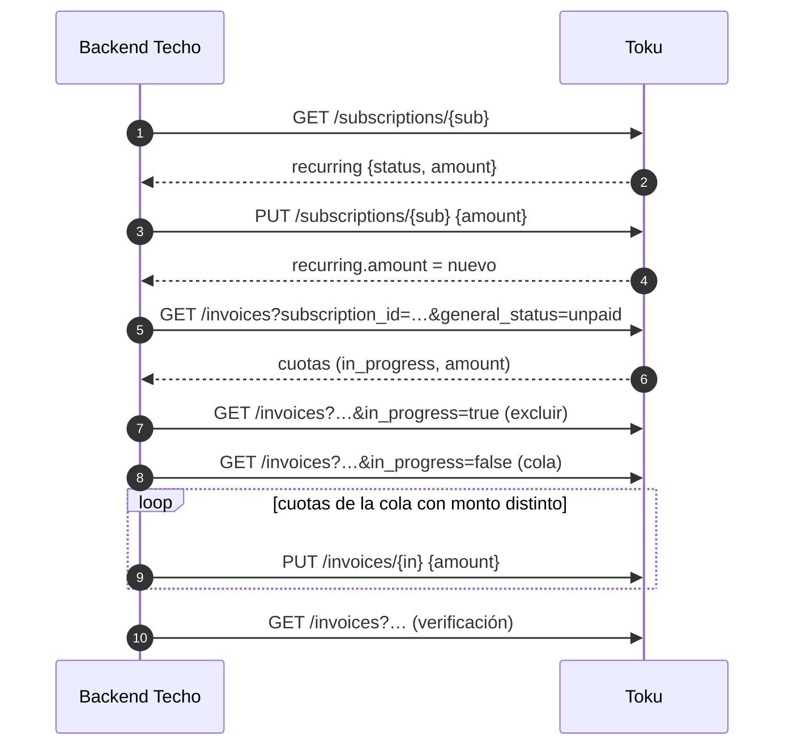

# Flujo: cambiar el monto del aporte (adaptador Toku)

**Objetivo:** cambiar el monto de la Subscription recurrente de un socio por API, con vigencia desde la **próxima cuota no cobrada**, sin tocar cuotas pagadas ni cobros en curso.
**Recursos:** Subscription · Invoice · **Postman:** carpeta `03 · Cambiar monto`
**Relacionados:** [capa común cambiar-monto](../../../../Transversal/docs/transversal/workflows/cambiar-monto.md) · [subscriptions.md](../subscriptions.md) · [invoices.md](../invoices.md)

> **Todo es producción.** Probar solo con Subscriptions `TEST-`.

## 1. Qué dice la documentación oficial

| Pieza | Qué permite | Fuente |
| --- | --- | --- |
| `PUT /subscriptions/{id}` | `amount` editable (actualización parcial). "Los cambios de recurrencia aplican a las Invoices que se generen en adelante" | *Editar Subscription* [Confirmado] |
| `PUT /invoices/{id}` | `amount` editable (actualización parcial). No restringe por estado | *Editar Invoice* [Confirmado] |
| Cuota en cobro | Toku advierte no borrar ni modificar una deuda "En proceso de cobro", para evitar cobros duplicados | Guía de Invoices [Confirmado] |

**Por qué hay que mirar las cuotas:** Toku crea cada cuota `creation_lead_days` días antes del vencimiento (en el alta usamos 5). Si el cambio llega cuando la cuota del próximo período **ya se generó**, el `PUT` de la Subscription no la cambia: hay que corregirla aparte para cumplir "próxima cuota no cobrada".

## 2. Flujo

```text
PASO 1 · Estado actual                              GET /subscriptions/{sub_…}
↓  is_recurring == true y recurring.status ∈ {ACTIVE, PAUSED} · guardar recurring.amount (anterior)
↓
PASO 2 · Cambiar el monto de la Subscription        PUT /subscriptions/{sub_…}  {"amount": <nuevo>}
↓  Validar en la respuesta: recurring.amount == nuevo
↓
PASO 3a · Cuotas en cobro (excluir)                 GET /invoices?subscription_id={sub_…}&general_status=unpaid&in_progress=true
↓  Guardar sus IDs → intocables. ⚠️ in_progress solo es fiable en el LISTADO, no en el detalle individual.
↓
PASO 3b · Cola de corrección                        GET /invoices?subscription_id={sub_…}&general_status=unpaid&in_progress=false
↓  Para cada cuota sin cobro en curso:
↓  ├─ amount == nuevo → nada
↓  └─ resto → PASO 4
↓  (partially_paid no aparece aquí; general_status ≠ unpaid. Revisión manual si se detecta aparte)
↓
PASO 4 · Corregir la cuota                          PUT /invoices/{in_…}  {"amount": <nuevo>}
↓  Sin releer el detalle: el filtro in_progress=false del listado ya excluyó las que están en cobro
↓
PASO 5 · Verificar                                  GET /invoices?subscription_id=…&general_status=unpaid&in_progress=false
↓  Todas las cuotas sin cobro en curso tienen el monto nuevo → APLICADO
↓  vigente_desde = due_date de la cuota corregida con vencimiento más próximo (la cola va ordenada por due_date)
↓
RESULTADO: Subscription y cuotas pendientes con el monto nuevo; lo ya cobrado o en cobro, intacto
```



## 3. Endpoints

| Paso | Método | Endpoint | Datos clave |
| --- | --- | --- | --- |
| 1 | `GET` | `/subscriptions/{encrypted_subscription_id}` | `recurring.status`, `recurring.amount` |
| 2 | `PUT` | `/subscriptions/{encrypted_subscription_id}` | `amount` (**número**, nunca string). Verificar `recurring.amount` en la respuesta (o `amount` si `recurring` no está en la raíz) |
| 3a | `GET` | `/invoices?subscription_id=&general_status=unpaid&in_progress=true` | IDs de cuotas en cobro → excluir del PUT |
| 3b, 5 | `GET` | `/invoices?subscription_id=&general_status=unpaid&in_progress=false` | Cola segura (paginación por cursor, ordenar por `due_date`) |
| 4 | `PUT` | `/invoices/{encrypted_invoice_id}` | `amount` (sin releer el detalle) |

## 4. Implementación (Node, referencia)

```js
async function cambiarMontoToku(subId, montoNuevo, cambio) {
  const sub = await toku.get(`/subscriptions/${subId}`);
  if (!sub.is_recurring || !['ACTIVE', 'PAUSED'].includes(sub.recurring?.status))
    throw new NoAplica(`Subscription ${subId} no es recurrente vigente`);

  const r = await toku.put(`/subscriptions/${subId}`, { amount: montoNuevo });
  if (Number(r.recurring?.amount ?? r.amount) !== montoNuevo) throw new Error('Toku no aplicó el monto');

  // ⚠️ in_progress es fiable solo en el listado (GET /invoices), no en el detalle individual.
  // Primero obtener las que están en cobro para excluirlas con certeza.
  const enCobro = new Set();
  for await (const inv of paginar(toku, '/invoices', { subscription_id: subId, general_status: 'unpaid', in_progress: true }))
    enCobro.add(inv.id);

  const corregidas = [], intactas = [...enCobro];
  for await (const inv of paginar(toku, '/invoices', { subscription_id: subId, general_status: 'unpaid', in_progress: false })) {
    if (Number(inv.amount) === montoNuevo) continue;
    if (enCobro.has(inv.id)) { intactas.push(inv.id); continue; }   // por si acaso (race condition)
    await toku.put(`/invoices/${inv.id}`, { amount: montoNuevo });
    corregidas.push({ id: inv.id, due_date: inv.due_date });
  }
  // Ordenar por due_date para que vigente_desde sea la cuota más próxima
  corregidas.sort((a, b) => a.due_date.localeCompare(b.due_date));

  await db.suscripcionCambios.update(cambio.id, {
    estado: 'APLICADO', metodo: 'API', aplicado_at: new Date(),
    vigente_desde: corregidas[0]?.due_date ?? 'próximo ciclo', detalle: { corregidas, intactas },
  });
  return 'APLICADO';
}
```

## 5. Errores y casos borde

| Caso | Qué hacer |
| --- | --- |
| `422` en el `PUT` de la Subscription | `amount` como string o negativo: enviar número entero (CLP sin decimales) |
| `recurring.status: PAUSED` por cuotas impagas | Se puede cambiar el monto; las cuotas impagas generadas se corrigen igual (si no están en cobro) |
| Cuota `in_progress` | No tocar: se cobra con el monto anterior y el nuevo rige desde la siguiente (decisión de vigencia) |
| Cuota `partially_paid` | No tocar: revisión manual |
| PAC | El intento de cobro parte 48 h hábiles antes del vencimiento: si la cuota ya está `in_progress`, aplica la regla anterior |
| `429` | Más de 20 req/s: backoff |

## 6. Pendientes por confirmar con Toku

| # | Pregunta |
| --- | --- |
| T-M1 | ¿Cambiar `amount` de la Subscription afecta un mandato PAC con tope de monto? |
| T-M2 | ¿`PUT /invoices` sobre una cuota ya enviada al banco (PAC) sin `in_progress` puede generar un cobro por el monto anterior? |

## 7. Probarlo en Postman

Carpeta **`03 · Cambiar monto`** de `Toku API.postman_collection.json`, para **Run folder**. ⚠️ **Producción:** los requests que escriben se cancelan si `cm_product_id` no empieza con `TEST-`.

| Request | Qué hace | Siguiente |
| --- | --- | --- |
| CT-1 Buscar Subscription | `lookup` por `cm_product_id`; guarda el monto actual | CT-2 |
| CT-2 Cambiar monto de la Subscription | `PUT` con `cm_monto` | CT-3 |
| CT-3a En cobro (excluir) | `GET /invoices?…&in_progress=true`; guarda IDs a excluir | CT-3b |
| CT-3b Cola de corrección | `GET /invoices?…&in_progress=false`; arma cola con monto distinto (ordenada por `due_date`) | Hay cola → CT-4 · FIN |
| CT-4 Corregir cuota | `PUT /invoices/{id}` con `cm_monto`; recorre la cola | CT-4 · CT-5 |
| CT-5 Verificar | Revisa que las cuotas no pagadas tengan el monto nuevo | FIN |

**Variables de colección:** `cm_product_id` (`TEST-…`) y `cm_monto`. Los scripts llenan `cm_subscription_id`, `cm_monto_anterior`, `cm_en_cobro` (IDs a excluir), `cm_queue` (ordenada por `due_date`) y `cm_invoice_id`.
