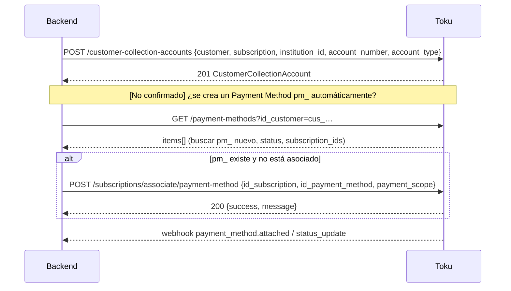

# Flujo: inscribir un medio de pago y asociarlo a una Subscription

(Reemplaza a `update-payment-method.md` de la estructura propuesta: en la API pública **no existe** un "update" de Payment Method. El cambio de medio se hace inscribiendo uno nuevo, asociándolo y eliminando el anterior.)

## 1. Qué necesitamos hacer
Que una Subscription tenga un medio de pago automático (PAC o tarjeta) para que Toku cobre sus cuotas.

## 2. Caminos posibles

| Camino | Quién ingresa los datos | Endpoints | Cuándo usarlo |
|---|---|---|---|
| **A. Portal / Checkout de Toku** | El socio | Checkout Session `mode: ENROLLMENT`, o el link del portal / `send_mail` | Tarjetas (PAT/Oneclick) y PAC con firma del socio. **Bloqueado hoy:** la cuenta no tiene configurado el flujo de inscripción (`flow_name`) |
| **B. Collection Account (PAC por API)** | Nosotros (datos bancarios que ya tenemos) | `POST /customer-collection-accounts` | PAC cuando ya tenemos la cuenta y el mandato del socio |
| **C. PAC por lote** | Nosotros | "Crear PACs por lote" | Migraciones masivas |

**[Recomendación]** Para el aprendizaje actual, el camino **B**. Para producción con socios nuevos, el camino **A** (requiere que Toku configure el flujo).

> El camino **A** con link enviado al socio está diseñado en el [link seguro de inscripción](../../../../Transversal/docs/transversal/workflows/link-seguro-inscripcion.md) y en el [adaptador de Toku](link-inscripcion.md): alta pendiente (caso A) y cambio de medio de pago de un socio existente (caso B).

## 3. Camino B paso a paso



### Paso 1: registrar la cuenta
```json
POST /customer-collection-accounts
{
  "customer": "cus_…",
  "subscription": "sub_…",
  "institution_id": "mock",
  "account_number": "000000000",
  "account_type": "sight_account",
  "currency_code": "CLP"
}
```
*`institution_id: "mock"` existe en el enum "para pruebas". **[No confirmado]** su comportamiento en producción: probar primero con él.*

### Paso 2: ver qué quedó creado
```http
GET /customer-collection-accounts?customer=cus_…
GET /payment-methods?id_customer=cus_…
```

### Paso 3: asociar (si hace falta)
```json
POST /subscriptions/associate/payment-method
{ "id_subscription": "sub_…", "id_payment_method": "pm_…", "payment_scope": "SUBSCRIPTION" }
```
Revisar `success` en el body: puede venir `200` con `success: false`.

### Paso 4: confirmar
`GET /payment-methods/{pm_id}` → `payment_method.status` en `chargeable` (o `pending_activation` si el banco debe activar el mandato) y `subscription_ids` que incluya el `sub_`.

## 4. Cambiar el medio de pago de un socio
```text
1. Inscribir el nuevo medio (camino A o B).
2. Asociarlo a la Subscription.
3. Verificar que quede como el medio activo (Toku cobra con el "activo" si hay varios).
4. DELETE /payment-methods?id_payment_method={pm_viejo}  (borrado lógico).
```
**[No confirmado]** Cómo decide Toku cuál es el "activo" cuando hay varios asociados. Preguntarlo a Toku antes de automatizar.

## 5. Qué guardar
`toku_payment_method_id`, `type`, `gateway`, `status`, `card_brand`/`bank_name`, los últimos 4 dígitos, y la relación con `sub_`. **Nunca** `account_number` ni `token` completos.

## 6. Consideraciones
- La Subscription y el Payment Method deben ser del **mismo Customer**.
- Si la Collection Account se registra **sin** `subscription`, aplica a todas las Subscriptions del Customer.
- Con PAC, el cobro tarda **24–48 h hábiles**; el reloj parte recién después de la inscripción.
- Webhooks a escuchar: `payment_method.attached`, `payment_method.attached_products`, `payment_method.status_update`, `payment_method_inscription_intent.failed`.

## 7. Diferencia con la nota interna anterior
La nota interna decía `POST /customers/{id}/collection-account`. **La ruta oficial es `POST /customer-collection-accounts`**, con `customer` en el body. Ver [postman-audit.md](../postman-audit.md).
