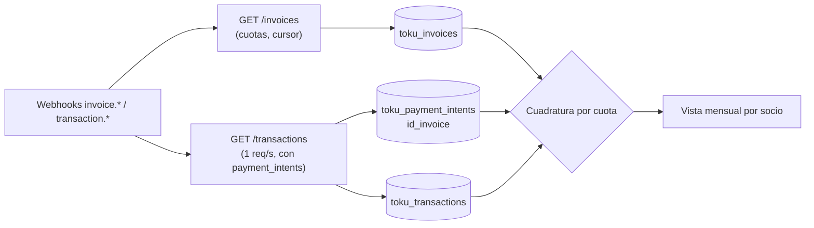

# Flujo: seguimiento de los cobros recurrentes (cuotas y transacciones)

**Objetivo:** saber, para cada socio y cada mes, **qué se le debía cobrar** (Invoice), **qué se cobró efectivamente** (Transaction), **qué parte de cada pago se aplicó a cada cuota** (Payment Intent), **por qué falló** y **en qué liquidación llegó la plata**.
**Recursos:** Invoice · Transaction · Payment Intent · Payout · **Postman:** carpeta `04 · Seguimiento de cobros`
**Relacionados:** [reconcile-payment.md](reconcile-payment.md) · [sync-toku.md](sync-toku.md) · [invoices.md](../invoices.md) · [transactions.md](../transactions.md) · [webhooks.md](../webhooks.md) · [capa común](../../../../Transversal/docs/transversal/workflows/seguimiento-cobros.md)

## 1. Cómo modela Toku la cuota y la transacción

Toku es el canal que **separa más claramente** la deuda del pago [Confirmado]:

| Concepto TECHO | Objeto Toku | Qué representa | Campos clave |
| --- | --- | --- | --- |
| **Cuota** (deuda del mes) | **Invoice** (`in_…`) | Lo que se debe. Toku la crea sola en las Subscriptions recurrentes | `due_date`, `amount`, `paid_amount`, `general_status` (`paid`/`partially_paid`/`unpaid`/`void`/`expired`), `status` (13 valores), `in_progress`, `remaining_collection_attempts` |
| **Transacción** (pago efectivo) | **Transaction** | Un movimiento de dinero: cobro, reversa o contracargo | `type`, `status` (`SUCCESS`, `FAILED`, `INITIALIZED`…), `amount`, `transaction_date`, `response_code`, `original_response_message`, `gateway`, `id_payout` |
| **Aplicación** del pago a la cuota | **Payment Intent** (dentro de la Transaction) | Qué parte de una Transaction saldó qué Invoice | `id_invoice`, `id_subscription`, `amount`, `status`, `is_partial` |
| **Liquidación** | **Payout** (`id_payout` en la Transaction) | En qué pago a TECHO llegó la plata | `id_payout` (`null` = cobrado pero aún no liquidado) |

```text
Subscription ──1:N──> Invoice (cuota)
                          ▲ id_invoice
                          │
Transaction ──1:N──> Payment Intent        →  Transaction ↔ Invoice es N:M
   │  (una Transaction puede pagar varias cuotas; una cuota puede tener varios intentos o pagos parciales)
   └── id_payout ──> Payout (liquidación a TECHO)
```

**Diferencias con VirtualPOS:**
- La Invoice **no tiene fecha de pago** (`paid_at`) ni `updated_at`. La fecha efectiva sale de `transaction.transaction_date` [Confirmado].
- **No hace falta ir uno a uno** para unir pago y cuota: cada Transaction del listado trae sus `payment_intents[]` con `id_invoice` [Confirmado].
- El **motivo del rechazo** viene en la Transaction (`response_code`, `original_response_message`), también en el listado masivo [Confirmado].

## 2. ¿Masivo o uno a uno?

| Necesito… | Endpoint | ¿Masivo? | Límite |
| --- | --- | --- | --- |
| **Todas las cuotas** (filtrando por vencimiento, estado, socio o suscripción) | `GET /invoices?due_date_from=&general_status=&in_progress=&page_size=100&next_cursor=` | ✅ Sí (cursor) | 20 req/s |
| Cuotas que se pueden cobrar ahora | `GET /invoices/chargeable` | ✅ Sí | 20 req/s |
| **Todas las transacciones** de un período, **con sus Payment Intents y el Customer** | `GET /transactions?start_date=&end_date=&status=&types=&page=&page_size=100` | ✅ Sí (página) | **1 req/s** |
| Transacciones de **una** cuota | `GET /transactions?id_invoice=in_…` | Por cuota | 1 req/s |
| Detalle de una cuota | `GET /invoices/{id}` | ❌ Uno a uno | 20 req/s |
| Qué transacciones componen una liquidación | `GET /transactions?id_payout=…` | Por payout | 1 req/s |
| Avisos en tiempo real | Webhooks `invoice.paid`, `transaction.success`, `transaction.bulk_success` (PAC), `transaction.failed`, `transaction.bulk_failed`, `transaction.status_update` | Push | — |

**Limitaciones** [Confirmado]:
- `GET /invoices` no tiene `due_date_to` ni filtro de modificación. Las fechas `start_date`/`end_date` son de **creación**.
- `GET /transactions` solo devuelve `PAYMENT`, `REVERSED` y `CHARGEBACK` (no las inscripciones). Además, `start_date`/`end_date` se comparan con la "fecha de la transacción" (⚠️ T-S1).

## 3. Job diario de seguimiento

```text
PASO 1 · Cuotas (masivo)                           GET /invoices?due_date_from={hoy-60}&page_size=100 (todas las páginas)
↓  Upsert toku_invoices (id, subscription, customer, due_date, amount, paid_amount, general_status, status, in_progress)
↓  Las cuotas que vencen después de hoy+31 se descartan del lado nuestro (no hay due_date_to)
↓
PASO 2 · Transacciones (masivo, 1 req/s)           GET /transactions?start_date={D-2}&end_date={D}&page=1..N
↓  Upsert toku_transactions + UNA fila por Payment Intent en toku_payment_intents (no solo el primero)
↓  REVERSED / CHARGEBACK llegan como transacciones NUEVAS → restan de la cuota que referencian
↓
PASO 3 · Cuadratura por cuota (en NUESTRA base)
↓  pagado_ok = Σ pi.amount de transacciones SUCCESS tipo PAYMENT − reversas y contracargos
↓  ├─ general_status = paid y pagado_ok = amount                  → OK
↓  ├─ status = EXTERNALLY_PAID sin transacción                    → pagada fuera de Toku (OK, marcar)
↓  ├─ transacción SUCCESS y cuota unpaid                          → INCONSISTENCIA (desfase o pago aplicado a otra cuota)
↓  ├─ in_progress = true por más de 3 días hábiles                → ALERTA: cobro PAC/PAT colgado
↓  ├─ vencida, unpaid, sin transacción y sin in_progress          → ALERTA: sin intento de cobro (¿sin medio de pago?)
↓  └─ última transacción FAILED                                    → motivo = response_code + original_response_message
↓        remaining_collection_attempts = 0 → flujo de reintento / cambio de medio de pago
↓
PASO 4 · Liquidación
↓  transacciones SUCCESS con id_payout = null por más de N días → seguimiento con Toku
↓
Tiempo real: los webhooks alimentan los mismos upserts (siempre releyendo el recurso por API)
↓
RESULTADO: por socio y mes → cuota (monto, estado) · transacciones (cuándo, cuánto, medio, motivo si falló) · liquidación
```



## 4. Estados

| Cuota (`general_status` / `in_progress`) | Transacciones esperadas | Lectura |
| --- | --- | --- |
| `unpaid`, `in_progress=false`, aún no vence | Ninguna | Por cobrar |
| `unpaid`, `in_progress=true` | `INITIALIZED` / `CAPTURE_PENDING` | Se está cobrando (PAC: 24–48 h hábiles) |
| `paid` | ≥ 1 `SUCCESS` tipo `PAYMENT` | Pagada ✅ |
| `partially_paid` | `SUCCESS` con `is_partial` | Pago parcial |
| `unpaid` tras vencer | `FAILED` (con `response_code`) | Rechazada: Toku reintenta según `remaining_collection_attempts` |
| `void` | — | Anulada (no se cobra) |
| `paid` → luego reversa | `REVERSED` / `CHARGEBACK` | Devolución o contracargo: la cuota vuelve a deberse [Inferencia] |

Detalle de los 13 `status` de la Invoice: [statuses.md](../statuses.md).

## 5. Vista mensual por socio

```sql
CREATE VIEW v_toku_cuotas_mensuales AS
SELECT i.customer                                   AS customer_id,
       date_trunc('month', i.due_date)::date        AS periodo,
       i.id AS invoice_id, i.amount AS monto_cuota, i.paid_amount, i.general_status, i.in_progress,
       t.transaction_id, t.estado_pago, t.fecha_pago,
       t.monto_aplicado, t.response_code, t.original_response_message,
       t.gateway, t.id_payout
FROM toku_invoices i
LEFT JOIN LATERAL (                                  -- la transacción más reciente que tocó la cuota
       SELECT x.id                    AS transaction_id,
              x.status                AS estado_pago,
              x.transaction_date      AS fecha_pago,
              x.response_code,
              x.original_response_message,
              x.gateway,
              x.id_payout,
              p.amount                AS monto_aplicado
       FROM toku_payment_intents p JOIN toku_transactions x ON x.id = p.transaction_id
       WHERE p.id_invoice = i.id AND x.type = 'PAYMENT'
       ORDER BY x.transaction_date DESC LIMIT 1) t ON true;
```

**Indicadores:** tasa de cobro (cuotas `paid` / cuotas vencidas no anuladas), recuperación (pagadas tras un `FAILED`), monto esperado vs cobrado vs liquidado, motivos de rechazo por `response_code`, cuotas con `in_progress` colgado.

## 6. Qué guardar

| Tabla | Clave | Notas |
| --- | --- | --- |
| `toku_invoices` | `id` | Estado al día (sin `updated_at` en Toku: guardar `synced_at` y `status_prev`) |
| `toku_transactions` | `id` | `transaction_date` en UTC; convertir a `America/Santiago` solo al presentar |
| `toku_payment_intents` | `id` | **Una fila por intent** (el sync de Sheets actual guarda solo el primero: corregir, ver [reconcile-payment.md](reconcile-payment.md)) |
| `stg_toku_webhook_events` | `event_id` | Ver [webhooks.md](../webhooks.md) |

## 7. Pendientes por confirmar

| # | Pregunta | Cómo |
| --- | --- | --- |
| T-S1 | ¿`start_date`/`end_date` de `GET /transactions` filtran por `transaction_date` o por `initialization_date`? | Postman ST-2: comparar fechas de los resultados con la ventana |
| T-S2 | Valores reales de `payment_intent.status` y cuáles cuentan como pago efectivo | Observar transacciones `SUCCESS`, `FAILED` y reversas |
| T-S3 | Endpoint *List Payouts* (fecha y monto de cada liquidación) | Revisar <https://docs.trytoku.com/reference/list_payouts> |
| T-S4 | Calendario de reintentos de Toku y cómo baja `remaining_collection_attempts` | Preguntar a Toku |

## 8. Probarlo en Postman

Carpeta **`04 · Seguimiento de cobros`** de `Toku API.postman_collection.json` (solo lectura, producción), para **Run folder**. Los requests a `/transactions` esperan 1,1 s antes de salir (límite de 1 req/s).

| Request | Qué hace | Siguiente |
| --- | --- | --- |
| ST-1 Cuotas desde una fecha | Recorre `GET /invoices?due_date_from=` con cursor y resume por estado, `in_progress` y mes | ST-2 |
| ST-2 Transacciones del período | Recorre `GET /transactions` y resume por estado, tipo y `response_code`; cuenta Payment Intents por transacción (N:M) | ST-3 |
| ST-3 Detalle de una cuota | Una cuota con pago (elegida en ST-2) | ST-4 |
| ST-4 Transacciones de la cuota | `GET /transactions?id_invoice=`: compara Σ Payment Intents `SUCCESS` con `paid_amount` | Con payout → ST-5 · FIN |
| ST-5 Transacciones de la liquidación | `GET /transactions?id_payout=` | FIN |

**Variables de colección:** `st_desde` (vencimientos desde), `st_tx_desde` / `st_tx_hasta` (ventana de transacciones). Los scripts llenan `st_cursor`, `st_page`, `st_resumen`, `st_invoice_id` y `st_payout_id`.
