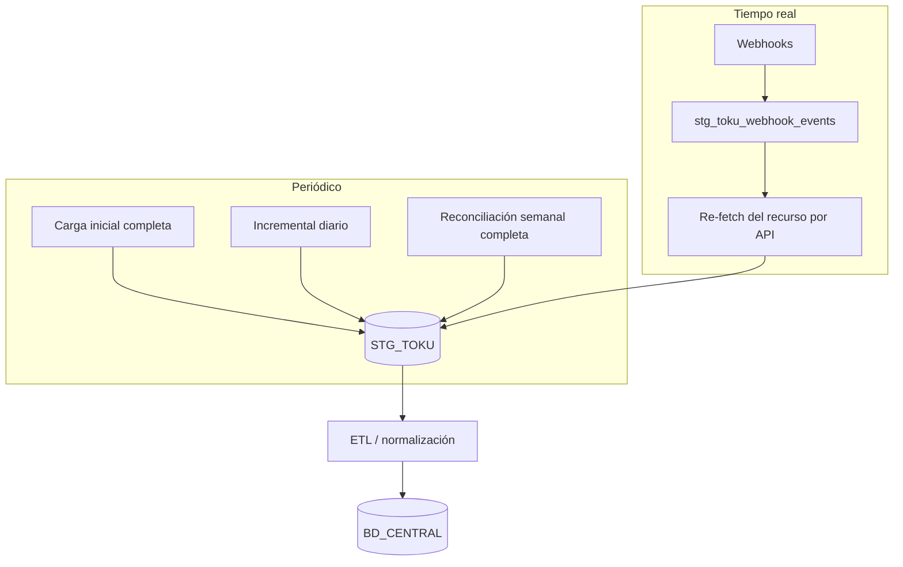

# Flujo: sincronización Toku → STG_TOKU → BD_CENTRAL

Objetivo: tener en nuestra base todos los clientes, suscripciones, cuotas, pagos y medios de pago de Toku, **recuperable aunque fallen los webhooks**.

## 1. Restricciones de la API que condicionan el diseño [Confirmado]

| Restricción | Impacto |
|---|---|
| No hay `updated_at` ni filtro por fecha de modificación en ningún listado | **No se puede hacer un incremental "lo que cambió desde X" por API.** Los filtros `start_date`/`end_date` son por creación (Customers, Subscriptions, Invoices) o por fecha de transacción (Transactions) |
| Payment Methods excluye los eliminados | Las bajas se detectan por webhook o comparando snapshots |
| Transactions: 1 req/s y paginación por página | La carga histórica es lenta; el incremental debe ser por ventana de fecha |
| Webhooks: ~1 h 41 min de reintentos y luego se pierden; `disabled` descarta los pendientes | Hace falta una reconciliación periódica |
| Ambiente único (producción) | Las pruebas de sync son de solo lectura, sin riesgo |

## 2. Estrategia híbrida [Recomendación]



### 2.1 Carga inicial (una vez, o ante un desastre)
| Orden | Recurso | Endpoint | Paginación | Notas |
|---|---|---|---|---|
| 1 | Customers | `GET /customers?page_size=100` | cursor | 20 req/s |
| 2 | Subscriptions | `GET /subscriptions?page_size=100` | cursor | |
| 3 | Invoices | `GET /invoices?page_size=100` | cursor | trae `general_status` e `in_progress` |
| 4 | Payment Methods | `GET /payment-methods?page=N&page_size=100` | página | enmascarar datos sensibles **antes** de guardar |
| 5 | Transactions | `GET /transactions?page=N&page_size=100&start_date=…&end_date=…` | página | **1 req/s**; recorrer en ventanas de un mes para acotar |

El orden importa solo para la **normalización** (las FKs). STG acepta cualquier orden.

### 2.2 Incremental diario
| Recurso | Qué leer | Por qué |
|---|---|---|
| Customers / Subscriptions | `start_date = última_corrida − 1 día` | **Altas** nuevas. Los cambios llegan por webhook o por la reconciliación |
| Invoices — nuevas | `start_date = última_corrida − 1 día` | Altas (incluye las recurrentes que generó Toku) |
| Invoices — abiertas | `general_status=unpaid&general_status=partially_paid` + `in_progress=true` | Capturar los cambios de estado de cuotas vivas |
| Invoices — recién vencidas | `due_date_from = hoy − 7 días` | Las que acaban de pasar por el ciclo de cobro |
| Transactions | `start_date = última_corrida − 24 h`, `end_date = ahora` | Solapamiento de 24 h (lo que ya hace el sync de Apps Script) |
| Payment Methods | Listado completo (suele ser chico) o por `start_date` | Los cambios de estado los cubre el webhook |

### 2.3 Reconciliación completa (semanal)
- Releer **todo** Customers, Subscriptions, Invoices y Payment Methods.
- Comparar con STG por `id` + `payload_hash`: lo nuevo, lo cambiado y **lo que desapareció** (→ marcar `deleted_in_source_at`, nunca borrar físicamente).
- Transactions: releer los últimos 30–60 días (pueden cambiar de `INITIALIZED` a `SUCCESS`/`FAILED`, y aparecer reversas).

## 3. Diseño de STG_TOKU

```sql
-- patrón por recurso (customers, subscriptions, invoices, payment_methods, transactions)
CREATE TABLE stg_toku_invoices (
  id               TEXT PRIMARY KEY,         -- in_…
  customer_id      TEXT,                     -- columnas promovidas para indexar
  subscription_id  TEXT,
  status           TEXT,
  general_status   TEXT,
  in_progress      BOOLEAN,
  due_date         DATE,
  payload          JSONB NOT NULL,           -- respuesta cruda (enmascarada si es sensible)
  payload_hash     TEXT NOT NULL,
  api_version      TEXT,                     -- x-api-version usada
  source           TEXT NOT NULL,            -- 'full' | 'incremental' | 'webhook_refetch'
  first_seen_at    TIMESTAMPTZ NOT NULL DEFAULT now(),
  last_seen_at     TIMESTAMPTZ NOT NULL DEFAULT now(),
  last_changed_at  TIMESTAMPTZ NOT NULL DEFAULT now(),
  deleted_in_source_at TIMESTAMPTZ
);

-- Transactions: guardar el agregado completo y, aparte, la tabla puente
CREATE TABLE stg_toku_payment_intents (
  id              TEXT PRIMARY KEY,
  transaction_id  TEXT NOT NULL,
  invoice_id      TEXT NOT NULL,
  subscription_id TEXT,
  amount          NUMERIC,
  currency        TEXT,
  status          TEXT,
  payload         JSONB NOT NULL
);

CREATE TABLE sync_checkpoints (
  resource TEXT PRIMARY KEY, mode TEXT, cursor TEXT, page INT,
  window_start TIMESTAMPTZ, window_end TIMESTAMPTZ, updated_at TIMESTAMPTZ
);
```

Upsert: `ON CONFLICT (id) DO UPDATE ... WHERE stg.payload_hash <> EXCLUDED.payload_hash` (solo actualiza `last_changed_at` si cambió de verdad; `last_seen_at` siempre).

## 4. Cliente API (separación de capas)

```text
app/integrations/toku/
├── client.py          # HTTP: auth, timeouts, retries/backoff, rate limiter por grupo, parse de errores
├── pagination.py      # iter_cursor(), iter_pages()
├── customers.py       # list/get/lookup/upsert  (solo llamadas, sin lógica de negocio)
├── subscriptions.py
├── invoices.py
├── transactions.py
├── payment_methods.py # incluye el enmascarado de datos sensibles
├── webhooks.py        # verify_signature(), parse_event()
└── exceptions.py      # TokuAPIError, TokuRateLimited, TokuNotFound
app/sync/toku/
├── staging.py         # upserts a STG_TOKU
├── jobs.py            # full / incremental / reconcile + checkpoints
└── normalize.py       # STG → BD_CENTRAL
```

Parámetros del cliente [Recomendación]:
- Timeout: 10 s de conexión y 30 s de lectura.
- Retries: `429`, `5xx`, timeouts y `TK20401`/`TK00600`. Backoff `1, 2, 4, 8, 16 s` con jitter, máximo 5. Solo en GETs y upserts idempotentes.
- Rate limiter: token bucket de 15 req/s para Customers/Subscriptions/Invoices (margen bajo 20) y **1 req/s para Transactions**. Si hay otro consumidor con la misma key (Apps Script), coordinar: la cuota es por credencial.
- Logging: método, path **sin IDs sensibles**, status, `error.code`, duración, `x-api-version`. Nunca headers ni bodies con PII.
- Validación de respuesta: exigir los campos requeridos del schema (`id`, etc.) y tolerar los campos nuevos.

## 5. Riesgos de duplicidad y cómo se cubren

| Riesgo | Mitigación |
|---|---|
| Reintento de página → mismos registros dos veces | Upsert por `id` |
| Webhook duplicado | `event_id` UNIQUE + re-fetch |
| Una Transaction con varios Payment Intents | Tabla puente por `payment_intent.id` |
| Páginas que se "corren" en Transactions durante la lectura | Ventana `start_date`/`end_date` fija por corrida + solapamiento |
| Dos procesos sincronizando a la vez | Lock por recurso en `sync_checkpoints` |

## 6. Qué se obtiene sin llamadas extra
- La Transaction trae **Customer, Payment Intents (con `id_invoice`, `id_subscription`, `product_id`, `invoice_external_id`) e instrumento**: no hace falta pedir la Invoice para saber a qué cuota aplicó.
- El Payment Method agregado trae **Customer + `subscription_ids` + `product_ids`**.
- `invoice.paid` trae la Invoice + sus Transactions.

## 7. Pruebas del sync

| Caso | Esperado |
|---|---|
| Happy path | Los conteos en STG coinciden con lo que hay en la UI de Toku |
| `401` | El job aborta, alerta, no avanza el checkpoint |
| `404` en el re-fetch de un webhook | Marcar `deleted_in_source_at` |
| `422` en filtros | Bug nuestro: abortar y alertar (no reintentar) |
| Timeout | Reintentar con backoff; si persiste, guardar el checkpoint y salir |
| `429` | Backoff; verificar que el limiter no esté mal configurado |
| Respuesta inesperada (falta `items`) | Excepción de validación; no sobrescribir STG con vacíos |
| Proceso cortado a mitad | La siguiente corrida retoma desde el checkpoint |
