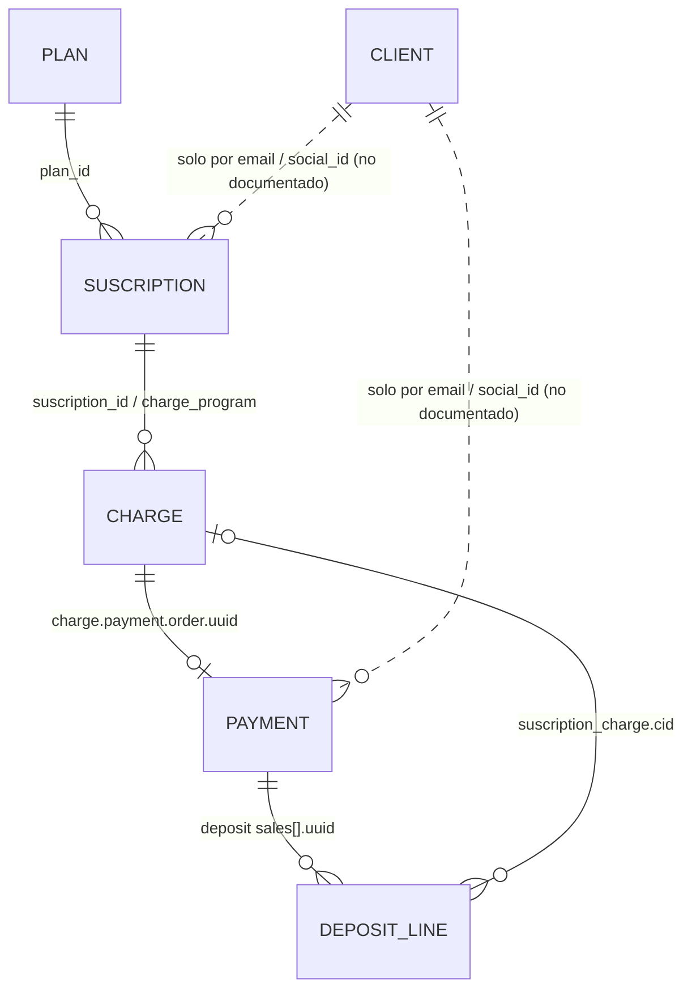

# VirtualPOS API — Documentación del proyecto

> **Fuente de verdad:** https://virtualpos.readme.io/reference/getting-started-with-your-api
> **Última verificación contra la doc oficial:** 2026-10-12 · API **v3** · 35 endpoints
> **Base:** borrador `VirtualPOS_API_Documentacion.md` (2026-08-14), corregido y reorganizado.

## Convenciones de esta documentación

| Marca | Significado |
| --- | --- |
| *(sin marca)* | Confirmado en la documentación oficial. |
| **Inferencia** / "se infiere" | Deducción técnica a partir de ejemplos, enums o mensajes de error. Verificar en sandbox. |
| "No confirmado en la documentación oficial de VirtualPOS." | La doc no lo dice. No construir lógica crítica sobre esto sin probarlo. |
| **Recomendación** | Decisión de arquitectura nuestra, no de VirtualPOS. |

## Qué es VirtualPOS (en 30 segundos)

API REST (solo JSON) para cobros **spot** (Web Checkout) y **recurrentes** (suscripciones PAT con tarjeta tokenizada), más un servicio separado de **Payout** (transferencias salientes).

Cada request lleva 3 headers: `Content-Type: application/json`, `Authorization: <API_KEY>` y `Signature: <JWT firmado con SECRET_KEY>` → ver [authentication.md](authentication.md).

## Ambientes

| API | Sandbox | Producción |
| --- | --- | --- |
| Payments / Suscripciones / Clientes | `https://api.virtualpos-sandbox.com` | `https://api.virtualpos.cl` |
| Payouts | `https://payout-api.virtualpos-sandbox.com` | `https://payout-api.virtualpos.cl` |
| Portal comercio (llaves) | `https://comercios.virtualpos-sandbox.com` | Portal producción → Perfil > Configuración de cuenta > Integración |

## Modelo de recursos



```text
CLIENTE (cli_...)           ← relación débil: email / RUT
   ↓
SUSCRIPTION (id)  ← PLAN (plan_id)
   ↓
CHARGE / CARGO PROGRAMADO (cid_...)
   ↓
PAYMENT / TRANSACCIÓN (order.uuid)
   ↓
ABONO (deposit/{date}/sales)  → conciliación bancaria
```

| Concepto Techo | Recurso VirtualPOS | ID | Archivo |
| --- | --- | --- | --- |
| Cliente / socio | Client | `uuid` (`cli_…`) | [clients.md](clients.md) |
| Plan de aporte | Plan | `id` (32 hex) | [plans.md](plans.md) |
| Suscripción | Suscription | `id` (10 hex) | [subscriptions.md](subscriptions.md) |
| Cobro programado | Charge | `id` (`cid_…`) | [charges.md](charges.md) |
| Pago / transacción | Payment | `order.uuid` (16 hex) | [payments.md](payments.md) |
| Depósito al comercio | Deposit (abono) | fecha | [deposits.md](deposits.md) |
| Transferencia saliente | Payout | `id` (`po_…`) + tu `merchant_id` | [payouts.md](payouts.md) |

## Índice de archivos

| Archivo | Contenido |
| --- | --- |
| [authentication.md](authentication.md) | API key, firma JWT, ejemplos en Postman / Node / Python / Apps Script |
| [payments.md](payments.md) | Objeto Payment, Web Checkout, Rule Set y los 9 endpoints de Payment |
| [deposits.md](deposits.md) | Abonos diarios: resumen, ventas y retenciones |
| [plans.md](plans.md) | Planes recurrentes |
| [subscriptions.md](subscriptions.md) | Suscripciones (PAT) |
| [charges.md](charges.md) | Cargos de suscripción |
| [clients.md](clients.md) | Clientes |
| [payouts.md](payouts.md) | Transferencias salientes (mTLS) |
| [quick-checkout.md](quick-checkout.md) | Formulario embebido en tu sitio |
| [webhooks.md](webhooks.md) | Notificaciones de Payment, Suscription y Payout |
| [errors.md](errors.md) | Objeto Error (E-001…E-116) y Objeto Rechazo (-1…-1018) |
| [pagination.md](pagination.md) | `page` / `limit`, diferencias entre endpoints |
| [sandbox.md](sandbox.md) | Tarjetas y datos de prueba |
| [discrepancies.md](discrepancies.md) | Diferencias detectadas: doc oficial vs borrador vs Postman |
| [workflows/](workflows/) | Flujos paso a paso |

### Flujos

| Flujo | Archivo |
| --- | --- |
| **Alta de socio desde formulario web** (cliente + plan + suscripción) | [workflows/alta-socio.md](workflows/alta-socio.md) |
| Crear o encontrar un cliente (upsert) | [workflows/create-client.md](workflows/create-client.md) |
| Cobro único por Web Checkout | [workflows/web-checkout-payment.md](workflows/web-checkout-payment.md) |
| Crear una suscripción | [workflows/create-subscription.md](workflows/create-subscription.md) |
| Cobrar una suscripción (cargos, reintentos, cambio de tarjeta) | [workflows/charge-subscription.md](workflows/charge-subscription.md) |
| Seguimiento de cobros recurrentes: cuotas (Charge) vs transacciones (Payment), qué es masivo y qué es uno a uno | [workflows/seguimiento-cobros.md](workflows/seguimiento-cobros.md) |
| Cancelar una suscripción | [workflows/cancel-subscription.md](workflows/cancel-subscription.md) |
| Gestionar pausa y cambios de una suscripción de monto fijo | [workflows/gestionar-suscripcion-monto-fijo.md](workflows/gestionar-suscripcion-monto-fijo.md) |
| Cambiar el monto del aporte (suscripción nueva sin cobrar dos veces el mismo mes) | [workflows/cambiar-monto.md](workflows/cambiar-monto.md) |
| Editar datos del socio (cliente / suscripción) | [workflows/editar-socio.md](workflows/editar-socio.md) |
| Enviar link de cambio de tarjeta | [workflows/cambio-tarjeta.md](workflows/cambio-tarjeta.md) |
| Link seguro de inscripción de tarjeta (alta pendiente y socio existente) | [workflows/link-inscripcion.md](workflows/link-inscripcion.md) |
| Reintentar cobros rechazados según el motivo | [workflows/reintento-cobro-rechazado.md](workflows/reintento-cobro-rechazado.md) |
| Sincronizar VirtualPOS → base central | [workflows/sync-virtualpos.md](workflows/sync-virtualpos.md) |
| Exportar todos los objetos de VirtualPOS | [workflows/exportar-objetos-completos.md](workflows/exportar-objetos-completos.md) |

## Todos los endpoints

| Método | Ruta | Operación | Doc |
| --- | --- | --- | --- |
| `POST` | `/v3/client` | Crear un Client | [clients.md](clients.md#crear-un-client) |
| `GET` | `/v3/client/{uuid}` | Recuperar un objeto Client | [clients.md](clients.md#recuperar-un-objeto-client) |
| `GET` | `/v3/clients` | Listar objetos Client | [clients.md](clients.md#listar-objetos-client) |
| `PUT` | `/v3/client/{uuid}` | Actualizar un objeto Client | [clients.md](clients.md#actualizar-un-objeto-client) |
| `POST` | `/v3/plan` | Crear un Plan | [plans.md](plans.md#crear-un-plan) |
| `GET` | `/v3/plan/{plan_id}` | Recuperar un Plan | [plans.md](plans.md#recuperar-un-plan) |
| `GET` | `/v3/plans` | Listar plans | [plans.md](plans.md#listar-plans) |
| `POST` | `/v3/suscription` | Crear una Suscription | [subscriptions.md](subscriptions.md#crear-una-suscription) |
| `GET` | `/v3/suscription/{suscription_id}` | Recuperar una Suscription | [subscriptions.md](subscriptions.md#recuperar-una-suscription) |
| `DELETE` | `/v3/suscription/{suscription_id}` | Cancelar una Suscription | [subscriptions.md](subscriptions.md#cancelar-una-suscription) |
| `GET` | `/v3/suscriptions` | Listar Suscriptions | [subscriptions.md](subscriptions.md#listar-suscriptions) |
| `PUT` | `/v3/suscription/{suscription_id}/changecard` | Generar link de cambio de tarjeta | [subscriptions.md](subscriptions.md#generar-link-de-cambio-de-tarjeta) |
| `POST` | `/v3/charge` | Crear un Charge | [charges.md](charges.md#crear-un-charge) |
| `POST` | `/v3/charge/online` | Crear un Charge Online | [charges.md](charges.md#crear-un-charge-online) |
| `GET` | `/v3/charge/{charge_id}` | Recuperar Charge | [charges.md](charges.md#recuperar-charge) |
| `DELETE` | `/v3/charge/{charge_id}` | Cancelar Charge | [charges.md](charges.md#cancelar-charge) |
| `GET` | `/v3/charge/{charge_id}/retry` | Reintentar Charge | [charges.md](charges.md#reintentar-charge) |
| `DELETE` | `/v3/charges/{suscription_id}` | Cancelar Cargos Futuros | [charges.md](charges.md#cancelar-cargos-futuros) |
| `GET` | `/v3/suscription/{suscription_id}/charges` | Listar Charges | [charges.md](charges.md#listar-charges) |
| `POST` | `/v3/payment/` | Crear un objeto Payment | [payments.md](payments.md#crear-un-objeto-payment) |
| `POST` | `/v3/payment/{uuid}/webcheckout` | Obtener link Web Checkout | [payments.md](payments.md#obtener-link-web-checkout) |
| `GET` | `/v3/payment/{uuid}` | Recuperar un objeto Payment | [payments.md](payments.md#recuperar-un-objeto-payment) |
| `DELETE` | `/v3/payment/{uuid}` | Cancelar un objeto Payment | [payments.md](payments.md#cancelar-un-objeto-payment) |
| `GET` | `/v3/payment/{uuid}/logs` | Obtener el logs transaccional de un objeto Payment | [payments.md](payments.md#obtener-el-logs-transaccional-de-un-objeto-payment) |
| `GET` | `/v3/payments` | Listar objetos Payment | [payments.md](payments.md#listar-objetos-payment) |
| `POST` | `/v3/payment/{uuid}/authorize` | Autorizar un objeto Payment | [payments.md](payments.md#autorizar-un-objeto-payment) |
| `POST` | `/v3/payment/{uuid}/send` | Envio de una solicitud de pago por Email, Whatsapp o SMS | [payments.md](payments.md#envio-de-una-solicitud-de-pago-por-email-whatsapp-o-sms) |
| `GET` | `/v3/payment/{uuid}/attempts` | Obtener los intentos de pago un objeto Payment | [payments.md](payments.md#obtener-los-intentos-de-pago-un-objeto-payment) |
| `GET` | `/v3/deposit/{date}` | Recuperar el abono o deposito de un día | [deposits.md](deposits.md#recuperar-el-abono-o-deposito-de-un-día) |
| `GET` | `/v3/deposit/{date}/sales` | Recuperar el listado de transacciones autorizadas incluidas en el abono del día | [deposits.md](deposits.md#recuperar-el-listado-de-transacciones-autorizadas-incluidas-en-el-abono-del-día) |
| `GET` | `/v3/deposit/{date}/withholdings` | Recuperar el listado de las retenciones incluidas en el abono del día | [deposits.md](deposits.md#recuperar-el-listado-de-las-retenciones-incluidas-en-el-abono-del-día) |
| `POST` | `/v3/payout` | Crear una nueva instrucción de payout | [payouts.md](payouts.md#crear-una-nueva-instrucción-de-payout) |
| `GET` | `/v3/payout/account/balance` | Obtener saldo disponible | [payouts.md](payouts.md#obtener-saldo-disponible) |
| `GET` | `/v3/payout/{payout_id}` | Consultar estado de payout por id | [payouts.md](payouts.md#consultar-estado-de-payout-por-id) |
| `GET` | `/v3/payout/merchant/{merchant_id}` | Consultar estado de payout por merchant id | [payouts.md](payouts.md#consultar-estado-de-payout-por-merchant-id) |

## Postman

- Colección: `postman/VirtualPOS API v2.postman_collection.json`
- Entorno: `postman/VirtualPOS Sandbox.postman_environment.json`
- La firma JWT, el Base64 de las URLs y la captura de IDs (`payment_uuid`, `suscription_id`, `charge_id`, `client_uuid`, `plan_id`) son automáticos. Ver la descripción de la colección.

## Reglas de oro (resumen)

1. **Nunca confíes en el retorno del navegador ni en el webhook**: ambos solo traen el `uuid`. Consulta siempre el recurso (`GET`) para saber el estado.
2. `return_url` / `callback_url` van **en Base64** (Payment, Web Checkout, Suscription).
3. Ortografía de VirtualPOS: **`suscription`** (sin *b*), `comission_and_taxes` (una *m*) en los abonos.
4. Idempotencia: VirtualPOS no la documenta para Payment/Suscription. Usa tus propias llaves: `merchant_internal_code` (Payment), `service_id` (Suscription), `internal_code` (Charge, con `E-086` como protección), `merchant_id` (Payout, con `E-019`).
5. Tipos inconsistentes (`""` vs número, `amount` string en `charge_program`): normaliza en la capa de staging.
6. Guarda los datos del pago autorizado **al menos 1 año** (requisito de VirtualPOS).
