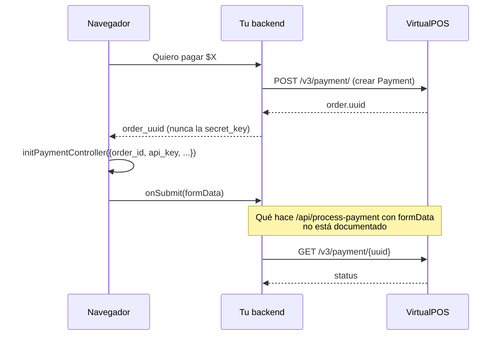

# Quick Checkout

> Fuente: https://virtualpos.readme.io/reference/qué-es-quick-checkout · https://virtualpos.readme.io/reference/integración · Verificado: 2026-10-12

## 1. Qué es

Formulario de pago **embebido en tu sitio** (módulos UI *plug & play*). El pagador paga sin ser redirigido a VirtualPOS. La doc lo describe como "un nuevo producto actualmente en desarrollo".

Requisitos: servicio contratado + API key + **un Payment creado previamente** (sin Payment el formulario no se renderiza).

## 2. Integración

### 2.1 Incluir la librería

```html
<!-- Sandbox -->
<script src="https://quick-checkout.virtualpos-sandbox.com/virtualpos-quick-checkout.js"></script>
<!-- Producción -->
<script src="https://quick-checkout.virtualpos.cl/virtualpos-quick-checkout.js"></script>
```

### 2.2 Configurar

```js
const settings = {
  initialization: {
    amount: 1000,
    api_key: 'your_api_key',
    order_id: 'order_uuid',            // uuid del Payment creado en tu backend
    clientInformation: { fullName: '', socialId: '', email: '' }
  },
  customization: {
    paymentMethods: {
      creditCard:  { available: "yes", installments: "1,2,3,4,5" },
      debitCard:   { available: "yes" },
      prePaidCard: { available: "yes" },
    },
  },
  callbacks: {
    onSubmit: ({ selectedPaymentMethod, formData }) => new Promise((resolve, reject) => {
      fetch("/api/process-payment", { method: "POST", body: formData })
        .then(r => r.json()).then(() => resolve()).catch(() => reject());
    }),
    onError: (error) => { /* manejar errores de Quick Checkout */ },
  },
};
window.initPaymentController(settings);
```

### 2.3 Renderizar

```html
<div id="vpos_payment_form"></div>
```

## 3. Flujo



## 4. Consideraciones

- La `api_key` va al navegador (es pública por diseño). La **`secret_key` jamás**.
- **No documentado:** qué contiene `formData`, qué debe hacer tu `/api/process-payment` con él (¿llamar a *Autorizar Payment* con un token?), y los rechazos `-1001`/`-1016` específicos de Quick Checkout. No confirmado en la documentación oficial de VirtualPOS → pedir detalle a soporte@virtualpos.cl antes de implementarlo.
- Rechazos antifraude relevantes (modo incógnito, bots, VPN): `-1004`, `-1005`, `-1006`, `-1017`. Ver [errors.md](errors.md#objeto-rechazo).
- **Recomendación para Techo:** usar **Web Checkout** (redirección) mientras Quick Checkout siga "en desarrollo" y con huecos de documentación.
