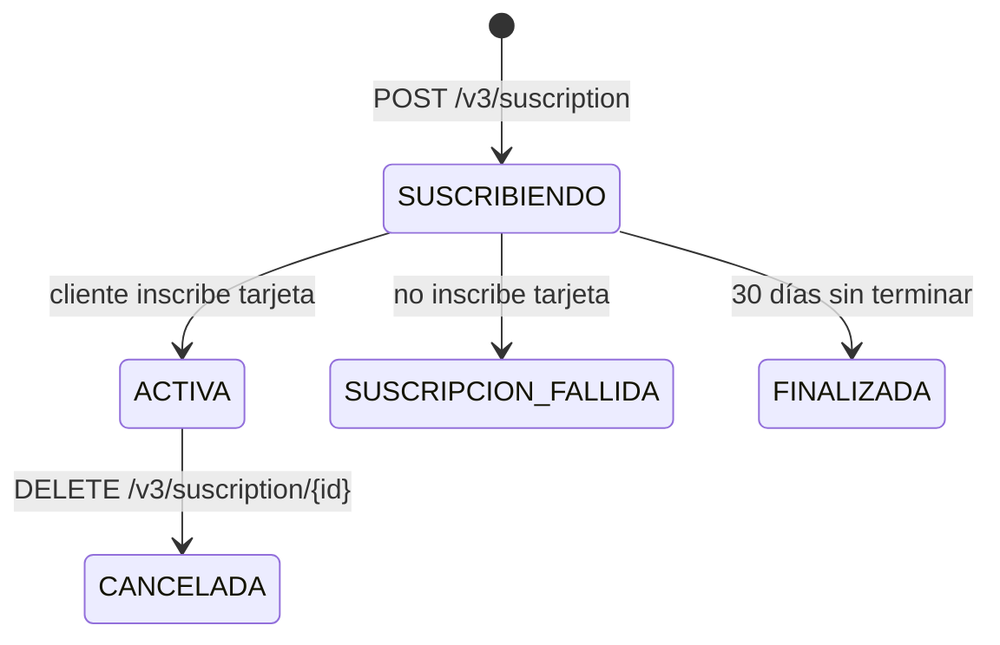

# Suscriptions

> Fuente: https://virtualpos.readme.io/reference/objeto-suscription-1 · Verificado: 2026-10-12
>
> ⚠️ VirtualPOS escribe **`suscription`** (sin *b*) en rutas y campos. Respeta esa ortografía en el código.

Una **Suscription** es el acuerdo entre el comercio y un cliente para cobrar un **Plan** de forma recurrente sobre una tarjeta tokenizada (PAT). El cliente inscribe su tarjeta en un formulario de VirtualPOS (`url_redirect`).

Características (doc oficial): crédito, débito y prepago · CLP y UF · activación 100% online · cambio de tarjeta (on demand / automático) · reintentos de cobro (hasta 3, configurable) · tokenización con y sin autenticación del emisor · tarjetas chilenas y extranjeras.

## Endpoints de este recurso

| Método | Ruta | Operación |
| --- | --- | --- |
| `POST` | `/v3/suscription` | [Crear una Suscription](#crear-una-suscription) |
| `GET` | `/v3/suscription/{suscription_id}` | [Recuperar una Suscription](#recuperar-una-suscription) |
| `DELETE` | `/v3/suscription/{suscription_id}` | [Cancelar una Suscription](#cancelar-una-suscription) |
| `GET` | `/v3/suscriptions` | [Listar Suscriptions](#listar-suscriptions) |
| `PUT` | `/v3/suscription/{suscription_id}/changecard` | [Generar link de cambio de tarjeta](#generar-link-de-cambio-de-tarjeta) |

## Objeto Suscription

| Status | Descripción |
| --- | --- |
| `SUSCRIBIENDO` | Inicial: esperando que el cliente termine el flujo. |
| `SUSCRIPCION_FALLIDA` | Final: terminó sin inscribir medio de pago. |
| `ACTIVA` | El cliente inscribió un medio de pago válido (la doc la llama "final" del flujo de suscripción, pero luego puede pasar a `CANCELADA`). |
| `CANCELADA` | Final: detenida; no se procesan cargos futuros. |
| `FINALIZADA` | Superó el tiempo máximo del intento de suscripción (default 30 días). |



| Atributo | Tipo | Descripción |
| --- | --- | --- |
| `id` | string | Identificador de la suscripción. Guárdalo. |
| `status` | enum | Ver tabla anterior |
| `plan_id` / `plan_name` | string | Plan suscrito |
| `suscription_date` | datetime | `yyyy-mm-dd hh:mm:ss` |
| `payment_method` | object | Tarjeta asociada (ver abajo) |
| `currency` | enum | `CLP`, `UF` |
| `amount` | numeric | Monto de los cobros recurrentes |
| `automatic_renewal` (en Recuperar/Listar: `renewal`) | enum | `T` / `F` |
| `channel` | string | Canal informado por el comercio |
| `service_id` | string | Identificador informado por el comercio |
| `charge_program` | array | Programa de cargos |
| `client` | object | Cliente de la suscripción (no incluye `client.uuid`) |

**`payment_method`:** `bin`, `issuer`, `last4CardDigit`, `brand` (Visa, Mastercard, Amex), `expiration_date`, `card_on_file` (`LOCAL_ISSUER` / `NO_AUTHENTICATION`; en los ejemplos aparece `F`).

**`charge_program[]`:** `id`, `charge_date` (`yyyy-mm-dd`), `amount`, `status` (`pendiente`, `pagado`, `cancelado`, `procesando`, `rechazado`), `description` (ej. "Cargo 1 de 12").

**`client`:** `email`, `first_name`, `last_name`, `social_id`, `phone`, `gender` (`{id, name}`), `birth_date`.

**`address`** (documentado en el objeto, pero no aparece en ningún ejemplo de endpoint): `id`, `address_name`, `street_name`, `street_number`, `dpto_number`, `additional_information`, `additional_commerce_notes`, `comuna_id`, `comuna_name`, `region_id`, `region_name`. Probablemente aplica a planes con `shipping_address = T` (inferencia).

---

## Crear una Suscription

> Fuente oficial: [Crear una Suscription](https://virtualpos.readme.io/reference/crear-una-suscription)

### Endpoint

```http
POST /v3/suscription
```

Base URL: `https://api.virtualpos-sandbox.com` (sandbox) · `https://api.virtualpos.cl` (producción)

### Propósito

Inicia la suscripción de un cliente a un plan. Devuelve `url_redirect` al formulario de VirtualPOS donde el cliente inscribe su tarjeta (tokenización). Mientras no termine, la suscripción está en `SUSCRIBIENDO`.

### Autenticación

| Header | Valor |
| --- | --- |
| Content-Type | `application/json` |
| Authorization | `<API_KEY>` |
| Signature | JWT HS256 firmado con la `SECRET_KEY` |

Payload del JWT: `{"api_key": "<API_KEY>", ...atributos del body}` según la doc oficial ("junto con los atributos requeridos"). En sandbox también funcionó firmar solo `{api_key}`. Ver [authentication.md](authentication.md).

### Path parameters

No aplica.

### Query parameters

No aplica.

### Request body

| Campo | Tipo | Requerido | Descripción |
| --- | --- | --- | --- |
| email | string | Sí | Correo electrónico del cliente |
| social_id | string | Sí | Rut del cliente, Tipo: Rut válido sin puntos ni guion |
| first_name | string | Sí | Nombre del cliente |
| last_name | string | Sí | Apellido del cliente |
| phone_number | string | Sí | Número teléfonico del cliente |
| plan_id | string | Sí | Identificador del plan a suscribir |
| service_id | string | No | Identificador del comercio, útil para realizar trazabilidad. |
| channel | string | No | Identificador del canal utilizado por el comercio para generar la suscripción, útil para realizar trazabilidad. |
| automatic_renewal | string | No | Parámetro que indica si la suscripción se debe renovar al finalizar la programación de los cobros, aplica para suscripciones de monto fijo y programa de cobros. Valores: `F`, `T` Default: `F` |
| card_on_file | string | No | Parámetro que indica si el método de pago es tokenizado y almacenado en la bóveda de VirtualPOS . Valores posibles : Valores: `LOCAL_ISSUER`, `NO_AUTHENTICATION` Default: `LOCAL_ISSUER` |
| charges_program | array | No | Parámetro obligatorio para planes del tipo “PROGRAMA DE PAGOS”, El formato del parámetro debe ser un array JSON con un listado de objetos con la fecha del cargo (charge_date) y el monto (amount). El parámetro charges_program debe ser codificada en Base64. |
| charges_program[].amount | number (float) | Sí | Monto del cobro que se desea programar |
| charges_program[].charge_date | string | Sí | Fecha que se desea realizar el cargo, Tipo: date yyyy-mm-dd, ejemplo: 2021-09-30 |
| charges_program[].description | string | Sí | Detalle descriptivo asociado al cargo que se realizará |
| charges_program[].internal_code | string | No | Identificador del comercio, útil para identificar y dar trazabilidad al cobro. |
| return_url | string | Sí | URL a la cual será redirigido el suscriptor una vez finalizado el flujo de suscripción. La URL debe ser codificada en Base64 |
| callback_url | string | Sí | URL a la cual se realizará un callback Asincrono una vez que se haya finalizado el proceso de inscripción en VirtualPOS. Debe estar codificada Base64 |

Ejemplo:

```json
{
  "email": "user@example.com",
  "social_id": "123456789",
  "first_name": "John",
  "last_name": "Doe",
  "phone_number": "56961934502",
  "plan_id": "fd53ead26f78b56113312609b668411b",
  "service_id": "SOCIO-000123",
  "channel": "WEB",
  "automatic_renewal": "F",
  "card_on_file": "LOCAL_ISSUER",
  "return_url": "aHR0cHM6Ly93d3cubWlzaXRpby5jbC9zdXNjcmlwY2lvbi9yZXN1bHRhZG8=",
  "callback_url": "aHR0cHM6Ly9hcGkubWlzaXRpby5jbC93ZWJob29rcy92aXJ0dWFscG9zL3N1c2NyaXB0aW9u"
}
```

### Response

**HTTP 200** (éxito):

```json
{
  "status": "OK",
  "code": 200,
  "url_redirect": "https://pat.virtualpos.cl/suscripcion-integrada/3a4d77f2e4",
  "suscription": {
    "status": "ACTIVA",
    "id": "3a4d77f2e4",
    "plan_id": "fd53ead26f78b56113312609b668411b",
    "plan_name": "Plan mensual",
    "suscription_date": "2021-09-08 11:20:31",
    "payment_method": {
      "bin": "405188",
      "issuer": "Banco de Chile",
      "last4CardDigit": "6623",
      "brand": "VISA",
      "expiration_date": "12/27",
      "card_on_file": "F"
    },
    "currency": "CLP",
    "amount": 9990,
    "automatic_renewal": "F",
    "channel": "WEB",
    "service_id": "12312312-3",
    "charge_program": [
      {
        "id": "cid_2566645567e51ef2b7.76832273",
        "charge_date": "2023-05-01",
        "amount": "6990",
        "status": "pagado",
        "description": "Cargo 1 de 3"
      },
      {
        "id": "cid_2566645567e51ef2b7.76832274",
        "charge_date": "2023-06-01",
        "amount": "6990",
        "status": "pendiente",
        "description": "Cargo 2 de 3"
      },
      {
        "id": "cid_2566645567e51ef2b7.76832275",
        "charge_date": "2023-07-01",
        "amount": "6990",
        "status": "pendiente",
        "description": "Cargo 3 de 3"
      }
    ],
    "client": {
      "email": "user@example.com",
      "first_name": "John",
      "last_name": "Doe",
      "social_id": "12345678-9",
      "phone": "56961934502",
      "gender": {
        "id": 1,
        "name": "Masculino"
      },
      "birth_date": "1992-10-20"
    }
  }
}
```

**HTTP 400** — el ejemplo oficial está vacío (`{}`). Se espera el formato estándar del [Objeto Error](errors.md#objeto-error) (inferencia).

### Campos importantes

| Campo | Qué significa / para qué sirve |
| --- | --- |
| `url_redirect` | Formulario donde el cliente inscribe la tarjeta. Redirige aquí al cliente. |
| `suscription.id` | **Guárdalo** de inmediato (antes de redirigir). |
| `suscription.status` | En el ejemplo oficial aparece `ACTIVA`, pero el flujo real parte en `SUSCRIBIENDO` hasta que el cliente termina. |
| `suscription.charge_program[]` | Cargos programados (id, fecha, monto, estado). |
| `suscription.payment_method` | BIN, emisor, últimos 4 dígitos, marca, vencimiento. |

### Estados posibles

`SUSCRIBIENDO` → `ACTIVA` | `SUSCRIPCION_FALLIDA` | `FINALIZADA` (30 días sin terminar). Luego `ACTIVA` → `CANCELADA`.

### Errores

Códigos del catálogo oficial cuyo mensaje aplica a este endpoint (la ficha del endpoint no lista sus errores; la asociación es por el texto del mensaje):

| Código | Mensaje oficial |
| --- | --- |
| `E-004` | Error en el parámetro email. |
| `E-005` | Error en el parámetro social_id. |
| `E-006` | Error en el parámetro first_name. |
| `E-007` | Error en el parámetro last_name. |
| `E-022` | Error en el parámetro return_url. |
| `E-023` | Error en el parámetro callback_url. |
| `E-043` | Error en el parámetro phone_number. |
| `E-044` | Error en el parámetro plan_id. |
| `E-046` | Solicitud rechazada, cuenta virtualPOS sin contrato PAT activo. |
| `E-047` | No existe el plan asociado al uuid : $uuid |
| `E-048` | El programa de pagos no puede ser vacío. |
| `E-049` | El programa de pagos contiene errores. |
| `E-084` | Error en el parámetro social_id. No cumple con el formato. |
| `E-096` | Error en el parámetro service_id. |
| `E-102` | El campo first_name solo puede contener letras y espacios. |
| `E-103` | El campo last_name solo puede contener letras y espacios. |
| `E-104` | El campo service_id solo puede contener letras y espacios. |

### Consideraciones

- `social_id`: la doc dice "Rut válido **sin puntos ni guion**" (ej. `123456789`). En otros endpoints el RUT va con guion (`12345678-9`).
- `return_url` y `callback_url` **obligatorias y en Base64**.
- `charges_program`: obligatorio para planes `PROGRAMA_DE_PAGOS`; es un array JSON `[{charge_date, amount, description, internal_code?}]` **codificado en Base64** (aunque la OpenAPI lo tipa como array).
- `card_on_file`: `LOCAL_ISSUER` (default) o `NO_AUTHENTICATION`. La doc no explica cada valor; se infiere que es tokenización con o sin autenticación del banco emisor. No confirmado en la documentación oficial de VirtualPOS.
- En la respuesta de *Crear* el campo es `automatic_renewal`, pero en *Recuperar/Listar* aparece como `renewal`. Normaliza ambos.
- Usa `service_id` como tu ID de socio/donante: es el único vínculo trazable que tú controlas. ⚠️ El error `E-104` dice que `service_id` solo admite letras y espacios, pero el ejemplo oficial usa `12312312-3`. Verifica en sandbox qué formato acepta.
- Requiere contrato PAT activo (`E-046`).

### Ejemplo práctico

Formulario "Hazte socio": tu backend crea la suscripción con `service_id = <id_socio>`, guarda `suscription.id` en estado `SUSCRIBIENDO` y redirige a `url_redirect`. El resultado llega por `callback_url` y se confirma con *Recuperar Suscription*.

Request en Postman (colección `VirtualPOS API v2`):

```http
POST {{base_url}}/v3/suscription
```

---

## Recuperar una Suscription

> Fuente oficial: [Recuperar una Suscription](https://virtualpos.readme.io/reference/recuperar-una-suscription)

### Endpoint

```http
GET /v3/suscription/{suscription_id}
```

Base URL: `https://api.virtualpos-sandbox.com` (sandbox) · `https://api.virtualpos.cl` (producción)

### Propósito

Obtiene el estado de una suscripción, su medio de pago, el programa de cargos y el cliente.

### Autenticación

| Header | Valor |
| --- | --- |
| Content-Type | `application/json` |
| Authorization | `<API_KEY>` |
| Signature | JWT HS256 firmado con la `SECRET_KEY` |

Payload del JWT: `{"api_key": "<API_KEY>"}`. Ver [authentication.md](authentication.md).

### Path parameters

| Nombre | Tipo | Requerido | Descripción |
| --- | --- | --- | --- |
| suscription_id | string | Sí | ID de la suscripción (ej. `3a4d77f2e4`). Se obtiene en `suscription.id`. |

### Query parameters

No aplica.

### Request body

No aplica (sin body).

### Response

**HTTP 200** (éxito):

```json
{
  "status": "OK",
  "code": 200,
  "suscription": {
    "status": "ACTIVA",
    "id": "3a4d77f2e4",
    "plan_id": "fd53ead26f78b56113312609b668411b",
    "plan_name": "Plan mensual",
    "suscription_date": "2021-09-08 11:20:31",
    "payment_method": {
      "bin": "405188",
      "issuer": "Banco de Chile",
      "last4CardDigit": "6623",
      "brand": "VISA",
      "expiration_date": "12/27",
      "card_on_file": "F"
    },
    "currency": "CLP",
    "amount": 9990,
    "renewal": "F",
    "channel": "WEB",
    "service_id": "12312312-3",
    "charge_program": [
      {
        "id": "cid_2566645567e51ef2b7.76832273",
        "charge_date": "2023-05-01",
        "amount": "6990",
        "status": "pagado",
        "description": "Cargo 1 de 3"
      },
      {
        "id": "cid_2566645567e51ef2b7.76832274",
        "charge_date": "2023-06-01",
        "amount": "6990",
        "status": "pendiente",
        "description": "Cargo 2 de 3"
      },
      {
        "id": "cid_2566645567e51ef2b7.76832275",
        "charge_date": "2023-07-01",
        "amount": "6990",
        "status": "pendiente",
        "description": "Cargo 3 de 3"
      }
    ],
    "client": {
      "email": "user@example.com",
      "first_name": "John",
      "last_name": "Doe",
      "social_id": "12345678-9",
      "phone": "56961934502",
      "gender": {
        "id": 1,
        "name": "Masculino"
      },
      "birth_date": "1992-10-20"
    }
  }
}
```

**HTTP 400** — el ejemplo oficial está vacío (`{}`). Se espera el formato estándar del [Objeto Error](errors.md#objeto-error) (inferencia).

### Campos importantes

| Campo | Qué significa / para qué sirve |
| --- | --- |
| `suscription.status` | Estado actual. |
| `suscription.charge_program[]` | Cargos con `id`, `charge_date`, `amount` (⚠️ string en el ejemplo), `status`, `description`. |
| `suscription.client` | Email, nombre, RUT, teléfono, género, fecha de nacimiento. **No trae el `uuid` del objeto Client.** |
| `suscription.renewal` | Renovación automática (`T`/`F`). |

### Estados posibles

`SUSCRIBIENDO`, `SUSCRIPCION_FALLIDA`, `ACTIVA`, `CANCELADA`, `FINALIZADA`.

### Errores

Códigos del catálogo oficial cuyo mensaje aplica a este endpoint (la ficha del endpoint no lista sus errores; la asociación es por el texto del mensaje):

| Código | Mensaje oficial |
| --- | --- |
| `E-050` | Error en el parámetro suscription_id. |
| `E-051` | No existen suscripciones asociados al uuid. |
| `E-052` | No se encontró datos de la suscripción. |

### Consideraciones

- Es la consulta que debes hacer al recibir el `callback_url` o el retorno del navegador.
- `amount` de cada cargo viene como string (`"6990"`) en los ejemplos: castea a número.

### Ejemplo práctico

Webhook de suscripción → `GET /v3/suscription/{id}` → si `ACTIVA`, activa al socio en tu CRM.

Request en Postman (colección `VirtualPOS API v2`):

```http
GET {{base_url}}/v3/suscription/{{suscription_id}}
```

---

## Cancelar una Suscription

> Fuente oficial: [Cancelar una Suscription](https://virtualpos.readme.io/reference/cancelar-una-suscription)

### Endpoint

```http
DELETE /v3/suscription/{suscription_id}
```

Base URL: `https://api.virtualpos-sandbox.com` (sandbox) · `https://api.virtualpos.cl` (producción)

### Propósito

Da de baja la suscripción: pasa a `CANCELADA` y sus cargos pendientes quedan `cancelado`.

### Autenticación

| Header | Valor |
| --- | --- |
| Content-Type | `application/json` |
| Authorization | `<API_KEY>` |
| Signature | JWT HS256 firmado con la `SECRET_KEY` |

Payload del JWT: `{"api_key": "<API_KEY>"}`. Ver [authentication.md](authentication.md).

### Path parameters

| Nombre | Tipo | Requerido | Descripción |
| --- | --- | --- | --- |
| suscription_id | string | Sí | ID de la suscripción (ej. `3a4d77f2e4`). Se obtiene en `suscription.id`. |

### Query parameters

No aplica.

### Request body

No aplica (sin body).

### Response

**HTTP 200** (éxito):

```json
{
  "status": "OK",
  "code": 200,
  "suscription": {
    "status": "CANCELADA",
    "id": "3a4d77f2e4",
    "plan_id": "fd53ead26f78b56113312609b668411b",
    "plan_name": "Plan mensual",
    "suscription_date": "2021-09-08 11:20:31",
    "payment_method": {
      "bin": "405188",
      "issuer": "Banco de Chile",
      "last4CardDigit": "6623",
      "brand": "VISA",
      "expiration_date": "12/27",
      "card_on_file": "F"
    },
    "currency": "CLP",
    "amount": 9990,
    "renewal": "F",
    "channel": "WEB",
    "service_id": "12312312-3",
    "charge_program": [
      {
        "id": "cid_2566645567e51ef2b7.76832273",
        "charge_date": "2023-05-01",
        "amount": "6990",
        "status": "cancelado",
        "description": "Cargo 1 de 3"
      },
      {
        "id": "cid_2566645567e51ef2b7.76832274",
        "charge_date": "2023-06-01",
        "amount": "6990",
        "status": "cancelado",
        "description": "Cargo 2 de 3"
      },
      {
        "id": "cid_2566645567e51ef2b7.76832275",
        "charge_date": "2023-07-01",
        "amount": "6990",
        "status": "cancelado",
        "description": "Cargo 3 de 3"
      }
    ],
    "client": {
      "email": "user@example.com",
      "first_name": "John",
      "last_name": "Doe",
      "social_id": "12345678-9",
      "phone": "56961934502",
      "gender": {
        "id": 1,
        "name": "Masculino"
      },
      "birth_date": "1992-10-20"
    }
  }
}
```

**HTTP 400** — el ejemplo oficial está vacío (`{}`). Se espera el formato estándar del [Objeto Error](errors.md#objeto-error) (inferencia).

### Campos importantes

| Campo | Qué significa / para qué sirve |
| --- | --- |
| `suscription.status` | `CANCELADA`. |
| `suscription.charge_program[].status` | Los cargos quedan `cancelado` (en el ejemplo, todos). |

### Estados posibles

`ACTIVA` → `CANCELADA` (final).

### Errores

Códigos del catálogo oficial cuyo mensaje aplica a este endpoint (la ficha del endpoint no lista sus errores; la asociación es por el texto del mensaje):

| Código | Mensaje oficial |
| --- | --- |
| `E-050` | Error en el parámetro suscription_id. |
| `E-052` | No se encontró datos de la suscripción. |

### Consideraciones

- Es irreversible según la tabla de estados (estado final). Para "pausar", considera *Cancelar Charge* o *Cancelar cargos futuros* en vez de cancelar la suscripción. Si luego quieres reactivar, debes crear una suscripción nueva (el cliente vuelve a inscribir tarjeta).
- En el ejemplo oficial también un cargo `pagado` aparece como `cancelado`; no confíes en el `status` del charge_program para contabilidad: usa Payments/abonos.

### Ejemplo práctico

Socio pide la baja → confirmación en tu sistema → `DELETE /v3/suscription/{id}` → guarda fecha y motivo de baja localmente (la API no recibe motivo).

Request en Postman (colección `VirtualPOS API v2`):

```http
DELETE {{base_url}}/v3/suscription/{{suscription_id}}
```

---

## Listar Suscriptions

> Fuente oficial: [Listar Suscriptions](https://virtualpos.readme.io/reference/listar-suscriptions)

### Endpoint

```http
GET /v3/suscriptions
```

Base URL: `https://api.virtualpos-sandbox.com` (sandbox) · `https://api.virtualpos.cl` (producción)

### Propósito

Lista las suscripciones del comercio, con filtro por estado. Soporta paginación.

### Autenticación

| Header | Valor |
| --- | --- |
| Content-Type | `application/json` |
| Authorization | `<API_KEY>` |
| Signature | JWT HS256 firmado con la `SECRET_KEY` |

Payload del JWT: `{"api_key": "<API_KEY>"}`. Ver [authentication.md](authentication.md).

### Path parameters

No aplica.

### Query parameters

| Nombre | Tipo | Requerido | Descripción |
| --- | --- | --- | --- |
| status | string | No | Estado del objeto suscription Valores: `SUSCRIBIENDO`, `SUSCRIPCION_FALLIDA`, `ACTIVA`, `CANCELADA`, `FINALIZADA` |
| page | integer | No | Página solicitada. Documentado en la página *Paginación*, no en la ficha del endpoint. |
| limit | integer | No | Registros por página. Mínimo 1, máximo 100 (según *Paginación*). |

### Request body

No aplica (sin body).

### Response

**HTTP 200** (éxito):

```json
{
  "status": "OK",
  "code": 200,
  "pagination": {
    "limit": 1,
    "page": 1,
    "pages": 2,
    "total": 6
  },
  "suscriptions": [
    {
      "status": "ACTIVA",
      "id": "3a4d77f2e4",
      "plan_id": "fd53ead26f78b56113312609b668411b",
      "plan_name": "Plan mensual",
      "suscription_date": "2021-09-08 11:20:31",
      "payment_method": {
        "bin": "405188",
        "issuer": "Banco de Chile",
        "last4CardDigit": "6623",
        "brand": "VISA",
        "expiration_date": "12/27",
        "card_on_file": "F"
      },
      "currency": "CLP",
      "amount": 9990,
      "renewal": "F",
      "channel": "WEB",
      "service_id": "12312312-3",
      "charge_program": [
        {
          "id": "cid_2566645567e51ef2b7.76832273",
          "charge_date": "2023-05-01",
          "amount": "6990",
          "status": "pagado",
          "description": "Cargo 1 de 3"
        },
        {
          "id": "cid_2566645567e51ef2b7.76832274",
          "charge_date": "2023-06-01",
          "amount": "6990",
          "status": "pendiente",
          "description": "Cargo 2 de 3"
        },
        {
          "id": "cid_2566645567e51ef2b7.76832275",
          "charge_date": "2023-07-01",
          "amount": "6990",
          "status": "pendiente",
          "description": "Cargo 3 de 3"
        }
      ],
      "client": {
        "email": "user@example.com",
        "first_name": "John",
        "last_name": "Doe",
        "social_id": "12345678-9",
        "phone": "56961934502"
      }
    },
    {
      "status": "ACTIVA",
      "id": "3a4d77f3ws",
      "plan_id": "fd53ead26f78b56113312609b668411b",
      "plan_name": "Plan mensual",
      "suscription_date": "2021-10-09 11:20:31",
      "payment_method": {
        "bin": "405188",
        "issuer": "Banco de Chile",
        "last4CardDigit": "6623",
        "brand": "VISA",
        "expiration_date": "12/27",
        "card_on_file": "F"
      },
      "currency": "CLP",
      "amount": 9990,
      "renewal": "F",
      "channel": "WEB",
      "service_id": "12312312-3",
      "charge_program": [
        {
          "id": "cid_2566645567e51ef2b7.76832273",
          "charge_date": "2023-05-01",
          "amount": "6990",
          "status": "pagado",
          "description": "Cargo 1 de 3"
        },
        {
          "id": "cid_2566645567e51ef2b7.76832274",
          "charge_date": "2023-06-01",
          "amount": "6990",
          "status": "pendiente",
          "description": "Cargo 2 de 3"
        },
        {
          "id": "cid_2566645567e51ef2b7.76832275",
          "charge_date": "2023-07-01",
          "amount": "6990",
          "status": "pendiente",
          "description": "Cargo 3 de 3"
        }
      ],
      "client": {
        "email": "user@example.com",
        "first_name": "John",
        "last_name": "Doe",
        "social_id": "12345678-9",
        "phone": "56961934502",
        "gender": {
          "id": 1,
          "name": "Masculino"
        },
        "birth_date": "1992-10-20"
      }
    }
  ]
}
```

**HTTP 400** — el ejemplo oficial está vacío (`{}`). Se espera el formato estándar del [Objeto Error](errors.md#objeto-error) (inferencia).

### Campos importantes

| Campo | Qué significa / para qué sirve |
| --- | --- |
| `suscriptions[]` | Arreglo de suscripciones (mismo formato que *Recuperar*). |
| `pagination` | `limit`, `page`, `pages`, `total`. |

### Estados posibles

No aplica.

### Errores

Códigos del catálogo oficial cuyo mensaje aplica a este endpoint (la ficha del endpoint no lista sus errores; la asociación es por el texto del mensaje):

| Código | Mensaje oficial |
| --- | --- |
| `E-090` | Error en el parámetro page. |
| `E-091` | Error en el parámetro limit. |
| `E-092` | Error en el parámetro status. |

### Consideraciones

- No hay filtros documentados por cliente, plan ni fecha de actualización. Para "suscripciones de un cliente" debes filtrar en tu base por `client.social_id`/`email` o `service_id`.
- Sin filtro de "actualizado desde": la sincronización de suscripciones es **barrido completo** paginado.

### Ejemplo práctico

Sincronización: recorre `status=ACTIVA` diario y el resto (`CANCELADA`, `SUSCRIPCION_FALLIDA`, `FINALIZADA`) semanalmente.

Request en Postman (colección `VirtualPOS API v2`):

```http
GET {{base_url}}/v3/suscriptions
```

---

## Generar link de cambio de tarjeta

> Fuente oficial: [Generar link de cambio de tarjeta](https://virtualpos.readme.io/reference/generar-link-de-cambio-de-tarjeta)

### Endpoint

```http
PUT /v3/suscription/{suscription_id}/changecard
```

Base URL: `https://api.virtualpos-sandbox.com` (sandbox) · `https://api.virtualpos.cl` (producción)

### Propósito

Genera un link para que el cliente reemplace la tarjeta de una suscripción (ej. tarjeta vencida o cargos rechazados).

### Autenticación

| Header | Valor |
| --- | --- |
| Content-Type | `application/json` |
| Authorization | `<API_KEY>` |
| Signature | JWT HS256 firmado con la `SECRET_KEY` |

Payload del JWT: `{"api_key": "<API_KEY>"}`. Ver [authentication.md](authentication.md).

### Path parameters

| Nombre | Tipo | Requerido | Descripción |
| --- | --- | --- | --- |
| suscription_id | string | Sí | ID de la suscripción (ej. `3a4d77f2e4`). Se obtiene en `suscription.id`. |

### Query parameters

No aplica.

### Request body

No aplica (sin body).

### Response

**HTTP 200** (éxito):

```json
{
  "status": "OK",
  "code": 200,
  "change_card_url": "https://pat.virtualpos.cl/card-change/3a4d77f2e4",
  "change_card_expiration_date": "2023-10-01",
  "suscription": {
    "status": "ACTIVA",
    "id": "3a4d77f2e4",
    "plan_id": "fd53ead26f78b56113312609b668411b",
    "plan_name": "Plan mensual",
    "suscription_date": "2023-03-08 11:20:31",
    "payment_method": {
      "bin": "405188",
      "issuer": "Banco de Chile",
      "last4CardDigit": "6623",
      "brand": "VISA",
      "expiration_date": "12/27",
      "card_on_file": "F"
    },
    "currency": "CLP",
    "amount": 9990,
    "renewal": "F",
    "channel": "WEB",
    "service_id": "12312312-3",
    "charge_program": [
      {
        "id": "cid_2566645567e51ef2b7.76832273",
        "charge_date": "2023-05-01",
        "amount": "6990",
        "status": "rechazado",
        "description": "Cargo 1 de 3"
      },
      {
        "id": "cid_2566645567e51ef2b7.76832274",
        "charge_date": "2023-06-01",
        "amount": "6990",
        "status": "rechazado",
        "description": "Cargo 2 de 3"
      },
      {
        "id": "cid_2566645567e51ef2b7.76832275",
        "charge_date": "2023-07-01",
        "amount": "6990",
        "status": "rechazado",
        "description": "Cargo 3 de 3"
      }
    ],
    "client": {
      "email": "user@example.com",
      "first_name": "John",
      "last_name": "Doe",
      "social_id": "12345678-9",
      "phone": "56961934502",
      "gender": {
        "id": 1,
        "name": "Masculino"
      },
      "birth_date": "1992-10-20"
    }
  }
}
```

**HTTP 400** — el ejemplo oficial está vacío (`{}`). Se espera el formato estándar del [Objeto Error](errors.md#objeto-error) (inferencia).

### Campos importantes

| Campo | Qué significa / para qué sirve |
| --- | --- |
| `change_card_url` | Link para el cliente. |
| `change_card_expiration_date` | Fecha de vencimiento del link. |

### Estados posibles

No aplica.

### Errores

Códigos del catálogo oficial cuyo mensaje aplica a este endpoint (la ficha del endpoint no lista sus errores; la asociación es por el texto del mensaje):

| Código | Mensaje oficial |
| --- | --- |
| `E-050` | Error en el parámetro suscription_id. |
| `E-053` | No se encontró información de la suscripción, para generar un link de cambio de tarjeta. |

### Consideraciones

- Método `PUT` sin body.
- Combínalo con *Envío por Email/WhatsApp* propio (este endpoint no envía nada; solo genera el link).

### Ejemplo práctico

Cargo rechazado 3 veces → genera link de cambio de tarjeta → envíalo al socio por WhatsApp/email desde tu sistema.

Request en Postman (colección `VirtualPOS API v2`):

```http
PUT {{base_url}}/v3/suscription/{{suscription_id}}/changecard
```

---
