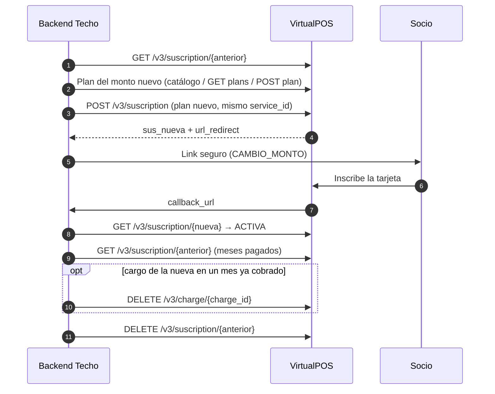

# Flujo: cambiar el monto del aporte (adaptador VirtualPOS)

**Objetivo:** cambiar el monto del aporte de un socio con el modelo `MONTO_FIJO`: suscripción **nueva** al plan fijo del monto nuevo, sin dejar al socio sin suscripción y sin cobrar dos veces el mismo mes.
**Recursos:** Plan · Suscription · Charge · **Postman:** carpeta `04 · Cambiar monto`
**Relacionados:** [capa común cambiar-monto](../../../../Transversal/docs/transversal/workflows/cambiar-monto.md) · [gestionar-suscripcion-monto-fijo.md](gestionar-suscripcion-monto-fijo.md) · [alta-socio.md](alta-socio.md) · [link-inscripcion.md](link-inscripcion.md)

## 1. Por qué una suscripción nueva

| Opción | ¿Sirve con `MONTO_FIJO`? | Respaldo oficial |
| --- | --- | --- |
| Editar la suscripción (monto, `plan_id`, `charge_program`) | ❌ No existe el endpoint | Endpoints de Suscription: crear, recuperar, cancelar, listar y `changecard` |
| Cancelar los cargos futuros (`DELETE /v3/charges/{id}`) y crear cargos nuevos (`POST /v3/charge`) con otro monto | ❌ `POST /v3/charge` exige plan `MONTO_VARIABLE` | Error oficial `E-113`: "El plan id $plan_id no es de tipo MONTO_VARIABLE" |
| **Suscripción nueva al plan fijo del monto nuevo** | ✅ | Crear Suscription + Cancelar Suscription |

El camino de cancelar cargos y crear otros quedaría disponible solo si el proyecto pasara a planes `MONTO_VARIABLE`. Se descartó el 2026-10-12: se mantiene `MONTO_FIJO`.

## 2. Flujo

Mejora respecto de [gestionar-suscripcion-monto-fijo.md § 3](gestionar-suscripcion-monto-fijo.md#3-cambiar-el-monto-frecuencia-o-día-de-cobro): **primero se crea la nueva y recién cuando está activa se cancela la anterior.** Si el socio no inscribe la tarjeta, sigue aportando el monto anterior.

```text
PASO 1 · Suscripción actual                       GET /v3/suscription/{sus_anterior}
↓  status == ACTIVA · guardar plan_id, amount, service_id y client (email, RUT, nombre, teléfono)
↓
PASO 2 · Plan fijo del monto nuevo                 vpos_plans_catalog → GET /v3/plans (paginado) → POST /v3/plan
↓  Mismo patrón que alta-socio.md pasos 3-4 (misma frecuencia y día de cobro)
↓
PASO 3 · Crear la suscripción nueva                POST /v3/suscription
↓  plan_id nuevo · mismo service_id · datos del socio desde NUESTRA base (no de la copia en la suscripción)
↓  → sus_nueva + url_redirect · guardar en suscripcion_cambios (PENDIENTE_REINSCRIPCION)
↓
PASO 4 · Link seguro al socio                      caso CAMBIO_MONTO → url_redirect de sus_nueva
↓
PASO 5 · Nueva activa                              callback_url / return_url → GET /v3/suscription/{sus_nueva} → ACTIVA
↓  SUSCRIPCION_FALLIDA / FINALIZADA → el cambio falla; la anterior sigue ACTIVA (nada que deshacer)
↓
PASO 6 · Un solo cobro por mes                     GET /v3/suscription/{sus_anterior} + GET /v3/suscription/{sus_nueva}
↓  Meses cubiertos por la anterior = charge_program con status pagado o procesando
↓  Para cada cargo PENDIENTE de la nueva en uno de esos meses → DELETE /v3/charge/{charge_id}
↓
PASO 7 · Cancelar la anterior                      DELETE /v3/suscription/{sus_anterior}
↓  Sus cargos pendientes quedan cancelados
↓
RESULTADO: sus_nueva ACTIVA con el monto nuevo desde la próxima cuota no cobrada; sus_anterior CANCELADA
```



### Ejemplo de la regla del paso 6

Día de cobro 5. El socio pide el cambio el 10 de octubre y termina la inscripción el 12.

| Suscripción | Oct | Nov | Dic |
| --- | --- | --- | --- |
| Anterior ($5.000) | `pagado` el 5 | `pendiente` → **cancelado** por el paso 7 | `pendiente` → **cancelado** |
| Nueva ($8.000) | Si VirtualPOS programa un cargo en octubre → **cancelado** por el paso 6 | `pendiente` ✅ | `pendiente` ✅ |

Resultado: octubre se cobra una vez ($5.000) y desde noviembre se cobran $8.000.

## 3. Endpoints

| Paso | Método | Endpoint | Datos clave |
| --- | --- | --- | --- |
| 1, 6 | `GET` | `/v3/suscription/{suscription_id}` | `status`, `plan_id`, `service_id`, `client`, `charge_program[]` |
| 2 | `GET` / `POST` | `/v3/plans` · `/v3/plan` | Plan `MONTO_FIJO` del monto nuevo |
| 3 | `POST` | `/v3/suscription` | `plan_id`, RUT **sin** guion, `service_id`, URLs en Base64 |
| 6 | `DELETE` | `/v3/charge/{charge_id}` | Solo cargos `pendiente` |
| 7 | `DELETE` | `/v3/suscription/{suscription_id}` | Baja de la anterior |

## 4. Implementación (Node, referencia)

```js
const mes = (d) => String(d).slice(0, 7);                               // "2026-10"

async function cambiarMontoVpos(susId, montoNuevo, cambio) {
  const { suscription: s } = await vpos.get(`/v3/suscription/${susId}`);
  if (s.status !== 'ACTIVA') throw new NoAplica(s.status);
  const planId = await getOrCreatePlan(montoNuevo);                      // alta-socio.md
  const socio = await db.socios.get(cambio.socio_id);                    // datos de NUESTRA base
  const r = await vpos.post('/v3/suscription', {
    email: socio.email, social_id: socio.rut.replace('-', ''), first_name: socio.nombre, last_name: socio.apellido,
    phone_number: socio.telefono, plan_id: planId, service_id: s.service_id, channel: 'WEB',
    return_url: b64(process.env.VPOS_RETURN_URL), callback_url: b64(process.env.VPOS_CALLBACK_URL),
  });
  await db.suscripcionCambios.update(cambio.id, { estado: 'PENDIENTE_REINSCRIPCION', metodo: 'NUEVA_SUSCRIPCION',
    suscripcion_nueva_id: r.suscription.id, url_redirect: r.url_redirect, monto_anterior: Number(s.amount) });
  await links.emitir(cambio.socio_id, { canal: 'virtualpos', caso: 'CAMBIO_MONTO', referencia: cambio.id });
  return 'PENDIENTE_REINSCRIPCION';
}

// Lo llaman el callback_url y el job, cuando la nueva queda ACTIVA.
async function cerrarCambioVpos(cambio) {
  const { suscription: nueva } = await vpos.get(`/v3/suscription/${cambio.suscripcion_nueva_id}`);
  if (nueva.status !== 'ACTIVA') return nueva.status;
  const { suscription: ant } = await vpos.get(`/v3/suscription/${cambio.suscripcion_id}`);
  const cubiertos = new Set(ant.charge_program.filter(c => ['pagado', 'procesando'].includes(c.status)).map(c => mes(c.charge_date)));
  const cancelados = [];
  for (const c of nueva.charge_program.filter(c => c.status === 'pendiente' && cubiertos.has(mes(c.charge_date)))) {
    const { charge } = await vpos.get(`/v3/charge/${c.id}`);             // reconfirmar justo antes
    if (charge.status === 'pendiente') { await vpos.delete(`/v3/charge/${c.id}`); cancelados.push(c.id); }
  }
  if (ant.status === 'ACTIVA') await vpos.delete(`/v3/suscription/${ant.id}`);
  await db.suscripcionCambios.update(cambio.id, { estado: 'APLICADO', aplicado_at: new Date(), cargos_cancelados: cancelados });
  return 'APLICADO';
}
```

## 5. Errores y casos borde

| Caso | Qué hacer |
| --- | --- |
| La anterior tiene un cargo `procesando` al cerrar | Su mes cuenta como cubierto (regla del paso 6); cancelar la anterior no afecta un cobro en curso (⚠️ validar en sandbox) |
| La anterior tiene un cargo `rechazado` con reintentos automáticos pendientes | VirtualPOS puede relanzar el cobro antes de que llegue el DELETE. El cargo `rechazado` pasa a `cancelado` al cancelar la suscripción, lo que en teoría detiene los reintentos automáticos. ⚠️ Validar en sandbox: si ya hay un reintento disparado, puede ejecutarse igualmente. |
| La nueva no se activa en 30 días (`FINALIZADA`) | El cambio falla; la anterior sigue `ACTIVA`. Ofrecer reintentar (suscripción nueva) |
| `E-083`/`E-084` al crear la nueva | RUT o datos mal formados: usar los de nuestra base, RUT **sin** guion |
| Dos suscripciones `ACTIVA` por más de 24 h | Alerta: el cierre no corrió (revisar el job) |
| `num_charges: 12` del plan nuevo | Mismo supuesto de membresía indefinida que el alta (renovación automática por validar) |

## 6. Probarlo en Postman

Carpeta **`04 · Cambiar monto`** de `VirtualPOS API v2.postman_collection.json` (sandbox), para **Run folder**:

| Request | Qué hace | Siguiente |
| --- | --- | --- |
| CM-1 Suscripción actual | Valida `ACTIVA` y guarda `plan_id`, monto, `service_id` y datos del socio | CM-1b |
| CM-1b Detalles del plan anterior | `GET /v3/plan/{cm_old_plan_id}` → guarda `cm_old_day` (día de cobro) y `cm_old_frequency` | CM-2 |
| CM-2 Buscar plan del monto nuevo | Recorre `/v3/plans` buscando `cm_monto` (mismo tipo, frecuencia y día) | Encontrado → CM-4 · No → CM-3 |
| CM-3 Crear plan del monto nuevo | `POST /v3/plan` | CM-4 |
| CM-4 Crear suscripción nueva | `POST /v3/suscription`; `url_redirect` en consola | CM-5 |
| CM-5 Confirmar suscripción nueva | `ACTIVA` → CM-6 · Otro → **FIN** (inscribe la tarjeta y reenvía) | |
| CM-6 Meses cubiertos por la anterior | Lee el `charge_program` de la anterior | CM-7 |
| CM-7 Cargos duplicados de la nueva | Arma la cola de cargos a cancelar | Hay cola → CM-8 · CM-9 |
| CM-8 Cancelar cargo duplicado | `DELETE /v3/charge/{id}`; recorre la cola | CM-8 · CM-9 |
| CM-9 Cancelar suscripción anterior | `DELETE /v3/suscription/{anterior}` | FIN |

**Variables de colección:** `suscription_id` (la anterior) y `cm_monto`. Los scripts llenan `cm_old_*`, `cm_plan_id`, `cm_plans_page`, `cm_new_suscription_id`, `cm_new_url`, `cm_covered_months`, `cm_dup_queue` y `cm_charge_id`.

**Paso manual:** tras CM-4, abre `url_redirect`, inscribe la VISA de prueba `4051 8856 0044 6623` (CVV 123) y envía **CM-5** a mano.
