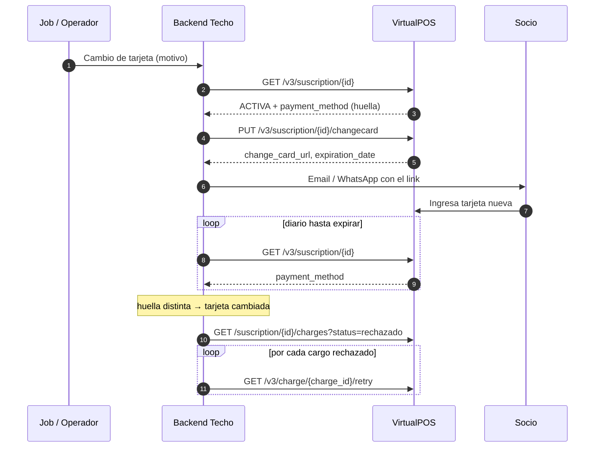

# Flujo: enviar un link de cambio de tarjeta

**Objetivo:** que el socio reemplace la tarjeta de su suscripción sin darse de baja, y recuperar los cobros rechazados una vez que la cambie.
**Recursos:** Suscription · Charge · **Postman:** carpeta `01 · Cambio de tarjeta`
**Relacionado:** [reintento-cobro-rechazado.md](reintento-cobro-rechazado.md)

> **Para enviar el link al socio**, usa el [link seguro de inscripción](../../../../Transversal/docs/transversal/workflows/link-seguro-inscripcion.md) con el [adaptador de VirtualPOS](link-inscripcion.md) (caso B): el `change_card_url` se genera al hacer clic, después de verificar al socio, en vez de enviarlo directamente en el PASO 4.

## 1. Cuándo se dispara

| Disparador | Origen |
| --- | --- |
| Cargo rechazado por **problema de tarjeta** (vencida, bloqueada, inválida…) | Flujo de [reintento](reintento-cobro-rechazado.md), decisión `CAMBIO_TARJETA` |
| Reintento agotado (rechazo definitivo) | Seguimiento del reintento |
| **Tarjeta por vencer** (proactivo) | Job mensual: `payment_method.expiration_date` dentro de los próximos 30–45 días |
| El socio lo pide | Portal, call center, bot |

## 2. Qué dice la doc oficial

- `PUT /v3/suscription/{suscription_id}/changecard` **sin body** devuelve `change_card_url` y `change_card_expiration_date`.
- **No documentado:** cuánto dura el link (solo viene la fecha `change_card_expiration_date`), **si VirtualPOS se lo envía al socio** (asume que no: lo envías tú), si existe un callback cuando se cambia la tarjeta, y qué pasa con los cargos rechazados después del cambio. No confirmado en la documentación oficial de VirtualPOS.
- La introducción menciona "gestión de cambio de tarjeta (ondemand / automático)", pero no explica el modo automático.
- `E-053`: "No se encontró información de la suscripción, para generar un link de cambio de tarjeta".

## 3. Flujo

```text
PASO 1 · Validar la suscripción                    GET /v3/suscription/{suscription_id}
↓  ├─ status ≠ ACTIVA → no enviar (CANCELADA / FINALIZADA: no corresponde)
↓  └─ ACTIVA → guardar la "huella" de la tarjeta actual:
↓       payment_method.bin + last4CardDigit + expiration_date + brand
↓
PASO 2 · ¿Ya hay un link vigente?  (TU tabla card_change_requests)
↓  ├─ Sí, vigente (no expiró y < 7 días) → reutilizarlo (no generar otro)
↓  └─ No → PASO 3
↓
PASO 3 · Generar el link                           PUT /v3/suscription/{suscription_id}/changecard
↓  Dato obtenido: change_card_url + change_card_expiration_date
↓  → GUARDAR en card_change_requests (motivo, url, expira, huella anterior)
↓
PASO 4 · Enviar el link al socio (TU canal: email / WhatsApp / SMS)
↓  Mensaje según el motivo: "tu tarjeta venció", "tu pago fue rechazado", "tu tarjeta vence pronto"
↓  Datos de contacto: los de TU base (más actualizados que suscription.client)
↓
PASO 5 · Detectar el cambio (no hay webhook documentado → polling)
↓  Diario hasta la fecha de expiración:  GET /v3/suscription/{suscription_id}
↓  Comparar la huella de payment_method con la del PASO 1
↓  ├─ Cambió → tarjeta actualizada ✅ → PASO 6
↓  └─ Sin cambio:
↓       recordatorio a los 3 y 6 días
↓       si el link expira → volver al PASO 3 (máx. 2 links nuevos) → luego gestión manual
↓
PASO 6 · Recuperar los cobros rechazados
↓  GET /v3/suscription/{suscription_id}/charges?status=rechazado
↓  ├─ Ninguno (o VirtualPOS ya los cobró) → fin
↓  └─ Por cada cargo rechazado: GET /v3/charge/{charge_id}/retry
↓       (con la tarjeta nueva, el motivo anterior ya no aplica)
↓       → seguimiento igual que en reintento-cobro-rechazado.md (PASO 5)
↓
RESULTADO: tarjeta nueva registrada y cobros pendientes reintentados
```



## 4. Endpoints

| Paso | Método | Endpoint | ID | Dato |
| --- | --- | --- | --- | --- |
| 1, 5 | `GET` | `/v3/suscription/{suscription_id}` | `suscription_id` | `status`, `payment_method` |
| 3 | `PUT` | `/v3/suscription/{suscription_id}/changecard` | `suscription_id` | `change_card_url`, `change_card_expiration_date` |
| 6 | `GET` | `/v3/suscription/{suscription_id}/charges?status=rechazado` | `suscription_id` | `charges[].id` |
| 6 | `GET` | `/v3/charge/{charge_id}/retry` | `charge_id` | `message` |

**Respuesta de `changecard` (extracto):**

```json
{
  "status": "OK",
  "code": 200,
  "change_card_url": "https://pat.virtualpos.cl/card-change/3a4d77f2e4",
  "change_card_expiration_date": "2023-10-01",
  "suscription": {
    "status": "ACTIVA",
    "id": "3a4d77f2e4",
    "payment_method": { "bin": "405188", "issuer": "Banco de Chile", "last4CardDigit": "6623", "brand": "VISA", "expiration_date": "12/27" }
  }
}
```

## 5. Implementación backend (referencia)

```js
const huella = (pm) => [pm?.bin, pm?.last4CardDigit, pm?.expiration_date, pm?.brand].join('|');

async function solicitarCambioTarjeta(susId, { motivo }) {
  const { suscription: s } = await vpos.get(`/v3/suscription/${susId}`);
  if (s.status !== 'ACTIVA') return { skipped: s.status };

  const vigente = await db.cardChanges.findVigente(susId);              // no expirado, < 7 días
  if (vigente) return vigente;

  const r = await vpos.put(`/v3/suscription/${susId}/changecard`);
  const req = await db.cardChanges.insert({
    suscription_id: susId, motivo, url: r.change_card_url,
    expires_on: r.change_card_expiration_date, huella_anterior: huella(s.payment_method), status: 'ENVIADO',
  });
  await notificar.socio(s.service_id, plantillaCambioTarjeta(motivo, r.change_card_url));
  return req;
}

// Job diario
async function verificarCambios() {
  for (const req of await db.cardChanges.pendientes()) {
    const { suscription: s } = await vpos.get(`/v3/suscription/${req.suscription_id}`);
    if (huella(s.payment_method) !== req.huella_anterior) {
      await db.cardChanges.update(req.id, { status: 'COMPLETADO', completed_at: new Date() });
      const { charges = [] } = await vpos.get(`/v3/suscription/${s.id}/charges`, { status: 'rechazado', limit: 100 });
      for (const c of charges) await reintento.forzar(c.id, 'tarjeta cambiada');   // registra y llama /retry una vez
    } else if (hoy() > req.expires_on) {
      await db.cardChanges.update(req.id, { status: 'EXPIRADO' });
      if (await db.cardChanges.count(req.suscription_id) < 3) await solicitarCambioTarjeta(s.id, { motivo: req.motivo });
      else await alertas.gestionManual(s.id);
    }
  }
}
```

## 6. Qué guardar

`card_change_requests(id, suscription_id, motivo, url, expires_on, huella_anterior, sent_at, channel, reminders, status [ENVIADO|COMPLETADO|EXPIRADO|CANCELADO], completed_at)`

## 7. Consideraciones

| Tema | Detalle |
| --- | --- |
| Seguridad del link | Es personal: envíalo solo al contacto verificado del socio y no lo registres en logs públicos |
| Datos de contacto | `suscription.client` puede estar desactualizado (ver editar-socio.md). Usa los de tu base |
| `E-053` | La suscripción no existe o no permite cambio → revisar estado |
| Sin webhook | La detección depende del polling diario; si el socio cambia la tarjeta el día del cobro, el cargo puede salir rechazado antes de que lo detectes → el PASO 6 lo recupera |
| ¿VirtualPOS reintenta solo tras el cambio? | No documentado. Por eso el PASO 6 **consulta primero** el estado de los cargos antes de llamar a `/retry` |
| Proactivo por vencimiento | `expiration_date` viene como `MM/AA` → parsear y comparar con hoy + 45 días |
