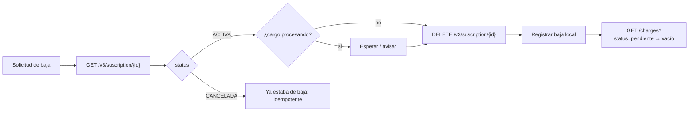

# Flujo: cancelar una suscripción (baja de socio)

**Objetivo:** detener los cobros de un socio de forma segura y trazable.
**Recursos:** Suscription, Charge · **Archivos:** [subscriptions.md](../subscriptions.md), [charges.md](../charges.md)

## Opciones

| Opción | Endpoint | Efecto | Reversible |
| --- | --- | --- | --- |
| **A. Baja definitiva** | `DELETE /v3/suscription/{suscription_id}` | Suscripción `CANCELADA` + cargos pendientes `cancelado` | ❌ No (estado final). Para volver, nueva suscripción e inscribir tarjeta de nuevo |
| B. Cancelar todos los cargos futuros | `DELETE /v3/charges/{suscription_id}` | Cancela todos los cargos pendientes; la suscripción sigue `ACTIVA` | ❌ En `MONTO_FIJO`, no se pueden recrear cargos |
| C. Saltar un cobro | `DELETE /v3/charge/{charge_id}` | Solo ese cargo | ✅ |

**Modelo de este proyecto:** solo `MONTO_FIJO`. Para "quiero dejar de ser socio" usa **A**. Para "pausa por 2 meses" usa **C** sobre cada cargo pendiente de los meses afectados. No uses **B** como pausa: dejaría cancelado todo el calendario restante y la API no permite reconstruirlo en una suscripción fija. Ver [gestionar-suscripcion-monto-fijo.md](gestionar-suscripcion-monto-fijo.md).

## Pasos (opción A)

```text
Paso 1: GET /v3/suscription/{suscription_id}
↓  Verificar status = ACTIVA y ver cargos en procesando
↓  Si hay un cargo "procesando": esperar a que termine (o avisar que ese cobro puede salir)
↓
Paso 2: DELETE /v3/suscription/{suscription_id}
↓  Dato obtenido: status = CANCELADA, charge_program[].status = cancelado
↓
Paso 3: Guardar en tu BD: fecha de baja, motivo, quién la pidió (la API no recibe motivo)
↓
Paso 4: GET /v3/suscription/{suscription_id}/charges?status=pendiente
↓  Esperado: vacío (verificación)
↓
Resultado: socio dado de baja, sin cargos futuros
```



## Manejo de errores

| Error | Qué hacer |
| --- | --- |
| `E-050` | `suscription_id` mal formado |
| `E-052` | No existe → marcar en tu BD como inconsistente y revisar |
| Timeout en el DELETE | Volver al Paso 1: si ya está `CANCELADA`, éxito |

## Riesgos

- Cancelar la suscripción **no devuelve** cobros ya hechos. Una devolución requiere Payout o gestión manual (no hay endpoint de reembolso documentado).
- Dos suscripciones activas por el mismo socio (duplicado): la baja debe buscar **todas** las del `service_id`/RUT, no solo la que tienes guardada.

## Efecto sobre cobros y reintentos automáticos

Al ejecutar `DELETE /v3/suscription/{id}` VirtualPOS pasa todos los cargos `pendiente` a `cancelado`. Esto **debería** detener los reintentos automáticos del portal (hasta 3 intentos configurables):

| Estado del cargo al cancelar | Efecto esperado |
| --- | --- |
| `pendiente` | Pasa a `cancelado` → no se cobrará |
| `rechazado` en espera de reintento | Pasa a `cancelado` → el reintento ya no debería ejecutarse |
| `procesando` | En curso: **no se cancela**. El cobro puede completarse o rechazarse igualmente |
| `pagado` | Inmutable: el cobro ya ocurrió |

⚠️ Si hay un reintento ya disparado (proceso en vuelo) justo antes del DELETE, puede ejecutarse de todas formas. Validar este comportamiento en sandbox antes de confiar en él para casos críticos (ej. doble cobro). Ver también [cambiar-monto.md §5](cambiar-monto.md#5-errores-y-casos-borde).
