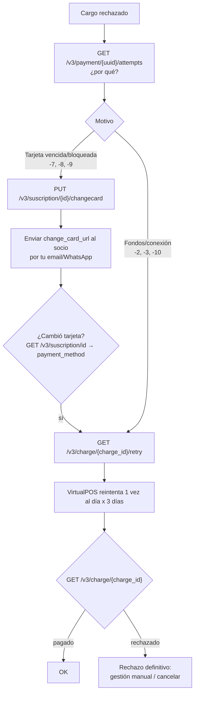

# Flujo: cobrar una suscripción (cargos, rechazos, cambio de tarjeta)

**Objetivo:** controlar los cobros recurrentes y recuperar los rechazados.
**Recursos:** Suscription → Charge → Payment · **Archivos:** [charges.md](../charges.md), [subscriptions.md](../subscriptions.md)

> **Seguimiento diario de cuotas y transacciones:** ver [seguimiento-cobros.md](seguimiento-cobros.md) (qué se obtiene de forma masiva, qué uno a uno y cómo cuadrar cuota ↔ transacción ↔ abono).
>
> **Alcance del proyecto:** las suscripciones operativas usan exclusivamente `MONTO_FIJO`. La sección de `MONTO_VARIABLE` se conserva solo como referencia de la API y no debe implementarse. Para pausar o cambiar una suscripción fija, ver [gestionar-suscripcion-monto-fijo.md](gestionar-suscripcion-monto-fijo.md).

## 1. ¿Quién genera los cargos?

| Tipo de plan | Cómo se generan los cargos |
| --- | --- |
| `MONTO_FIJO` | VirtualPOS los programa solo al activarse la suscripción (`charge_program`) |
| `PROGRAMA_DE_PAGOS` | Los envías en `charges_program` al crear la suscripción |
| `MONTO_VARIABLE` | Tú los creas con `POST /v3/charge` (fecha futura) o `POST /v3/charge/online` (inmediato) |

## 2. Referencia: flujo mensual para un plan de monto variable (fuera de alcance)

```text
Paso 1: Job mensual (día 1) — por cada socio activo
↓
Paso 2: POST /v3/charge
↓  Datos: suscription_id, charge_date (≥ hoy), amount, description,
↓         internal_code = <id_socio>-<YYYYMM>   ← idempotencia
↓  Dato obtenido: charge.id (pendiente)
↓  Si E-086 → el cargo de ese periodo ya existe: OK, sigue
↓
Paso 3 (día del cobro + 1): GET /v3/suscription/{suscription_id}/charges?status=...
↓  Dato usado: suscription_id
↓  Dato obtenido: status de cada cargo (pagado / rechazado / procesando)
↓
Paso 4: Para cada cargo pagado → GET /v3/charge/{charge_id}
↓  Dato obtenido: charge.payment.order.uuid (si viene) → enlazar con vpos_payments
↓
Resultado: cargos del mes conciliados
```

## 3. Flujo de recuperación de un cargo rechazado



| Paso | Método | Endpoint | ID usado |
| --- | --- | --- | --- |
| Diagnóstico | `GET` | `/v3/payment/{uuid}/attempts` | `uuid` del Payment del cargo (si lo tienes) |
| Link de cambio | `PUT` | `/v3/suscription/{suscription_id}/changecard` | `suscription_id` |
| Reintento | `GET` | `/v3/charge/{charge_id}/retry` | `charge_id` |
| Verificación | `GET` | `/v3/charge/{charge_id}` | `charge_id` |

> La doc menciona "gestión de reintentos de cobro (hasta 3, y configurable)" y "cambio de tarjeta automático". **No está documentado** si VirtualPOS reintenta solo sin llamar a *Reintentar*. Verifica en sandbox / con soporte antes de automatizar *retry* (podrías duplicar reintentos).

## 4. Otras operaciones

| Necesidad | Endpoint |
| --- | --- |
| Saltarse un mes | `DELETE /v3/charge/{charge_id}` (solo `pendiente`) |
| Cobro extra hoy | No disponible como Charge para `MONTO_FIJO`; evaluar un Payment spot separado. |
| Reprogramar todo | No disponible en `MONTO_FIJO`; cancelar y crear una nueva suscripción con el plan de destino. |

## 5. Manejo de errores

| Error | Qué hacer |
| --- | --- |
| `E-086` | Ya existe un cargo con ese `internal_code` → idempotente, no es fallo |
| `E-078` | `charge_date` en el pasado |
| `E-060` | La suscripción no está `ACTIVA` → no cobrar; sincronizar estado |
| `E-087` | Máximo de cargos mensuales → revisar si hay duplicados |
| `E-112`/`E-113` | Plan inactivo o no variable |
| `E-081` | El cargo no se puede reintentar (no está rechazado o ya se reintentó) |

## 6. Qué guardar

`vpos_charges(charge_id PK, suscription_id FK, internal_code UNIQUE, charge_date, amount, status, description, created_at, payment_uuid NULL, last_retry_at, raw_json, synced_at)`.

## 7. Riesgos

- **No hay webhook de cargos**: todo es polling. Ver [sync-virtualpos.md](sync-virtualpos.md).
- `Reintentar Charge` es un **GET que cambia estado**: nunca lo pongas en un reintento automático de red.
- Sin `internal_code`, un job que corre dos veces crea dos cargos → doble cobro.
