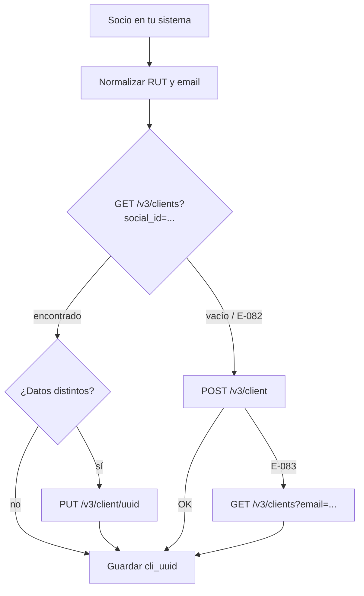

# Flujo: crear o encontrar un cliente (upsert)

**Objetivo:** tener un Client en VirtualPOS por cada socio/donante, sin duplicados.
**Recursos:** Client · **Archivos:** [clients.md](../clients.md)

## Por qué no basta con "crear"

`email` y `social_id` son únicos por comercio: crear dos veces da `E-083` ("Este cliente ya existe"). Y la API no documenta idempotencia. Por eso el patrón es **buscar → crear si no existe → actualizar si cambió**.

## Pasos

```text
Paso 1: Normalizar datos en tu sistema
↓  RUT → "12345678-9" (sin puntos, con guion, DV en mayúscula) · email → minúsculas
↓
Paso 2: GET /v3/clients?social_id=12345678-9
↓  Dato obtenido: clients[] (0 o 1)
↓
┌─ Si existe ───────────────────────────────┐   ┌─ Si no existe ────────────────────────┐
│ Paso 3a: comparar campos                  │   │ Paso 3b: POST /v3/client              │
│ ↓ si cambió algo                          │   │ ↓ Dato obtenido: client.uuid          │
│ PUT /v3/client/{uuid} (solo lo cambiado)  │   │ ↓ si E-083 (carrera/email repetido):  │
└───────────────────────────────────────────┘   │   volver al Paso 2 buscando por email │
                                                └───────────────────────────────────────┘
↓
Paso 4: Guardar client.uuid junto al socio en tu BD
↓
Resultado: socio ⇄ cli_xxx (1 a 1)
```



## Detalle

| Paso | Método | Endpoint | IDs necesarios | Resultado |
| --- | --- | --- | --- | --- |
| 2 | `GET` | `/v3/clients?social_id={rut}` | RUT | `clients[]` |
| 3a | `PUT` | `/v3/client/{uuid}` | `client.uuid` | Cliente actualizado |
| 3b | `POST` | `/v3/client` | — | `client.uuid` |
| 3b' | `GET` | `/v3/clients?email={email}` | email | Recuperar el que choca |

## Manejo de errores

| Error | Qué hacer |
| --- | --- |
| `E-082` en el listado | Significa "no hay clientes": continúa a crear |
| `E-083` | Ya existe por email o RUT → buscar por **ambos** y vincular. Si el RUT coincide pero el email no (o al revés), **no** pises datos: márcalo para revisión manual |
| `E-084` | RUT con formato inválido: corrige en origen |
| `E-102` / `E-103` | Nombre/apellido con números o símbolos: limpia (solo letras y espacios) |

## Qué guardar

`vpos_clients(client_uuid PK, social_id, email, type, status, created, updated, raw_json, synced_at)` + en tu tabla de socios la FK `vpos_client_uuid`.

## Riesgos y optimizaciones

- **Duplicado por carrera:** dos procesos crean el mismo socio a la vez → uno recibe `E-083`. El reintento por búsqueda lo resuelve. Mejor aún: un *lock* por RUT en tu backend.
- **El Client no se conecta a la suscripción** en la API: crear el Client no es requisito para suscribir (Crear Suscription pide email/RUT/nombre directamente). Úsalo como ficha maestra, no como dependencia.
- Para cargas masivas: primero baja todos los clientes (`GET /v3/clients` paginado) a un mapa `rut → uuid` en memoria y crea solo los que faltan.
