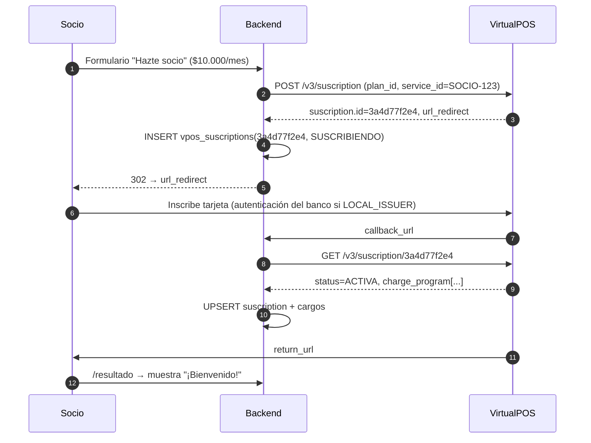

# Flujo: crear una suscripción (hazte socio)

**Objetivo:** inscribir a un socio en un plan mensual con su tarjeta tokenizada.
**Recursos:** Plan → Suscription → Charge · **Archivos:** [plans.md](../plans.md), [subscriptions.md](../subscriptions.md)

## Prerrequisitos

- Contrato **PAT** activo (si no, `E-046`).
- Plan creado y activo (una vez): `POST /v3/plan` → guardar `plan.id` en configuración.

## Pasos

```text
Paso 0 (una vez): POST /v3/plan  →  plan.id
↓
Paso 1: (opcional) Upsert del Client → ver create-client.md
↓
Paso 2: POST /v3/suscription
↓  Datos: email, social_id (sin puntos ni guion), first_name, last_name, phone_number,
↓         plan_id (paso 0), service_id = <id_socio>, channel = "WEB",
↓         return_url (Base64), callback_url (Base64), [charges_program Base64 si PROGRAMA_DE_PAGOS]
↓  Dato obtenido: suscription.id + url_redirect
↓  → GUARDAR suscription.id con estado SUSCRIBIENDO ANTES de redirigir
↓
Paso 3: Redirigir al socio a url_redirect (inscribe su tarjeta en VirtualPOS)
↓
Paso 4: VirtualPOS → callback_url (asíncrono) y → return_url (navegador)
↓  En ambos: GET /v3/suscription/{id}
↓  Dato obtenido: status (ACTIVA / SUSCRIPCION_FALLIDA), payment_method, charge_program[]
↓
Paso 5: Si ACTIVA → guardar charge_program[] como cargos programados
↓
Resultado: socio activo con calendario de cargos
```



## Detalle

| Paso | Método | Endpoint | IDs necesarios | Relación |
| --- | --- | --- | --- | --- |
| 0 | `POST` | `/v3/plan` | — | Plan 1—N Suscriptions |
| 2 | `POST` | `/v3/suscription` | `plan_id` | Suscription pertenece a Plan |
| 4 | `GET` | `/v3/suscription/{suscription_id}` | `suscription.id` | Trae `charge_program` y `client` |

## Manejo de errores

| Error / estado | Qué hacer |
| --- | --- |
| `E-044` / `E-047` | `plan_id` inválido o inexistente → revisar configuración |
| `E-046` | Sin contrato PAT → escalar a comercial |
| `E-048` / `E-049` | `charges_program` vacío o mal formado (¿Base64 del JSON?) |
| `E-084` | RUT mal formado (en este endpoint **sin puntos ni guion**) |
| `SUSCRIPCION_FALLIDA` | Ofrecer reintentar: crea una **nueva** suscripción (la fallida es estado final) |
| Sigue `SUSCRIBIENDO` | Polling a 15 min / 1 h / 24 h; a los 30 días pasa a `FINALIZADA` |

## Qué guardar

`vpos_suscriptions(suscription_id PK, plan_id, service_id, status, currency, amount, renewal, channel, card_brand, card_last4, card_exp, client_social_id, client_email, suscription_date, raw_json, synced_at)` y `vpos_charges` desde `charge_program[]`.

## Riesgos de duplicidad

- **No hay idempotencia documentada** para `POST /v3/suscription`. Un doble envío crea dos suscripciones (y, si ambas se completan, **doble cobro mensual**).
  - Antes de crear: busca en tu BD una suscripción del mismo `service_id` en `SUSCRIBIENDO` (< 30 min) o `ACTIVA` → reutiliza su `url_redirect` o bloquea.
  - Control periódico: `GET /v3/suscriptions?status=ACTIVA` y alerta si hay 2+ activas por el mismo `service_id`/RUT.
