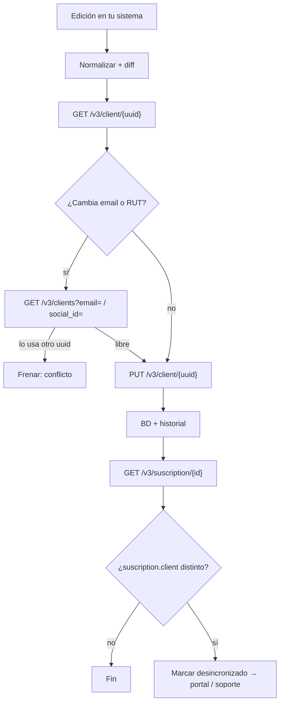

# Flujo: editar los datos de un socio (cliente y suscripción)

**Objetivo:** actualizar nombre, email, teléfono o RUT del socio sin crear duplicados, sabiendo qué se puede cambiar en VirtualPOS y qué no.
**Recursos:** Client · Suscription · **Postman:** carpeta `03 · Editar socio`
**Relacionado:** [capa común editar-socio](../../../../Transversal/docs/transversal/workflows/editar-socio.md) (origen backoffice/portal, verificación, auditoría y propagación a todos los canales). Este documento es el **adaptador de VirtualPOS**.

## 1. Idea clave

En VirtualPOS hay **dos copias** de los datos del socio y **no están vinculadas**:

```text
Client (cli_…)                     Suscription (3a4d77f2e4)
├─ first_name, last_name           └─ client: { email, first_name, last_name,
├─ email, phone_number                          social_id, phone, ... }
└─ social_id, ...                     ↑ copia propia, guardada al suscribir
        ✗ no hay vínculo por uuid ✗
```

Editar el Client **no** actualiza el `client` dentro de la suscripción. La doc no dice que se sincronicen (No confirmado en la documentación oficial de VirtualPOS). La carpeta de Postman incluye una prueba para comprobarlo.

## 2. Qué se puede editar

**Client** → `PUT /v3/client/{uuid}` (actualización parcial)

Las **"Reglas de actualización"** oficiales (revisadas el 2026-10-12) dicen: "Solo se actualizan los campos enviados en el body"; "No se pueden modificar: `uuid`, `created`"; "`updated` es gestionado automáticamente"; y "se aplican las mismas reglas de validación que en Crear un objeto Client para cualquier campo enviado: formato de email, unicidad de `email` y `social_id`, reglas condicionales de `last_name`". Es decir: **todo campo del Client es editable salvo `uuid`, `created` y `updated`**.

| Campo | ¿Editable? | Respaldo |
| --- | --- | --- |
| `email` | ✅ | Confirmado (reglas + ejemplo oficial). Único por comercio |
| `phone_number` | ✅ | Confirmado (reglas + ejemplo oficial) |
| `first_name`, `last_name` | ✅ | Confirmado por las reglas ("cualquier campo enviado"). `last_name` sigue siendo obligatorio si `type` es `PERSONA` |
| `social_id`, `social_id_type` | ✅ | Confirmado por las reglas. `social_id` único por comercio; con `social_id_type: 1` se valida el formato de RUT |
| `status` (`ACTIVO`/`BLOQUEADO`) | ✅ | Confirmado (ejemplo oficial) |
| `private_note` | ✅ | Confirmado (ejemplo oficial) |
| `birth_date`, `gender_id`, `type` | ✅ | Por las reglas. ⚠️ El schema del body está vacío: validar en sandbox (fuera del alcance de este flujo) |
| `uuid`, `created` | ❌ | Confirmado |
| `updated` | ❌ (automático) | Confirmado |

**Suscription** → **no existe un endpoint para editar datos.**

| Quieres cambiar… | Cómo |
| --- | --- |
| Nombre, email, teléfono o RUT dentro de la suscripción | ❌ No hay forma por API. Usar el portal de VirtualPOS o soporte, o crear una suscripción nueva |
| Tarjeta | ✅ [cambio-tarjeta.md](cambio-tarjeta.md) |
| Monto / plan | ❌ No se puede cambiar el `plan_id`. En el modelo `MONTO_FIJO`, cancelar y crear otra suscripción contra el plan de destino; el socio vuelve a ingresar la tarjeta. |
| Saltarse un cobro | ✅ `DELETE /v3/charge/{charge_id}` |
| Pausar los cobros | ✅ `DELETE /v3/charge/{charge_id}` (cargo por cargo; ver [gestionar-suscripcion-monto-fijo.md §2](gestionar-suscripcion-monto-fijo.md#2-pausar-cobros-por-x-meses)) |
| Dar de baja | ✅ [cancel-subscription.md](cancel-subscription.md) |

## 3. Flujo

```text
PASO 0 · Edición en TU sistema
↓  Normalizar (email en minúsculas, teléfono 569XXXXXXXX, RUT 12345678-9) y calcular el diff
↓
PASO 1 · Estado actual                      GET /v3/client/{uuid}
↓
PASO 2 · Si cambia email o RUT: ¿está libre?   (los cambios ya se guardaron y verificaron en TU base: ver la capa común)
↓  GET /v3/clients?email={nuevo}  /  GET /v3/clients?social_id={nuevo}
↓  ├─ Lo usa otro uuid → FRENAR (el PUT daría E-083) → revisión de duplicados
↓  └─ Libre → seguir
↓
PASO 3 · Actualizar                         PUT /v3/client/{uuid}   (solo los campos cambiados)
↓
PASO 4 · Guardar en TU base + historial (antes → después, quién, cuándo)
↓
PASO 5 · ¿Afecta a la suscripción?          GET /v3/suscription/{suscription_id}
↓  Comparar suscription.client con los datos nuevos
↓  ├─ Igual → fin
↓  └─ Distinto → marcar "desincronizado en VirtualPOS":
↓       email o teléfono → actualizar en el portal o pedirlo a soporte (probablemente se usan para comprobantes;
↓                          inferencia por los logs "Comprobante de pago cliente enviado a …")
↓       nombre → registrar y seguir
↓       RUT → revisión manual
↓
RESULTADO: Client actualizado + diferencia con la suscripción documentada
```



## 4. Request

```json
PUT /v3/client/cli_00183af742e91dc3
{ "email": "nuevo@mail.com", "phone_number": "56977777777" }
```

⚠️ El ejemplo oficial envuelve los campos en `{"client": {...}}`. Prueba ambas variantes en sandbox ([discrepancies.md](../discrepancies.md), C5).

## 5. Errores

| Error | Causa | Qué hacer |
| --- | --- | --- |
| `E-083` | El email o RUT nuevo pertenece a otro cliente | Revisar duplicados |
| `E-004` / `E-012` | Email inválido | Validar antes |
| `E-084` | RUT inválido | Normalizar |
| `E-102` / `E-103` | Nombre con números o símbolos | Dejar solo letras y espacios |

## 6. Corrección de RUT

El RUT solo se corrige desde el **backoffice**, con respaldo y aprobación (ver la [capa común](../../../../Transversal/docs/transversal/workflows/editar-socio.md#5-corrección-de-rut-impacto-por-canal)).

| Dónde | Qué pasa | Qué hacer |
| --- | --- | --- |
| Client | `PUT /v3/client/{uuid}` con `social_id` (con guion, `12345678-9`) | Antes: `GET /v3/clients?social_id={nuevo}`; si lo usa otro `uuid` → frenar (daría `E-083`) |
| Suscription | Conserva el RUT anterior en su copia (sin endpoint de edición) | Marcar `vpos_sus_desync`; corregir por el portal de VirtualPOS o soporte. Si no se puede: suscripción nueva (el socio vuelve a inscribir la tarjeta) |
| Búsquedas futuras | El flujo de alta busca el Client por RUT (`GET /v3/clients?social_id=`) | Con el Client corregido, una nueva alta lo encuentra por el RUT nuevo |

## 7. Probarlo en Postman

Carpeta **`03 · Editar socio`** (ampliada el 2026-10-12 a nombre y RUT), para **Run folder**:

| Request | Qué hace | Siguiente |
| --- | --- | --- |
| ES-1 Recuperar Client | Lee `client_uuid` y arma el body solo con lo que cambia (`edit_first_name`, `edit_last_name`, `edit_email`, `edit_phone`, `edit_social_id`) | Sin cambios → FIN · Cambia email o RUT → ES-2 · Otro → ES-3 |
| ES-2 Verificar email libre | ¿El email nuevo lo usa otro Client? (`GET /v3/clients?email=`) | Libre → ES-2b · Ocupado → **FIN** |
| ES-2b Verificar RUT libre | ¿El RUT nuevo lo usa otro Client? (`GET /v3/clients?social_id=`) | Libre → ES-3 · Ocupado → **FIN** |
| ES-3 Actualizar Client | `PUT` con `edit_body` | ES-4 si hay `suscription_id` · FIN |
| ES-4 Prueba de sincronización con la suscripción | ¿La copia de la suscripción cambió? | FIN |

**Variables de colección:** `client_uuid`, `suscription_id` (opcional) y los valores nuevos `edit_first_name`, `edit_last_name`, `edit_email`, `edit_phone`, `edit_social_id` (vacío = no cambia). Los scripts llenan `edit_body` y `edit_before`.

## 8. Recomendaciones

- **Tu base es la fuente de verdad** de los datos de contacto. VirtualPOS se actualiza hasta donde la API lo permite.
- Envía **solo el diff**.
- Tabla `socio_cambios` (auditoría) y columna `vpos_sus_desync` en tus suscripciones para tener una lista de pendientes en el portal.
- Para las notificaciones (links de pago, cambio de tarjeta) usa **tus** datos de contacto, no `suscription.client`.
