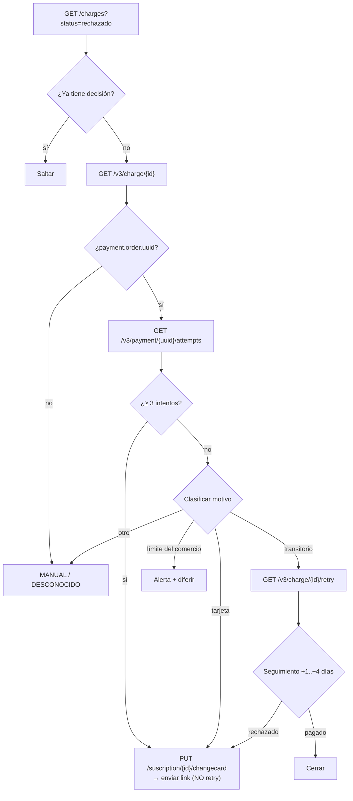

# Flujo: reintento de cobros rechazados (solo los que conviene reintentar)

**Objetivo:** ante un cargo de suscripción `rechazado`, obtener el **motivo**:
- si el problema es **la tarjeta** → **no reintentar** y enviar un **link de cambio de tarjeta** ([cambio-tarjeta.md](cambio-tarjeta.md));
- si es **transitorio** (conexión, fondos, error general) → **reintentar**;
- si es **antifraude, límites del comercio o un motivo desconocido** → revisión manual o reintento diferido.

**Recursos:** Charge → Payment (attempts) · **Postman:** carpeta `02 · Reintento de cobro rechazado`

## 1. ¿Dónde está el motivo del rechazo? (revisado en la doc oficial, 2026-10-12)

| Fuente | ¿Trae el motivo? | Detalle |
| --- | --- | --- |
| **Charge** (`GET /v3/charge/{id}`, `/charges`) | ❌ **No** | Solo `status: rechazado`. El Objeto Charge no tiene código ni mensaje de rechazo. Sí incluye `payment.order.uuid` (la transacción asociada) |
| **Payment** (`GET /v3/payment/{uuid}`) | ❌ No | Solo `order.status` |
| **Payment attempts** (`GET /v3/payment/{uuid}/attempts`) | ✅ **Sí** | `rejected_object.code` / `message` (catálogo [Objeto Rechazo](../errors.md#objeto-rechazo)) + `authorization_attempts_cards[]` con `response_code`, `response_description`, `response_message`, `acquirer`, `authorization_type` por cada intento |
| **Payment logs** (`GET /v3/payment/{uuid}/logs`) | 🟡 Texto libre | Útil para revisión manual, no para automatizar |

**Conclusión:** el motivo se obtiene de la **transacción**, no del cobro:

```text
Charge (rechazado) ──payment.order.uuid──> Payment ──/attempts──> rejected_object + intentos
```

Puntos sin confirmar (verificar en sandbox antes de automatizar):
- El ejemplo de *Recuperar Charge* **no** muestra el bloque `payment`; solo lo muestra el Objeto Charge. Hay que confirmar que un cargo **rechazado** trae `payment.order.uuid`. No confirmado en la documentación oficial de VirtualPOS.
- El ejemplo de `/attempts` es un pago `PAT` (pago automático con tarjeta), lo que indica que aplica a los cobros de suscripción (**inferencia**).
- `authorization_attempts_cards[].response_code` usa **códigos del adquirente** (ej. `-2122` Klap "Violación de seguridad") que **no están** en el catálogo de rechazos de VirtualPOS. Hay que mapearlos a medida que aparezcan.

## 2. Clasificación del motivo (**Recomendación**)

Prioridad: 1) `rejected_object.code` del catálogo oficial; 2) si no viene o no es concluyente, `response_description` del **último** intento (palabras clave); 3) si nada calza → `DESCONOCIDO`.

| Decisión | Códigos de rechazo VirtualPOS | Palabras clave del adquirente (heurística) | Acción |
| --- | --- | --- | --- |
| **CAMBIO_TARJETA** | `-1` número inválido · `-4` vencimiento inválido · `-5` autenticación del emisor · `-7` bloqueada · `-8` expirada · `-9` no soportada · `-11` superó el límite de rechazos de la marca · `-1013` extranjera no habilitada · `-1016` no habilitada | vencid, expirad, bloquead, inválid, invalid, robad, perdid, cancelad, no soportad, seguridad, restringid | **No reintentar** → [cambio-tarjeta.md](cambio-tarjeta.md) |
| **REINTENTAR** | `-2` error de conexión · `-10` problema general en la transacción · `-6` rechazo general (1 vez) · `-3` excede el monto máximo del emisor (1 vez, puede ser cupo) | fondos, saldo, cupo, conexi, timeout, temporal, intente, sistema no disponible | `GET /v3/charge/{id}/retry` |
| **DIFERIR + ALERTA** (límites del comercio) | `-1003` · `-1009` · `-1010` · `-1014` · `-1015` | — | No es culpa del socio: avisar a finanzas y reintentar al día siguiente |
| **MANUAL** | `-1011` cliente o dispositivo restringido · `-1002` el pago no está pendiente · códigos del checkout (`-1001`, `-1004`…`-1007`, `-1017`, `-1018`) | — | Revisión humana |
| **DESCONOCIDO** | Sin `payment.order.uuid`, sin intentos o código no mapeado | — | Revisión manual (conservador) y agregar el código al mapa |

¿Por qué no reintentar a ciegas?
- Reintentar una tarjeta **bloqueada, expirada o inválida** nunca va a funcionar: solo suma rechazos.
- Las marcas (Visa, Mastercard) **penalizan los reintentos sobre rechazos de tipo "no reintentar"**. El código `-11` ("superó el límite de rechazos establecidos por la marca") es exactamente eso. *(Regla general de la industria de pagos, no de la doc de VirtualPOS.)*
- `-6` y `-3` son ambiguos: se reintentan **una sola vez**. Si el reintento también falla, pasan a CAMBIO_TARJETA.

## 3. Flujo

```text
PASO 1 · Detectar cargos rechazados (job diario)
↓  Por cada suscripción ACTIVA:  GET /v3/suscription/{suscription_id}/charges?status=rechazado
↓  (o usar charge_program[] de GET /v3/suscriptions para ahorrar llamadas)
↓  Dato obtenido: charge.id[] rechazados
↓  Filtrar los que YA tienen decisión en tu tabla vpos_charge_retries (idempotencia)
↓
PASO 2 · Obtener la transacción del cargo          GET /v3/charge/{charge_id}
↓  Dato obtenido: charge.payment.order.uuid
↓  └─ Sin uuid → decisión DESCONOCIDO → revisión manual (y registrar)
↓
PASO 3 · Obtener el motivo                         GET /v3/payment/{uuid}/attempts
↓  Datos obtenidos: rejected_object.code/message
↓                   authorization_attempts_cards[] → último intento (created_at más reciente)
↓                   cantidad de intentos (si ya hay ≥ 3 → NO reintentar: ya agotó los reintentos)
↓
PASO 4 · Clasificar (tabla de la sección 2)
↓
├─ CAMBIO_TARJETA ─→ PUT /v3/suscription/{suscription_id}/changecard → enviar el link
│                    (1 link por suscripción aunque tenga varios cargos rechazados)
│                    → cuando cambie la tarjeta: reintentar los cargos rechazados (ver cambio-tarjeta.md)
│
├─ REINTENTAR ─────→ GET /v3/charge/{charge_id}/retry
│                    ├─ OK → VirtualPOS intenta 1 vez al día durante 3 días
│                    └─ E-081 → no cumple condiciones → MANUAL
│
├─ DIFERIR ────────→ alerta a finanzas + reprogramar la revisión para mañana
│
└─ MANUAL / DESCONOCIDO → cola de revisión (con logs: GET /v3/payment/{uuid}/logs)
↓
PASO 5 · Seguimiento (días +1 a +4 tras el retry)  GET /v3/charge/{charge_id}
↓  ├─ pagado → cerrar
↓  ├─ procesando / pendiente → esperar
↓  └─ rechazado (al día +4) → rechazo definitivo → CAMBIO_TARJETA (o MANUAL)
↓
RESULTADO: cada cargo rechazado tiene una decisión registrada y una sola acción
```



## 4. Endpoints y datos

| Paso | Método | Endpoint | ID usado | Dato que sale |
| --- | --- | --- | --- | --- |
| 1 | `GET` | `/v3/suscription/{suscription_id}/charges?status=rechazado` | `suscription_id` | `charges[].id` |
| 2 | `GET` | `/v3/charge/{charge_id}` | `charge_id` | `charge.payment.order.uuid` |
| 3 | `GET` | `/v3/payment/{uuid}/attempts` | `uuid` | `rejected_object`, `authorization_attempts_cards[]` |
| 4a | `GET` | `/v3/charge/{charge_id}/retry` | `charge_id` | `message` |
| 4b | `PUT` | `/v3/suscription/{suscription_id}/changecard` | `suscription_id` | `change_card_url` |
| 5 | `GET` | `/v3/charge/{charge_id}` | `charge_id` | `charge.status` |

**Respuesta de `/attempts` (extracto del ejemplo oficial):**

```json
{
  "payment": {
    "order": {
      "uuid": "1700570969d8093d",
      "status": "pagado",
      "payment_method": "PAT",
      "authorization_attempts_cards": [
        { "created_at": "2026-04-10 09:01:00", "response_code": "0", "acquirer": "transbank",
          "response_message": null, "response_description": "Operación exitosa", "authorization_type": "PAN" },
        { "created_at": "2026-04-09 16:18:15", "response_code": "-2122", "acquirer": "klap",
          "response_message": "VIOLACION DE SEGURIDAD", "response_description": "Violacion de seguridad", "authorization_type": "NETWORK_TOKEN" }
      ]
    }
  },
  "rejected_object": { "code": "0", "message": "Operación exitosa", "doc_url": "https://virtualpos.readme.io/reference/objeto-rechazo" }
}
```

> En este ejemplo el primer intento (klap, `-2122`) falló y el segundo (transbank) se aprobó. Esto muestra que VirtualPOS **ya reintenta por su cuenta** con otro adquirente o tipo de autorización. Por eso hay que mirar la cantidad de intentos antes de pedir otro reintento.

## 5. Implementación backend (referencia)

```js
const CARD   = new Set(['-1','-4','-5','-7','-8','-9','-11','-1013','-1016']);
const RETRY1 = new Set(['-2','-10']);          // transitorios
const RETRY_ONCE = new Set(['-6','-3']);       // ambiguos: 1 sola vez
const MERCHANT = new Set(['-1003','-1009','-1010','-1014','-1015']);
const KW_CARD  = /(vencid|expirad|bloquead|inv[aá]lid|robad|perdid|cancelad|no soportad|seguridad|restringid)/i;
const KW_RETRY = /(fondo|saldo|cupo|conexi|timeout|temporal|intente|no disponible)/i;

function classify(attempts, priorRetries) {
  const ro = attempts.rejected_object || {};
  const code = String(ro.code ?? ro.error_code ?? '');
  const list = attempts.payment?.order?.authorization_attempts_cards ?? [];
  const last = [...list].sort((a, b) => b.created_at.localeCompare(a.created_at))[0];
  const text = `${ro.message ?? ''} ${last?.response_description ?? ''} ${last?.response_message ?? ''}`;

  if (CARD.has(code)) return 'CAMBIO_TARJETA';
  if (MERCHANT.has(code)) return 'DIFERIR';
  if (RETRY1.has(code)) return priorRetries ? 'MANUAL' : 'REINTENTAR';               // transitorio que no se resolvió
  if (RETRY_ONCE.has(code)) return priorRetries ? 'CAMBIO_TARJETA' : 'REINTENTAR';   // ambiguo: 2.º rechazo → tarjeta
  if (KW_CARD.test(text)) return 'CAMBIO_TARJETA';            // códigos del adquirente
  if (KW_RETRY.test(text)) return priorRetries ? 'CAMBIO_TARJETA' : 'REINTENTAR';
  return 'DESCONOCIDO';
}

async function procesarRechazado(sus, charge) {
  if (await db.retries.exists(charge.id)) return;                    // idempotencia
  const ch = await vpos.get(`/v3/charge/${charge.id}`);
  const uuid = ch.charge?.payment?.order?.uuid;
  if (!uuid) return db.retries.insert({ charge_id: charge.id, decision: 'DESCONOCIDO', reason: 'sin payment uuid' });

  const at = await vpos.get(`/v3/payment/${uuid}/attempts`);
  const nAttempts = at.payment?.order?.authorization_attempts_cards?.length ?? 0;
  const prior = await db.retries.countRetries(charge.id);
  const decision = nAttempts >= 3 ? 'CAMBIO_TARJETA' : classify(at, prior);

  await db.retries.insert({ charge_id: charge.id, suscription_id: sus.id, payment_uuid: uuid, decision,
    reject_code: at.rejected_object?.code, reject_msg: at.rejected_object?.message, attempts: nAttempts });

  if (decision === 'REINTENTAR') await vpos.get(`/v3/charge/${charge.id}/retry`);    // GET que cambia estado: una sola vez
  if (decision === 'CAMBIO_TARJETA') await cambioTarjeta.solicitar(sus.id, { motivo: at.rejected_object?.message });
  if (decision === 'DIFERIR') await alertas.finanzas('Límite de comercio VirtualPOS', { charge: charge.id });
}
```

## 6. Qué guardar

`vpos_charge_retries(charge_id, suscription_id, payment_uuid, decision, reject_code, reject_msg, acquirer, response_code, attempts, retried_at, followup_status, decided_at)`: una fila por decisión. Te da idempotencia (no reintentar dos veces) y además las **estadísticas de rechazo** (qué códigos se repiten y cuánto se recupera con el reintento).

`vpos_reject_code_map(source, code, description, decision)`: tu mapa de códigos del adquirente (ej. `klap,-2122 → CAMBIO_TARJETA`). Se alimenta con los `DESCONOCIDO` revisados a mano.

## 7. Errores y riesgos

| Caso | Qué hacer |
| --- | --- |
| `E-081` en `/retry` | El cargo no cumple las condiciones (no está rechazado o ya se reintentó) → MANUAL |
| `E-056` / `E-057` | `charge_id` inválido o inexistente |
| `E-020` en `/attempts` | El `uuid` no existe → DESCONOCIDO |
| VirtualPOS ya reintenta solo ("hasta 3, configurable") | Revisa la configuración en el portal. Si los reintentos automáticos están activos, tu `/retry` puede **sumar** intentos. Regla: si ya hay ≥ 3 intentos → no reintentar |
| `/retry` es un `GET` que cambia estado | Nunca dentro de un retry HTTP automático. Registra la decisión **antes** de llamarlo |
| Varios cargos rechazados de la misma suscripción | Un solo link de cambio de tarjeta por suscripción |
| Socio con suscripción `CANCELADA` | No hacer nada (E-060 / E-053) |

> Cuando lo pruebes en sandbox, usa la MASTERCARD `5186 0595 5959 0568` (rechazada) para ver qué `rejected_object.code` devuelve VirtualPOS. Anota el resultado en [discrepancies.md](../discrepancies.md).
