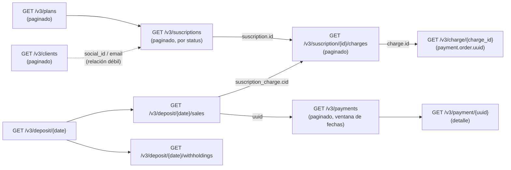

# Flujo: sincronizar VirtualPOS → base de datos central

**Objetivo:** tener en nuestra base todos los clientes, planes, suscripciones, cargos, pagos y abonos de VirtualPOS, actualizados y sin duplicados.
**Archivos relacionados:** todos los recursos · [pagination.md](../pagination.md) · [webhooks.md](../webhooks.md)

> Para una carga inicial o reconstrucción histórica de clientes, planes, suscripciones, cargos y Payments, seguir primero [exportar-objetos-completos.md](exportar-objetos-completos.md). Este flujo asume que esa base ya existe y define la actualización incremental.

## 1. Arquitectura

```text
VirtualPOS
    ↓  (HTTPS + JWT; polling + webhooks)
API client (capa delgada: firma, timeouts, retries, paginación)
    ↓
STAGING / RAW   → raw_vpos_*  (JSON tal cual llegó + fetched_at + endpoint + hash)
    ↓
NORMALIZACIÓN   → tipos ("" → null, "6990" → 6990), nombres (renewal/automatic_renewal), RUT, fechas
    ↓
BASE DE DATOS CENTRAL → vpos_* (upsert por ID natural) → vistas de negocio (socios, donaciones)
```

**Recomendación:** separa siempre RAW de normalizado. VirtualPOS tiene campos inconsistentes y no documentados; si guardas el crudo puedes re-normalizar sin volver a llamar a la API.

## 2. Qué se puede obtener y cómo se relaciona



| Relación | Cómo se une | Confirmado |
| --- | --- | --- |
| Plan → Suscription | `suscription.plan_id = plan.id` | ✅ |
| Suscription → Charge | `charges.suscription_id` / `charge_program[].id` | ✅ |
| Charge → Payment | `charge.payment.order.uuid` (en el objeto Charge) | ✅ objeto; ⚠️ el ejemplo de *Recuperar Charge* no lo trae |
| Payment → Charge | `deposit sales[].suscription_charge.cid` | ✅ (solo para pagos abonados) |
| Payment → Abono | `deposit sales[].uuid` y `order.deposits[].payout_date` | ✅ |
| Client → Suscription / Payment | `social_id` / `email` | ⚠️ No hay `client_uuid` — relación débil |
| Socio Techo → Suscription | `service_id` (lo envías tú) | ✅ (si lo envías siempre) |
| Donación Techo → Payment | `merchant_internal_code` (lo envías tú) | ✅ (si lo envías siempre) |

## 3. Orden de sincronización (job completo)

```text
Paso 1: Planes
↓  GET /v3/plans?limit=100&page=N      → upsert vpos_plans (por plan.id)
↓
Paso 2: Suscripciones
↓  GET /v3/suscriptions?status=ACTIVA&limit=100&page=N   (diario)
↓  GET /v3/suscriptions?status=<resto>&limit=100&page=N  (semanal)
↓  → upsert vpos_suscriptions (por suscription.id)
↓  → upsert vpos_charges desde charge_program[] (por charge.id)   ← ahorra llamadas
↓
Paso 3: Cargos (detalle)
↓  Para suscripciones ACTIVAS con cargos en ventana [hoy-35d, hoy+1d]:
↓  GET /v3/suscription/{id}/charges?limit=100&page=N
↓  → upsert vpos_charges (agrega created_at, estado al día)
↓
Paso 4: Pagos (incremental)
↓  GET /v3/payments?created_from=D-2&created_to=D&limit=100&page=N
↓  GET /v3/payments?authorization_from=D-2&authorization_to=D&limit=100&page=N
↓  → upsert vpos_payments (por order.uuid)
↓
Paso 5: Abonos (conciliación, D-1)
↓  GET /v3/deposit/{D-1}          (E-110 = sin abono, normal)
↓  GET /v3/deposit/{D-1}/sales    → vpos_deposit_lines (tipo=sale); enlaza payment_uuid ↔ charge_id
↓  GET /v3/deposit/{D-1}/withholdings → vpos_deposit_lines (tipo=withholding)
↓
Paso 6: Clientes
↓  Diario: GET /v3/clients?created_from=D-2&limit=100&page=N  (nuevos)
↓  Semanal: barrido completo (no hay filtro por "updated")
↓
Paso 7: Vistas de negocio
   socio ⇄ suscripción (service_id / RUT) · donación ⇄ payment (merchant_internal_code)
```

**Por qué en este orden:** de lo más estable (planes) a lo más volátil (pagos), y los abonos al final porque cierran el círculo (Payment ↔ Charge) con datos ya cargados.

## 4. Estrategia incremental por recurso

| Recurso | ¿Filtro incremental? | Estrategia | Frecuencia sugerida |
| --- | --- | --- | --- |
| Plans | No | Full (son pocos) | Diario |
| Suscriptions | Solo `status` | Full por estado; detectar cambios por **hash** del JSON | ACTIVA diario; resto semanal |
| Charges | Solo `status` (+ quizás `charge_date_from/to`, no documentado) | Por suscripción activa; desde `charge_program` para ahorrar | Diario, día después de cada fecha de cobro |
| Payments | `created_from/to`, `authorization_from/to` | Ventana móvil con **solape** (D-2…D) | Cada hora / diario + webhook |
| Deposits | Por fecha | Día anterior + re-chequeo D-7 (abonos `NOT VERIFIED`) | Diario |
| Clients | `created_from/to` | Nuevos diario + full semanal | Diario/semanal |

**Solape de ventanas:** consulta siempre un poco hacia atrás (ej. 2 días). Los pagos pueden autorizarse después de creados y los estados cambian (`reintentando` → `pagado`). El `upsert` por ID hace inofensivo el solape.

Guarda un **checkpoint** por recurso (`sync_state(resource, last_success_at, last_window_to)`) y avanza solo si el job terminó completo.

## 5. Tablas sugeridas (central)

```sql
-- RAW (staging)
CREATE TABLE raw_vpos (
  id            BIGSERIAL PRIMARY KEY,
  resource      TEXT NOT NULL,          -- plan | suscription | charge | payment | deposit | client
  external_id   TEXT,                   -- id/uuid del recurso
  endpoint      TEXT NOT NULL,
  payload       JSONB NOT NULL,
  payload_hash  TEXT NOT NULL,
  fetched_at    TIMESTAMPTZ NOT NULL DEFAULT now()
);

-- Normalizado
CREATE TABLE vpos_plans        (plan_id TEXT PRIMARY KEY, name TEXT, type TEXT, currency TEXT, amount NUMERIC,
                                frequency_type TEXT, num_charges INT, day_charge TEXT, is_active BOOLEAN,
                                created_at TIMESTAMP, synced_at TIMESTAMPTZ);
CREATE TABLE vpos_suscriptions (suscription_id TEXT PRIMARY KEY, plan_id TEXT REFERENCES vpos_plans,
                                service_id TEXT, status TEXT, currency TEXT, amount NUMERIC, renewal BOOLEAN,
                                channel TEXT, client_social_id TEXT, client_email TEXT,
                                card_brand TEXT, card_last4 TEXT, card_exp TEXT,
                                suscription_date TIMESTAMP, payload_hash TEXT, synced_at TIMESTAMPTZ);
CREATE TABLE vpos_charges      (charge_id TEXT PRIMARY KEY, suscription_id TEXT REFERENCES vpos_suscriptions,
                                internal_code TEXT, charge_date DATE, amount NUMERIC, status TEXT,
                                description TEXT, payment_uuid TEXT, created_at TIMESTAMP, synced_at TIMESTAMPTZ);
CREATE TABLE vpos_payments     (payment_uuid TEXT PRIMARY KEY, merchant_internal_code TEXT, status TEXT,
                                amount INT, payment_type_code TEXT, auth_code TEXT, authorized_at TIMESTAMP,
                                installment_number INT, installment_amount INT, card_last4 TEXT,
                                client_social_id TEXT, client_email TEXT, created_at TIMESTAMP, synced_at TIMESTAMPTZ);
CREATE TABLE vpos_deposit_lines(deposit_date DATE, kind TEXT, payment_uuid TEXT, installment TEXT,
                                total_amount INT, commission_and_taxes INT, net_amount INT,
                                charge_id TEXT, suscription_id TEXT,
                                PRIMARY KEY (deposit_date, kind, payment_uuid, installment));
CREATE TABLE vpos_clients      (client_uuid TEXT PRIMARY KEY, social_id TEXT, email TEXT, type TEXT,
                                status TEXT, created TIMESTAMP, updated TIMESTAMP, synced_at TIMESTAMPTZ);
CREATE INDEX ON vpos_suscriptions (client_social_id);
CREATE INDEX ON vpos_payments (merchant_internal_code);
```

> Si el destino es **Google Sheets** (Control General de Socios): replica el mismo modelo con una hoja por tabla y la columna ID como llave de *upsert*; mantén la hoja RAW aparte. Ojo con el límite de ejecución de Apps Script (6 min): procesa por páginas y guarda el checkpoint en Script Properties.

## 6. Manejo de errores en el job

| Situación | Qué hacer |
| --- | --- |
| HTTP 5xx / timeout | Retry con backoff exponencial (1s, 2s, 4s… máx. 5) **solo en GET** |
| `E-041`, `E-066`, `E-079`, `E-082`, `E-110` | "Sin datos": registrar y continuar |
| `E-014`/`E-015` | Detener el job y alertar (credenciales) |
| `E-090`/`E-091` | Bug en tu paginación (`limit` > 100, `page` < 1) |
| Página vacía antes de `pages` | Terminar el recorrido y registrar una advertencia |
| JSON con tipos raros | Normalizar; si falla, guardar en RAW con `status=parse_error` y seguir |

## 7. Riesgos de duplicidad y consistencia

- **Upsert siempre por el ID de VirtualPOS**, nunca `INSERT` simple.
- Una suscripción aparece en dos páginas si cambia de estado mientras paginas por `status` → el upsert lo resuelve; un estado "perdido" se recupera en la siguiente corrida.
- El `amount` de `charge_program` viene como string → castear antes de sumar.
- Estados monotónicos: no sobrescribas `pagado` con un `pendiente` más viejo; compara `synced_at` / prioridad de estado.
- Cuotas: un pago en 3 cuotas aparece en 3 abonos → la PK de `vpos_deposit_lines` incluye `installment`.

## 8. Optimizaciones

- Usa `charge_program[]` de la suscripción para tener los cargos sin la llamada N+1; pide `/charges` solo para suscripciones con cargos en la ventana.
- Los **abonos** son la forma más barata de saber qué cargos se cobraron (traen `suscription_charge.cid`).
- Cachea planes en memoria durante el job.
- Detecta cambios por `payload_hash` y salta la normalización si no cambió.
- Paraleliza con cuidado (ej. 3 requests concurrentes) — no hay rate limit documentado.

## 9. Observabilidad

Por cada corrida registra: recurso, páginas recorridas, registros nuevos/actualizados/sin cambios, errores por `error_code`, duración. Alerta si: 0 registros cuando normalmente hay, error de firma, o diferencia entre `total_deposit` y la suma de `sales.net_amount − withholdings.net_amount − services.net_total`.
