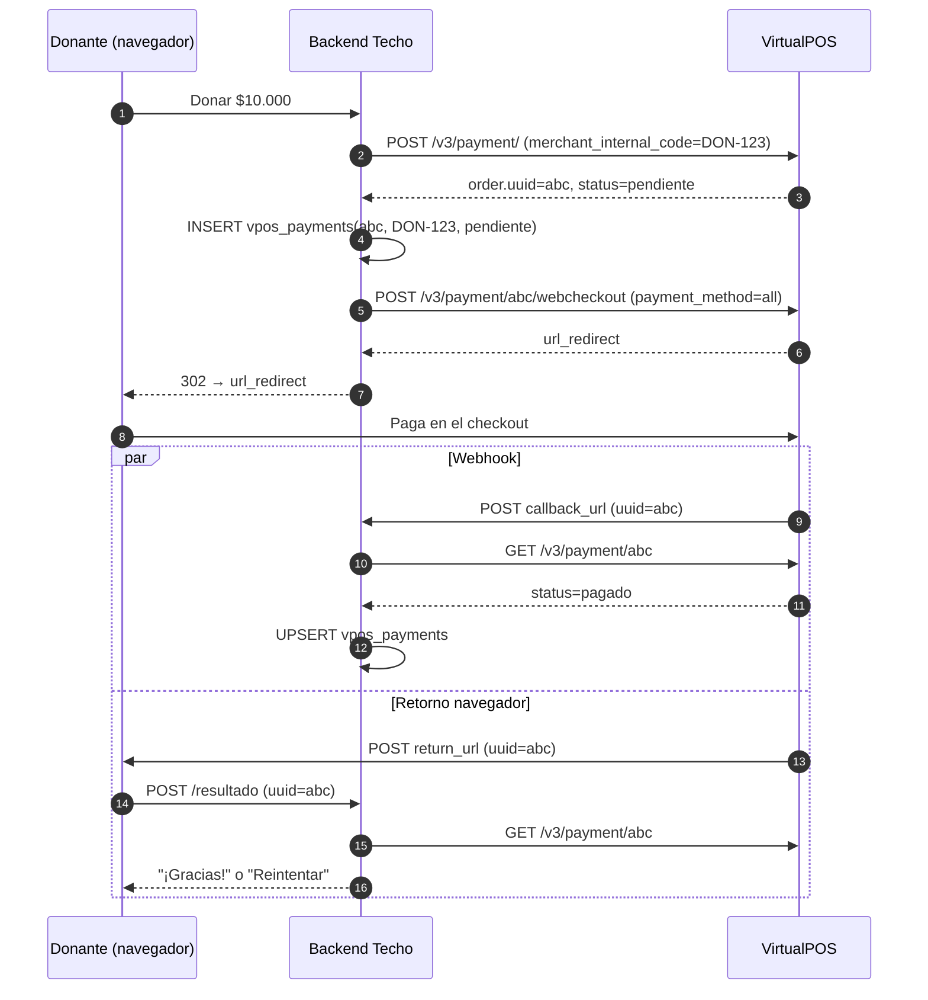

# Flujo: cobro único por Web Checkout

**Objetivo:** cobrar una donación spot redirigiendo al donante al checkout de VirtualPOS.
**Recursos:** Payment · **Archivos:** [payments.md](../payments.md), [webhooks.md](../webhooks.md)

## Pasos

```text
Paso 1: POST /v3/payment/
↓  Datos: amount, email, social_id, nombre, phone, description, merchant_internal_code = <id_donación>,
↓         return_url (Base64), callback_url (Base64), [rule_set_uuid]
↓  Dato obtenido: payment.order.uuid (status pendiente)
↓  → GUARDAR uuid + merchant_internal_code ANTES de seguir
↓
Paso 2: POST /v3/payment/{uuid}/webcheckout
↓  Dato usado: uuid del paso 1 · body: return_url, callback_url, payment_method="all"
↓  Dato obtenido: url_redirect
↓
Paso 3: Redirigir el navegador a url_redirect
↓
Paso 4a (asíncrono): VirtualPOS → POST callback_url {uuid}
Paso 4b (navegador): VirtualPOS → POST return_url {uuid}
↓  En ambos: GET /v3/payment/{uuid}
↓  Dato obtenido: order.status, auth_code, authorized_at, payment_type_code, deposits[]
↓
Resultado: donación pagada / rechazada en tu BD; pantalla de éxito o "reintentar"
```



## Manejo de errores y reintentos

| Situación | Qué hacer |
| --- | --- |
| Timeout en el Paso 1 | **No** reintentes a ciegas: `GET /v3/payments?merchant_internal_code=DON-123`; si existe, úsalo |
| `E-011` | Monto < 1000 |
| `E-022/E-023/E-025` | URL mal codificada (¿Base64 de verdad? ¿URL completa con https?) |
| `E-027` | Medio no contratado → usa `all` |
| Estado `rechazado` | Mostrar "reintentar": se reintenta **con el mismo `uuid`** (volver a pedir el link de Web Checkout) |
| Estado `reintentando` | No es final: espera el webhook siguiente o consulta más tarde |
| Nunca llega el webhook | Job cada 15 min: `pendiente` con > 15 min → `GET /v3/payment/{uuid}`; a los 30 días VirtualPOS lo deja `expirado` |
| Usuario cambia el monto | `DELETE /v3/payment/{uuid}` (solo si `pendiente`) y crear uno nuevo |

## Qué guardar (mínimo exigido por VirtualPOS: 1 año)

`uuid`, `merchant_internal_code`, `amount`, `status`, `authorized_at`, `auth_code`, `payment_type_code`, `installment_number`, `installment_amount`, `card_number` (últimos 4), `deposits[]` (comisión, neto, fecha de abono), `raw_json`, `updated_at`.

## Riesgos de duplicidad

- Doble clic en "Donar" → dos Payments. Mitiga con un *lock* por `merchant_internal_code` y reutilizando el Payment `pendiente` existente.
- Webhook + retorno + polling procesan el mismo `uuid` → `upsert` por `uuid` y transición de estado monotónica (no bajes de `pagado` a `pendiente` si llega una respuesta vieja).
