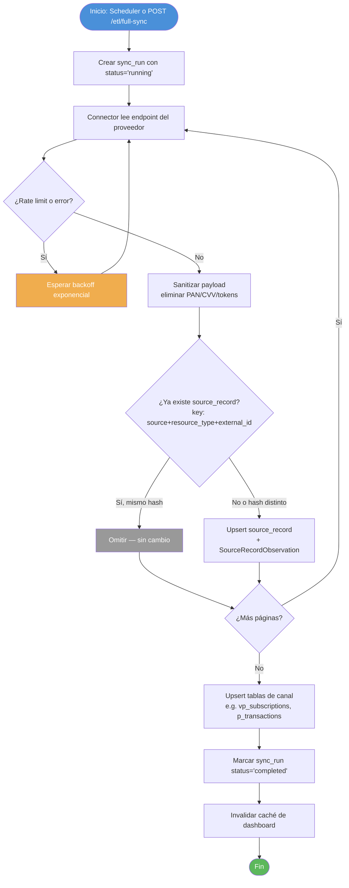
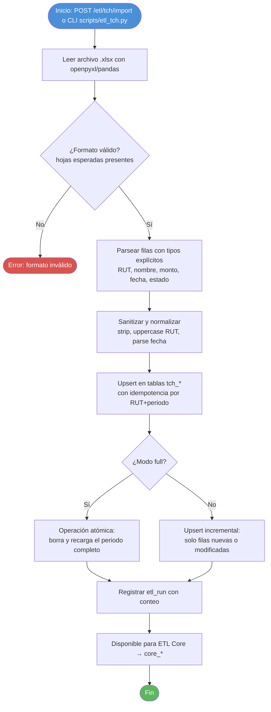
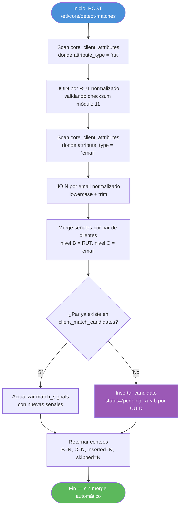

# BPMN Técnico — Flujos del Sistema

**Última actualización:** 2026-10-20
**Ítem cubierto:** 3 (diagrama BPMN — perspectiva técnica/sistema)

Cubre los 4 flujos internos principales del backend de SynkmetriX.
Para flujos desde la perspectiva del operador, ver [03-bpmn-operacional.md](./03-bpmn-operacional.md).

---

## Flujo 1 — Sincronización de datos de proveedor (API polling)

Aplica a VirtualPOS (2 cuentas), Toku y Payku. TCH usa el Flujo 4.



**Garantías:**
- Idempotente: re-ejecutar produce el mismo resultado.
- `sync_runs` registra cada ejecución con timestamps y conteo de registros.
- Datos de tarjeta eliminados en `payload_sanitization.py` antes de persistir.

---

## Flujo 2 — Recepción de webhook

Aplica a Toku (HMAC-SHA256), VirtualPOS (HMAC en payout), Payku (token en query).

```mermaid
flowchart TD
    A([Proveedor envía POST /api/v1/webhooks/{provider}/{kind}]) --> B{¿Autenticación válida?}
    B -->|No — 401| E1([Retornar 401 Unauthorized])
    B -->|No configurada — 503| E2([Retornar 503 Service Unavailable])
    B -->|Sí| C[Persistir en tabla stg_*_webhook_events\ncon payload JSONB + source_ip]
    C --> D[Retornar 200 OK inmediatamente]
    D --> F[BackgroundTask: invalidar caché]
    F --> Z([Fin])

    E1 -.->|Log intento fallido| LOG[(stg_*_webhook_events\nno registrado)]
    style A fill:#4A90D9,color:#fff
    style Z fill:#5CB85C,color:#fff
    style E1 fill:#D9534F,color:#fff
    style E2 fill:#F0AD4E,color:#fff
```

**Tablas de staging:**
- `stg_toku_webhook_events` — con `toku_event_id` para idempotencia
- `stg_vpos_webhook_events` — con `signature_verified` (Boolean)
- `stg_payku_webhook_events` — con `raw_body` + headers filtrados

**Nota:** Los webhooks se reciben y persisten; el procesamiento hacia Core queda pendiente (sprint futuro).

---

## Flujo 3 — ETL hacia entidades Core (Layer 3)

Aplica a los 4 proveedores. Transforma tablas de canal hacia `core_*`.

```mermaid
flowchart TD
    A([Inicio: POST /etl/core/{provider} o schedule]) --> B[Crear etl_run status='running']
    B --> C[Leer tablas de canal del proveedor\ne.g. vp_subscriptions, t_subscriptions]
    C --> D{¿Existe core_client\npara este external_id?}
    D -->|No| E[Crear core_client con UUID]
    D -->|Sí| F[Usar core_client existente]
    E & F --> G[Upsert ExternalIdentity\nsource + resource_type + external_id]
    G --> H[Upsert core_subscription\ncon source + external_id]
    H --> I[Upsert core_charges\nvínculo a core_subscription]
    I --> J[Upsert core_payments\nvínculo a core_charge o suscripción]
    J --> K[Upsert core_client_attributes\nRUT, email, teléfono por fuente]
    K --> L[Commit transacción]
    L --> M{¿Error?}
    M -->|Sí| N[Rollback + etl_run status='failed']
    M -->|No| O[etl_run status='completed'\n+ conteo de registros]
    N --> Z([Fin con error])
    O --> Z2([Fin exitoso])

    style A fill:#4A90D9,color:#fff
    style Z fill:#D9534F,color:#fff
    style Z2 fill:#5CB85C,color:#fff
```

**Garantía de idempotencia:** `UNIQUE(source, external_id)` en `core_subscriptions`, `core_charges`, `core_payments`. Re-ejecutar es seguro.

---

## Flujo 4 — Carga ETL desde Excel TCH



---

## Flujo 5 — Detección de match cross-canal (EPIC-C)



**ADR-001:** Ningún merge automático. Los candidatos en `client_match_candidates` requieren revisión manual.

---

*Documento generado como parte de la Fase 1 — Arquitectura base.*
