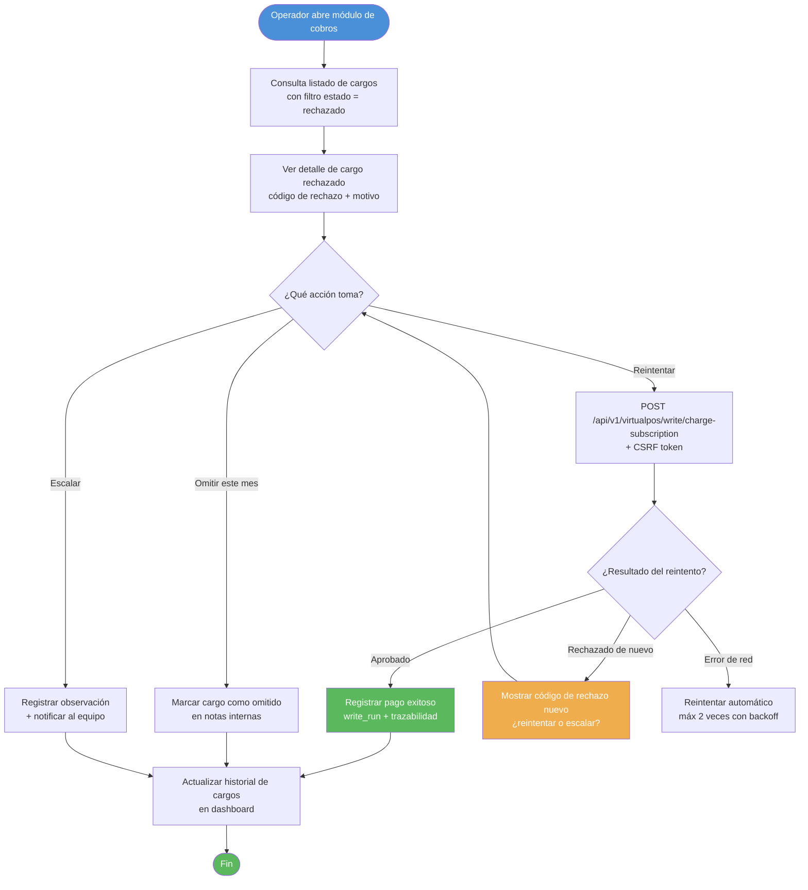
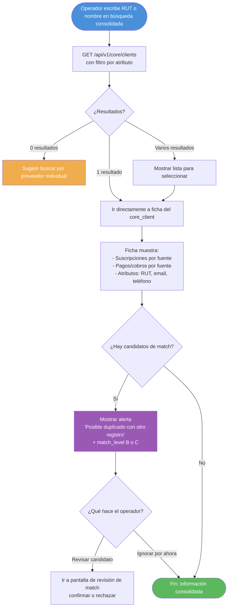
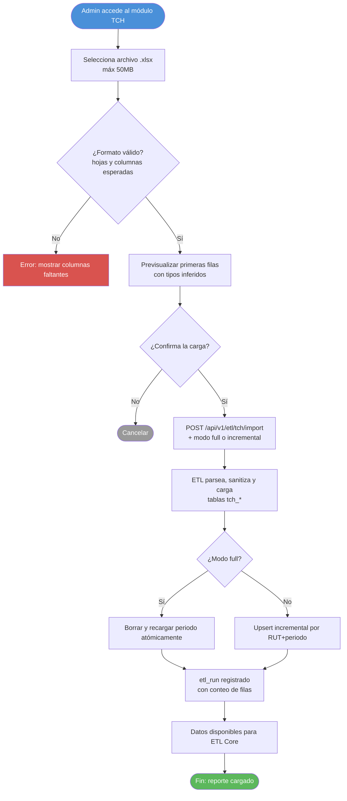

# BPMN Operacional — Flujos del Operador CRM

**Última actualización:** 2026-10-20
**Ítem cubierto:** 3 (diagrama BPMN — perspectiva operador/negocio)

Cubre los flujos que ejecuta el operador del CRM a través de la interfaz web.
Para flujos internos del sistema, ver [02-bpmn-tecnico.md](./02-bpmn-tecnico.md).

---

## Flujo 1 — Alta de socio en proveedor

El operador registra un nuevo socio en VirtualPOS, Toku o Payku directamente desde el CRM.

```mermaid
flowchart TD
    A([Operador accede a módulo del proveedor]) --> B[Busca socio existente\npor RUT o email]
    B --> C{¿Existe en el sistema?}
    C -->|Sí — ya registrado| E1([Informar al operador\nno duplicar])
    C -->|No| D[Completar formulario de alta\nnombre, RUT, email, plan, monto]
    D --> F{¿Datos válidos?\nRUT con DV correcto, email bien formado}
    F -->|No| G[Mostrar errores de validación]
    G --> D
    F -->|Sí| H[POST /api/v1/{provider}/write/create-customer\ncon CSRF token]
    H --> I{¿Respuesta del proveedor?}
    I -->|Error de proveedor| J[Mostrar error con detalle\n+ write_run registrado como failed]
    I -->|Éxito| K[Crear suscripción en proveedor\nPOST /api/v1/{provider}/write/create-subscription]
    K --> L{¿WRITES_ENABLED = true?}
    L -->|No — modo lectura| M[Simular sin ejecutar\nretornar preview]
    L -->|Sí| N[Ejecutar alta real en proveedor]
    N --> O[Registrar write_run\ncon trazabilidad completa]
    O --> P[Marcar para sincronización\nen próximo ciclo]
    P --> Z([Fin: socio dado de alta])

    style A fill:#4A90D9,color:#fff
    style Z fill:#5CB85C,color:#fff
    style E1 fill:#F0AD4E,color:#fff
    style J fill:#D9534F,color:#fff
    style M fill:#999,color:#fff
```

---

## Flujo 2 — Seguimiento de cobros y reintento de rechazados

El operador revisa cobros rechazados y decide si reintenta el cargo.



---

## Flujo 3 — Cambio de monto de suscripción

El operador modifica el monto de un socio activo en el proveedor.

```mermaid
flowchart TD
    A([Operador busca socio en el CRM]) --> B[Accede a ficha de suscripción]
    B --> C[Solicita cambio de monto\nFormulario con nuevo valor CLP]
    C --> D{¿Monto válido?\nEntero positivo, dentro de límites del proveedor}
    D -->|No| E[Error de validación]
    E --> C
    D -->|Sí| F[Mostrar confirmación\n'Cambiar de $X a $Y para RUT Z']
    F --> G{¿Confirma?}
    G -->|No| H([Cancelar])
    G -->|Sí| I[PUT /api/v1/{provider}/write/update-subscription\n+ CSRF token]
    I --> J{¿Respuesta del proveedor?}
    J -->|Error| K[Mostrar error + write_run failed]
    J -->|Éxito| L[write_run status='completed']
    L --> M[Programar sincronización\npara reflejar cambio en staging]
    M --> Z([Fin: monto actualizado])

    style A fill:#4A90D9,color:#fff
    style Z fill:#5CB85C,color:#fff
    style H fill:#999,color:#fff
    style K fill:#D9534F,color:#fff
```

---

## Flujo 4 — Sincronización manual desde el CRM

El operador fuerza una sincronización sin esperar el scheduler.

```mermaid
flowchart TD
    A([Operador accede al panel de sincronización]) --> B[Selecciona proveedor o 'Todos']
    B --> C[POST /api/v1/etl/full-sync\ncon lista de proveedores + CSRF]
    C --> D[Backend retorna run_id inmediatamente\nstatus='running']
    D --> E[UI muestra progreso en tiempo real\npolling GET /etl/runs/{run_id}]
    E --> F{¿Status?}
    F -->|running| E
    F -->|completed| G[Mostrar resumen\nregistros procesados por proveedor]
    F -->|failed| H[Mostrar error\n+ enlace a logs del run]
    G --> Z([Fin: datos actualizados])
    H --> I{¿Reintentar?}
    I -->|Sí| C
    I -->|No| Z2([Fin con error registrado])

    style A fill:#4A90D9,color:#fff
    style Z fill:#5CB85C,color:#fff
    style Z2 fill:#F0AD4E,color:#fff
    style H fill:#D9534F,color:#fff
```

---

## Flujo 5 — Consulta consolidada de socio cross-canal

El operador busca un socio y ve su información unificada de todos los proveedores.



---

## Flujo 6 — Carga de reporte TCH (Excel)

El administrador carga un nuevo reporte mensual de TCH al sistema.



---

*Documento generado como parte de la Fase 1 — Arquitectura base.*
