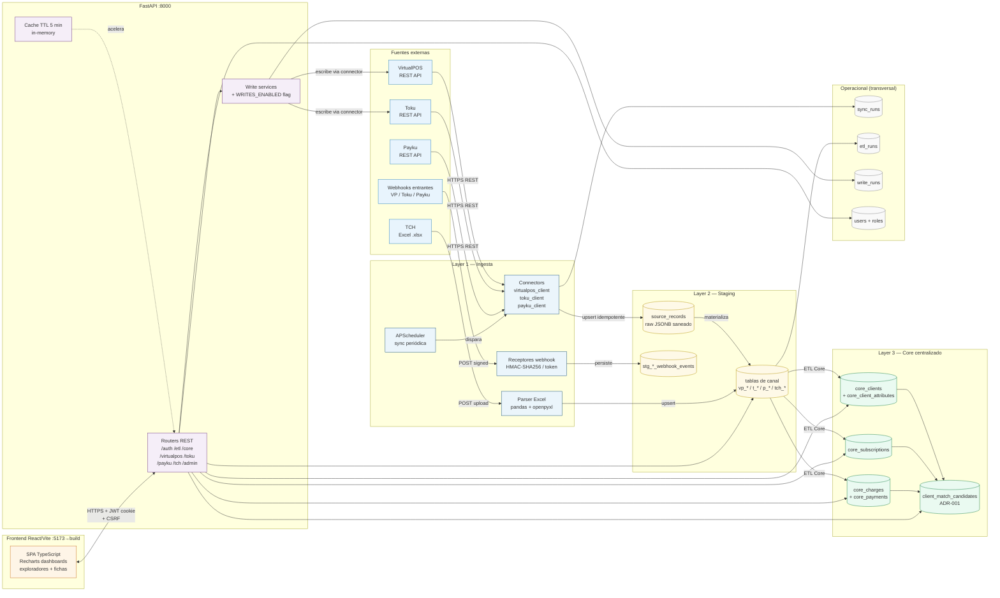
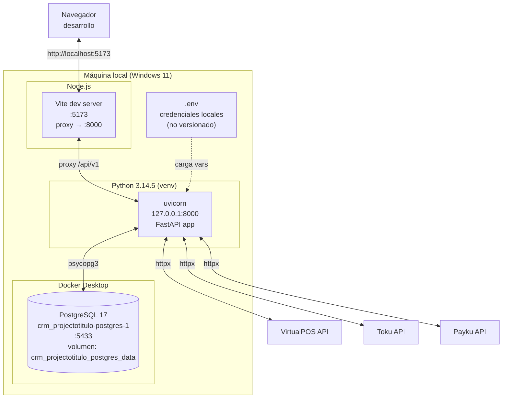
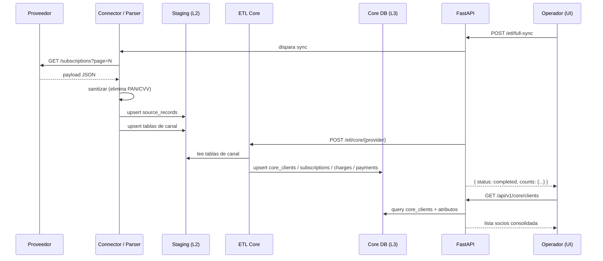

# Diagrama de Arquitectura — SynkmetriX

**Última actualización:** 2026-10-20
**Ítem cubierto:** 9 (diagrama de arquitectura formal — reemplaza el ASCII de overview.md)

---

## Arquitectura de capas (vista canónica)

---

## Arquitectura de despliegue (vista infraestructura — desarrollo local)

---

## Flujo de datos — resumen de capas

---

## Principios arquitectónicos activos

| Principio | Implementación |
|-----------|---------------|
| Separación de capas | Connectors → Staging → ETL → Core; ningún proveedor escribe en Core directamente |
| Idempotencia | Clave `(source, resource_type, external_id)` en `source_records`; re-sync es segura |
| Trazabilidad | `sync_runs`, `etl_runs`, `write_runs` registran toda operación con timestamps y conteo |
| Sin merge automático | `client_match_candidates` requiere revisión manual (ADR-001) |
| Writes controlados | Flag `*_WRITES_ENABLED` por proveedor; toda escritura externa queda en `write_runs` |
| PII mínima | PAN/CVV eliminados antes de staging; RUT/email tratados como atributos, no claves |

---

*Documento generado como parte de la Fase 1 — Arquitectura base.*
*Este diagrama reemplaza el ASCII de `docs/architecture/overview.md`.*
