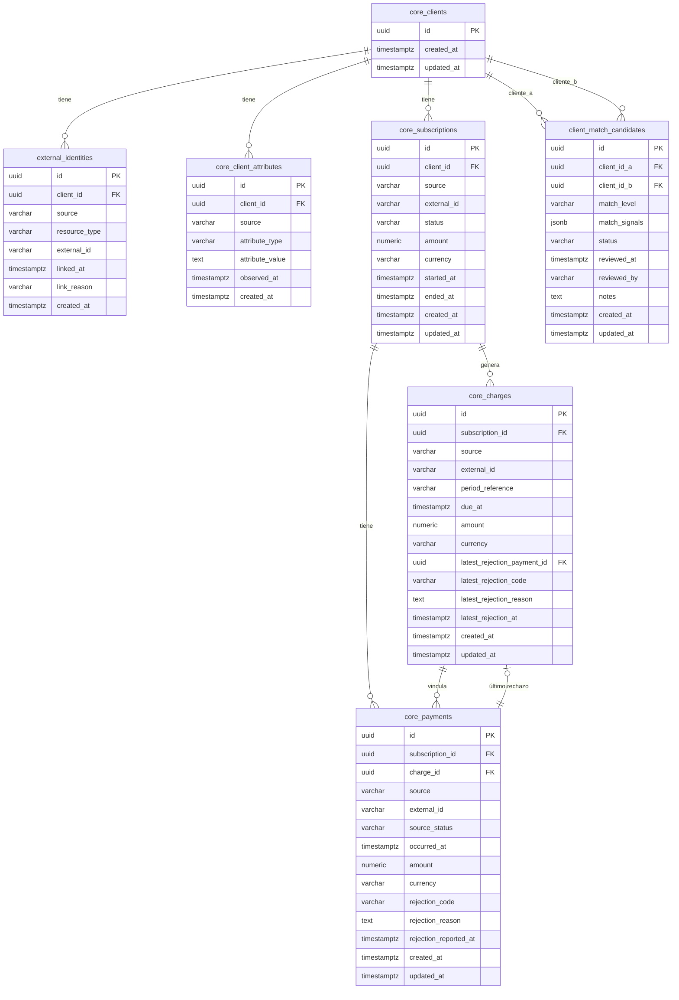
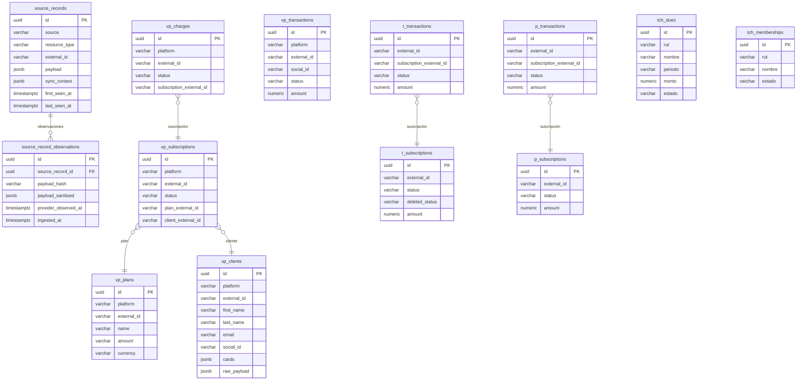
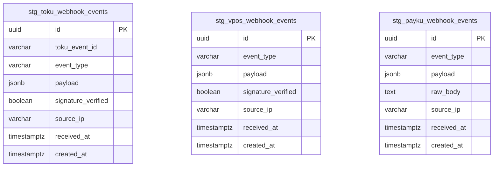
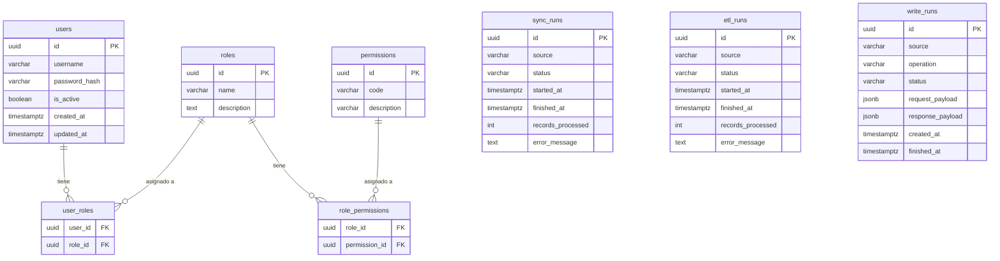

# Modelo de Datos — SynkmetriX

**Última actualización:** 2026-10-20
**Ítem cubierto:** 6 (modelo de datos — diagrama ER formal)

---

## Diagrama ER — Core Layer 3

Entidades centralizadas independientes de proveedor.

---

## Diagrama ER — Staging / Raw (por proveedor)

---

## Diagrama ER — Webhooks Staging

---

## Diagrama ER — Operacional (auth, runs)

---

## Invariantes y restricciones clave

| Tabla | Restricción | Propósito |
|-------|------------|-----------|
| `source_records` | UNIQUE `(source, resource_type, external_id)` | Idempotencia en ingesta |
| `external_identities` | UNIQUE `(source, resource_type, external_id)` | Una identidad externa por fuente |
| `core_subscriptions` | UNIQUE `(source, external_id)` | Idempotencia en ETL Core |
| `core_charges` | UNIQUE `(source, external_id)` | Idempotencia en ETL Core |
| `core_payments` | UNIQUE `(source, external_id)` | Idempotencia en ETL Core |
| `core_client_attributes` | UNIQUE `(source, attribute_type, attribute_value)` | Sin duplicados de atributos personales por fuente |
| `client_match_candidates` | UNIQUE `(client_id_a, client_id_b)` con `a < b` | Sin duplicados de pares; orden garantiza unicidad |
| `users` | UNIQUE `(username)` | Un usuario por nombre |
| `roles` | UNIQUE `(name)` | Un rol por nombre |
| `permissions` | UNIQUE `(code)` | Un permiso por código |

---

## Valores conocidos de campos clave

| Campo | Valores posibles | Fuente |
|-------|-----------------|--------|
| `source_records.source` | `virtualpos`, `toku`, `payku` | Connectors |
| `source_records.resource_type` | `subscription`, `charge`, `transaction`, `customer`, `plan` | Por proveedor |
| `core_client_attributes.attribute_type` | `rut`, `email`, `phone`, `name` | ETL Core |
| `client_match_candidates.match_level` | `B` (RUT), `C` (email) | ADR-001 |
| `client_match_candidates.status` | `pending`, `confirmed`, `rejected` | Revisión manual |
| `sync_runs.status` / `etl_runs.status` | `running`, `completed`, `failed` | Operacional |
| `write_runs.source` | `virtualpos`, `toku` | Write services |

---

*Documento generado como parte de la Fase 2 — Datos y comunicaciones.*
