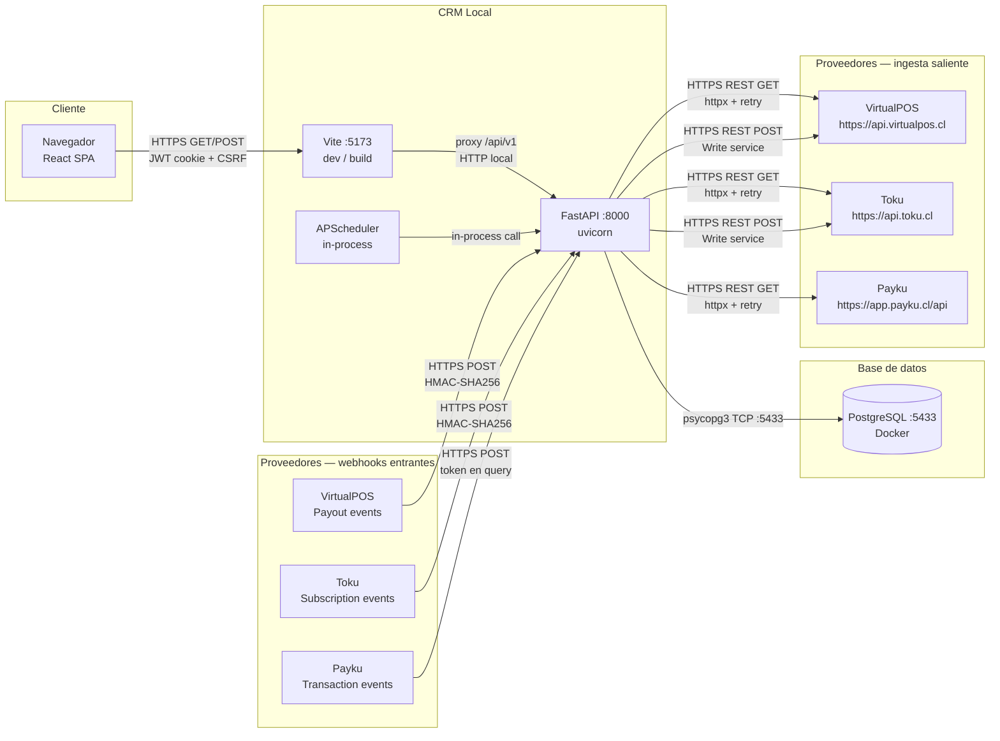
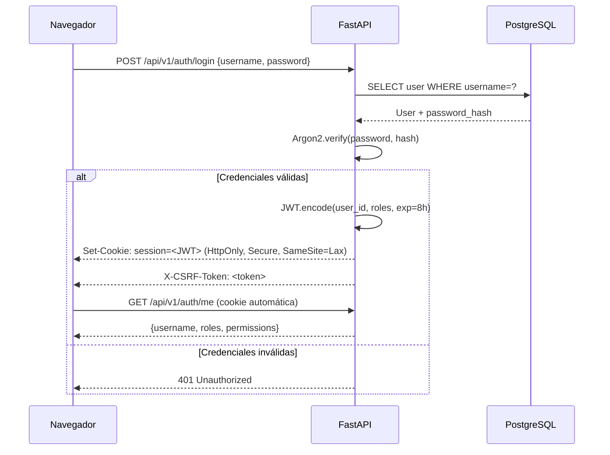
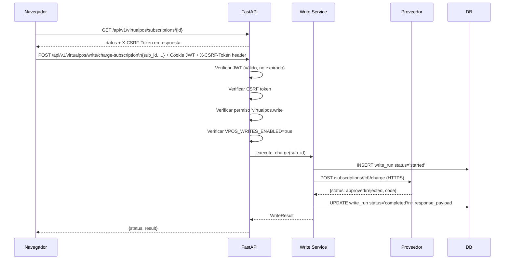
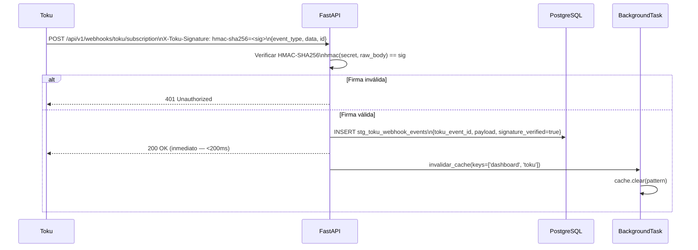

# Topología de Comunicaciones — SynkmetriX

**Última actualización:** 2026-10-20
**Ítem cubierto:** 7 (topología de comunicaciones)

---

## Mapa general de comunicaciones

---

## Tabla de canales de comunicación

| Canal | Protocolo | Dirección | Auth | Idempotencia |
|-------|-----------|-----------|------|--------------|
| Browser → Vite → API | HTTPS (dev: HTTP local) | Saliente del navegador | JWT HttpOnly + CSRF token | — |
| API → VirtualPOS (lectura) | HTTPS REST | Saliente | API Key en header | `(source, resource_type, external_id)` en `source_records` |
| API → Toku (lectura) | HTTPS REST | Saliente | API Key en header | `(source, resource_type, external_id)` en `source_records` |
| API → Payku (lectura) | HTTPS REST | Saliente | API Key Bearer | `(source, resource_type, external_id)` en `source_records` |
| API → VirtualPOS (escritura) | HTTPS REST | Saliente | API Key en header | `write_runs` + flag `VPOS_WRITES_ENABLED` |
| API → Toku (escritura) | HTTPS REST | Saliente | API Key en header | `write_runs` + flag `TOKU_WRITES_ENABLED` |
| VirtualPOS → API (webhook) | HTTPS POST | Entrante | HMAC-SHA256 sobre body | `stg_vpos_webhook_events.id` único |
| Toku → API (webhook) | HTTPS POST | Entrante | HMAC-SHA256 + `toku_event_id` | `stg_toku_webhook_events.toku_event_id` |
| Payku → API (webhook) | HTTPS POST | Entrante | Token en query param | `stg_payku_webhook_events.id` único |
| API → PostgreSQL | psycopg3 TCP | Saliente | usuario/password | Constraints UNIQUE en tablas |
| APScheduler → API | In-process Python | Interna | N/A | Idempotencia del conector |

---

## Diagrama de secuencia — autenticación del operador

---

## Diagrama de secuencia — write con CSRF

---

## Diagrama de secuencia — recepción de webhook Toku

---

## Puertos y endpoints expuestos

| Puerto | Servicio | Acceso | Notas |
|--------|---------|--------|-------|
| `:8000` | FastAPI (uvicorn) | `127.0.0.1` solamente | No expuesto públicamente en local |
| `:5173` | Vite dev server | `localhost` | Solo en desarrollo; en producción sirve build estático |
| `:5433` | PostgreSQL (Docker) | `localhost` | Interno; credenciales en `.env` |
| `443` (futuro) | HTTPS público | Internet | Requerido para activar webhooks en producción |

---

## Restricciones y notas de seguridad

- Las credenciales de proveedores (API Keys) se leen desde `.env` en runtime; nunca se almacenan en git ni se exponen en logs.
- El JWT viaja solo como cookie HttpOnly: el JavaScript del navegador no puede accederlo.
- El CSRF token se requiere en todas las mutaciones (POST/PUT/DELETE) para proteger contra ataques cross-site.
- Los webhooks verifican firma criptográfica antes de persistir; un webhook sin firma válida retorna 401 y no escribe nada.
- Las escrituras externas requieren `*_WRITES_ENABLED=true` en `.env` como segunda capa de control; por defecto están deshabilitadas.
- Los payloads de proveedores son sanitizados (se eliminan PAN/CVV/tokens de tarjeta) antes de persistir en `source_records`.

---

*Documento generado como parte de la Fase 2 — Datos y comunicaciones.*
