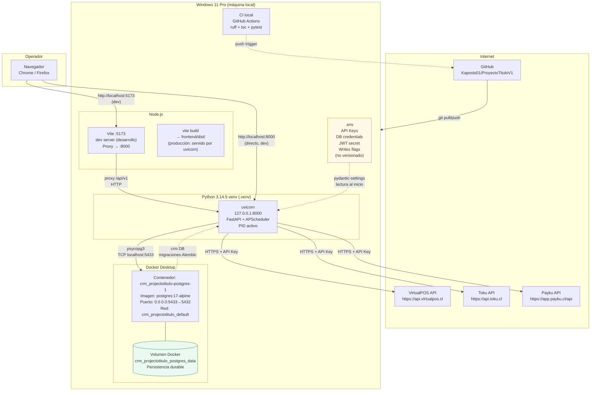
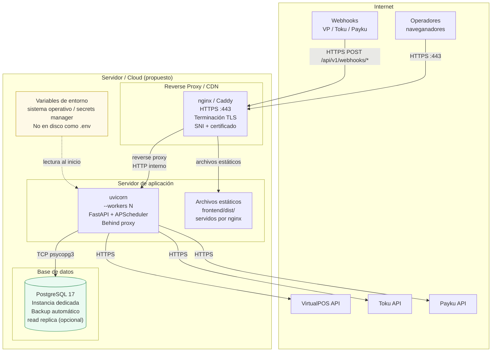
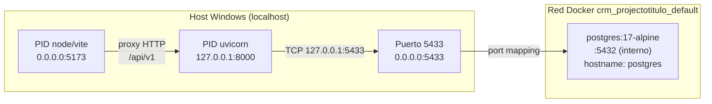
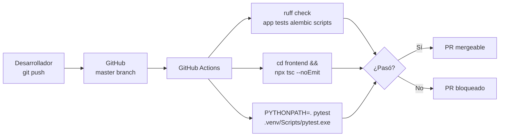

# Diagrama de Infraestructura — SynkmetriX

**Última actualización:** 2026-10-20
**Ítem cubierto:** 8 (diagrama de infraestructura)

---

## Infraestructura actual — desarrollo local (estado operativo)

---

## Infraestructura objetivo — producción (propuesta)

---

## Inventario de servicios y recursos

### Servicios activos (desarrollo local)

| Servicio | Tecnología | Host:Puerto | Estado |
|---------|-----------|-------------|--------|
| API Backend | FastAPI + uvicorn | `127.0.0.1:8000` | Activo |
| Frontend dev | Vite | `localhost:5173` | Activo (dev) |
| Base de datos | PostgreSQL 17 (Docker) | `localhost:5433` | Activo |

### Recursos de datos

| Recurso | Tipo | Ubicación | Contenido |
|---------|------|-----------|-----------|
| Base de datos principal | PostgreSQL | Docker volumen `crm_projectotitulo_postgres_data` | Todas las tablas del CRM |
| Migraciones | Alembic | `alembic/versions/` | 31 revisiones — head: `20261020_0031` |
| Código fuente | Git | `C:\Users\Usuario\Downloads\CRM_projectoTitulo` | Repositorio local + GitHub |
| Variables de entorno | Archivo `.env` | Raíz del proyecto | API Keys, secretos, flags |
| Dependencias Python | `requirements.lock` | Raíz | Bloqueadas en Python 3.14.5 |
| Dependencias Node | `frontend/package.json` | `frontend/` | React, Vite, TypeScript |

---

## Diagrama de red local — detalle Docker

---

## CI/CD actual

**Estado del CI:** ruff pasa limpio; `pytest` tiene 3 fallos pre-existentes no relacionados con el Core ETL (2 en Toku sync mock, 1 en Payku consolidación histórica). Pendiente de resolución.

---

## Gaps infraestructurales conocidos

| Gap | Impacto | Prioridad |
|-----|---------|-----------|
| Sin URL HTTPS pública | Webhooks de proveedores no se pueden activar en producción | Alta |
| Sin backup automatizado | Pérdida de datos ante fallo de disco en local | Alta |
| Sin servidor de producción definido | No hay entorno de producción separado del de desarrollo | Media |
| APScheduler in-process | Pérdida de trabajos si uvicorn se reinicia durante una sync | Media |
| Sin monitoreo de uptime | No hay alertas si el servicio cae | Media |
| Sin rate-limit en API pública | Riesgo de abuso si se expone | Baja (hoy solo en local) |

---

*Documento generado como parte de la Fase 2 — Datos y comunicaciones.*
