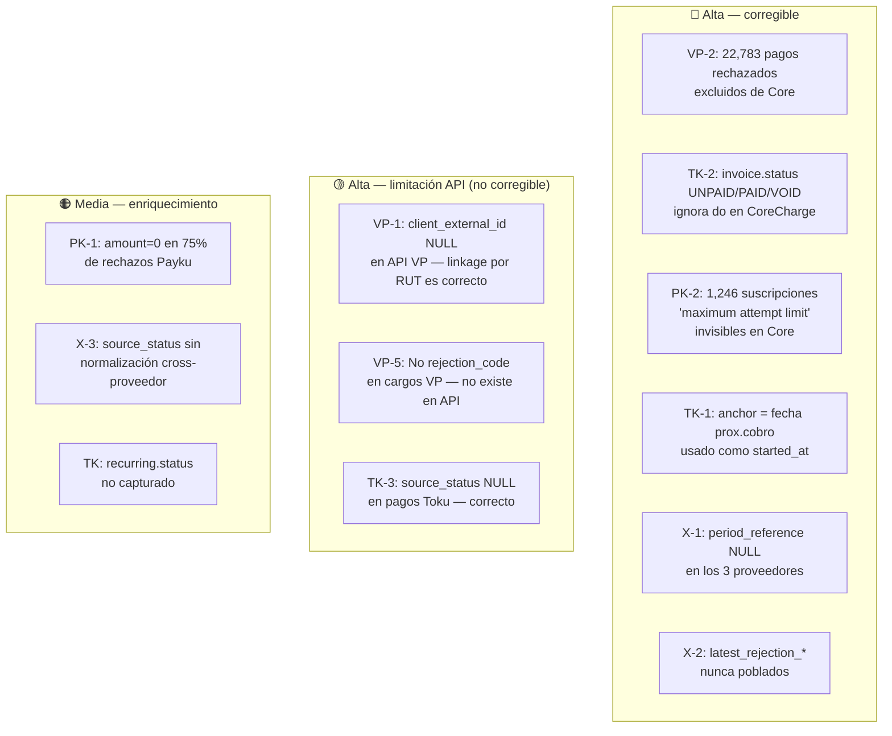

# Análisis de Contratos API — VirtualPOS · Toku · Payku

**Última actualización:** 2026-10-20
**Propósito:** Comparar qué ofrece cada API de proveedor contra lo que el CRM captura en staging y lo que llega al modelo Core. Todos los hallazgos están verificados contra la BD local (PostgreSQL `crm` en Docker).

Fuentes inspeccionadas: `source_records`, tablas `vp_*`, `tk_*`, `p_*`, `app/services/core_*_etl.py`, `app/models/vp.py`, `app/models/toku_channel.py`, `app/models/payku_channel.py`, `app/models/core.py`.

---

## 1. VirtualPOS

### 1.1 Volumen de datos

| Tabla | Registros |
|-------|-----------|
| `vp_subscriptions` | 8,999 |
| `vp_charges` | 235,746 |
| `vp_payments` | 71,011 |
| `vp_clients` | (capturado) |

### 1.2 Payload real de suscripción (source_records)

```json
{
  "id": "str",
  "amount": "int",
  "client": {
    "email": "str",
    "phone": "str",
    "gender": "str",
    "last_name": "str",
    "social_id": "str",
    "birth_date": "str",
    "first_name": "str"
  },
  "origin": "str",
  "status": "str",
  "address": {},
  "channel": null,
  "plan_id": "str",
  "renewal": "str",
  "currency": "str",
  "plan_name": "str",
  "seller_id": null,
  "service_id": null,
  "canceled_at": "str",
  "terminal_pos": {},
  "charge_program": [],
  "payment_method": null,
  "suscription_date": "str"
}
```

**Hallazgo VP-1:** El campo `client` en el payload de suscripción contiene `social_id` (RUT) pero **NO contiene `id` del cliente**. Todos los 8,999 source_records de suscripción confirman `client.id = 0` (absent), `client.social_id = 2,144` con RUT. La API de VirtualPOS genuinamente no expone el `client_id` externo en el objeto suscripción.

### 1.3 Payload real de pago (vp_payments)

```json
{
  "order": {
    "bank": {},
    "uuid": "str",
    "amount": "int",
    "status": "str",
    "deposits": [{ "tip_amount", "description", "installment", "payout_date", "payout_amount", "processing_fee", "processing_flat_fee" }],
    "created_at": "str(ISO)",
    "tip_amount": "int",
    "authorized_at": "str(ISO)",
    "payment_method": "str",
    "payment_type_code": "str",
    "installment_amount": "str",
    "installment_number": "str",
    "merchant_internal_code": "str",
    "merchant_internal_channel": "str"
  },
  "client": {
    "email": "str",
    "phone": "str",
    "last_name": "str",
    "social_id": "str",
    "first_name": "str"
  }
}
```

**Hallazgo VP-3:** El payload de pago VP no contiene ningún `charge_id` o referencia cruzada al cargo. El campo `charge_external_id` en `vp_payments` es NULL para los 71,011 registros. Esta es una limitación real de la API.

### 1.4 Payload real de cargo (vp_charges)

```json
{
  "id": "str",
  "amount": "int",
  "status": "str",
  "currency": "str",
  "charge_date": "str",
  "description": "str"
}
```

**Hallazgo VP-5:** El payload de cargo VP NO tiene campos de rejection_code ni rejection_reason. Solo tiene `status`. No es posible obtener códigos de rechazo de la API VP — la información no existe en la respuesta.

### 1.5 Distribución de status en vp_payments (verificado)

| Status | Count | ¿Llega a Core? |
|--------|-------|----------------|
| `pagado` | 48,228 | Sí |
| `rechazado` | 22,425 | **No — descartado** |
| `reintentando` | 306 | **No — descartado** |
| `anulado` | 33 | **No — descartado** |
| `expirado` | 17 | **No — descartado** |
| `pendiente` | 2 | **No — descartado** |

**Hallazgo VP-2:** 22,783 pagos (32.1% del total) son descartados por el ETL. Ningún pago rechazado, reintentado, anulado ni expirado llega a `core_payments`.

### 1.6 Distribución de status en vp_charges (verificado)

| Status | Count |
|--------|-------|
| `pendiente` | 124,264 |
| `pagado` | 48,255 |
| `cancelado` | 40,644 |
| `rechazado` | 22,274 |
| `procesando` | 309 |

---

## 2. Toku

### 2.1 Volumen de datos

| Tabla | Registros |
|-------|-----------|
| `tk_subscriptions` | 508 |
| `tk_invoices` | 6,363 |
| `tk_payments` | 2,377 |

### 2.2 Payload real de suscripción (source_records)

```json
{
  "id": "str",
  "amount": "float",
  "due_day": "int",
  "customer": "str (customer_id)",
  "metadata": {},
  "recurring": {
    "amount": "float",
    "anchor": "str (ISO date — fecha del próximo cobro)",
    "status": "str",
    "due_day": "int",
    "end_date": null,
    "interval": "int",
    "frequency": "str",
    "creation_lead_days": "int",
    "max_active_invoices": null
  },
  "id_account": "str",
  "product_id": "str",
  "is_recurring": "bool",
  "currency_code": "str",
  "pac_mandate_id": null,
  "receipt_product_code": null
}
```

**Hallazgo TK-1 verificado:** El campo `anchor` (que vive dentro de `recurring.anchor`) es una **fecha ISO completa** (ej. `2026-11-17`), no un día de mes. Representa la **fecha del próximo cobro**, no la fecha de inicio de la suscripción. La API de Toku **no expone una fecha de inicio de suscripción** en este objeto. `created_at` no existe en el payload.

El campo `tk_subscriptions.anchor` se está usando como `CoreSubscription.started_at`, pero en realidad contiene la fecha del próximo cobro — **el mapeo es semánticamente incorrecto**.

Campos ricos no capturados en staging: `recurring.status`, `recurring.frequency`, `recurring.interval`, `recurring.creation_lead_days`, `due_day`.

### 2.3 Payload real de invoice (source_records — muy rico)

Campos disponibles: `account`, `amount`, `currency_code`, `customer`, `disable_automatic_payment`, `due_date`, `expiration_action`, `expiration_date`, **`general_status`**, `id`, `id_receipt`, `in_progress`, `invoice_external_id`, **`is_paid`**, **`is_void`**, `link_payment`, `max_collection_attempts`, `metadata`, `paid_amount`, `product_id`, `receipt_type`, `refund_data`, `remaining_collection_attempts`, `source`, **`status`**, `subscription`.

### 2.4 Distribución de status en tk_invoices (verificado)

| Status | general_status | is_paid | is_void | in_progress | Count |
|--------|----------------|---------|---------|-------------|-------|
| `UNPAID` | `unpaid` | false | false | false | 3,984 |
| `PAID` | `paid` | true | false | false | 2,377 |
| `UNPAID_PAYMENT_IN_PROGRESS` | `unpaid` | false | false | true | 1 |
| `VOID` | `void` | false | true | false | 1 |

**Hallazgo TK-2 verificado:** 3,984 invoices (`CoreCharge`) están en estado `UNPAID` y no se puede saberlo desde `core_charges` — el ETL no mapea el `status` ni `is_paid` a ningún campo de Core. Tampoco `remaining_collection_attempts`.

### 2.5 Payload real de TokuPayment (verificado)

```json
{
  "id": "str",
  "name": "str",
  "invoice": "str (invoice_id)",
  "customer": "str",
  "due_date": "str(ISO)",
  "buy_order": null,
  "card_type": "str",
  "created_at": "str(ISO)",
  "deleted_at": null,
  "product_id": "str",
  "amount_paid": "float",
  "mc_order_id": null,
  "payment_type": null,
  "government_id": "str",
  "payment_amount": "float",
  "payment_method": "str",
  "transaction_date": "str(ISO)",
  "processed_by_toku": "bool",
  "authorization_code": null
}
```

**Hallazgo TK-3 verificado:** TokuPayment **no tiene campo `status`** en el payload — confirmado: los 2,377 payments tienen `raw_payload->>'status' = NULL`. El pago Toku no tiene status enum; su existencia implica que fue procesado. `source_status = NULL` en Core es correcto dado lo que provee la API.

Campos no capturados pero disponibles: `card_type`, `authorization_code`, `payment_method`, `processed_by_toku`.

---

## 3. Payku

### 3.1 Volumen de datos

| Tabla | Registros |
|-------|-----------|
| `p_subscriptions` | 5,700 |
| `p_transactions` | 35,854 |

### 3.2 Payload real de suscripción (source_records)

Campos: `active_cards`, `cards`, `client`, `end` (fecha fin), `id`, `last_status_current_payment`, `logs`, `plan`, `start` (fecha inicio), `status`, `transactions` (embebido).

### 3.3 Payload real de transacción (source_records)

```json
{
  "order": "str",
  "amount": "int",
  "status": "str",
  "created_at": "str(ISO)",
  "description": "str",
  "transaction": "str",
  "__subscription_id": "str",
  "authorization_code": null
}
```

### 3.4 Distribución status + amount en p_transactions rechazadas (verificado)

| Status | amount | Count |
|--------|--------|-------|
| `rejected` | `0` | 6,445 |
| `rejected` | (monto real) | 2,115 |
| `pending` | `0` | 87 |
| `pending` | (monto real) | variado |

**Hallazgo PK-1 verificado — más preciso que la documentación inicial:**
- 6,445 rechazos (75.3%) tienen `amount=0` — el monto real se pierde
- 2,115 rechazos (24.7%) tienen el monto real — la pérdida no es universal
- La causa probable es que Payku pone `amount=0` cuando el rechazo ocurre antes de la autorización y el monto real cuando ocurre después

### 3.5 Distribución de last_status_current_payment (verificado)

| Valor | Count | Interpretación |
|-------|-------|----------------|
| `pending` | 3,200 | Cobro en curso o primer cobro pendiente |
| `maximum attempt limit` | 1,246 | Suscripción bloqueada por máximo de intentos |
| `success` | 964 | Último cobro exitoso |
| `first payment rejected` | 217 | Primer cobro rechazado — suscripción nunca activada |
| `canceled by paymaster` | 58 | Cancelada por el cobrador |
| `retry` | 8 | En reintento |
| `canceled by customer` | 7 | Cancelada por el cliente |

**Hallazgo PK-2 verificado — muy relevante operacionalmente:**
1,246 suscripciones (21.9% del total) tienen `last_status_current_payment = 'maximum attempt limit'`. Esto significa que están bloqueadas sin poder cobrar. Esta información es **invisible desde `core_subscriptions`** (que muestra solo el status de suscripción, no el estado del último cobro).

---

## 4. Gaps verificados — tabla definitiva

### Prioridad Alta

| ID | Confirmado | Descripción | Impacto cuantificado |
|----|-----------|-------------|---------------------|
| VP-2 | **SI** | 22,783 pagos VP (32.1%) descartados — solo `pagado` llega a Core | 22,425 rechazados + 362 en otros estados ausentes de `core_payments` |
| VP-3 | **SI** | `charge_external_id` NULL para los 71,011 vp_payments — limitación de la API | Cadena charge→payment inoperable para VP |
| TK-1 | **SI (corregido)** | `anchor` = fecha del próximo cobro (ISO), no fecha de inicio. **No existe `started_at` en la API Toku.** | `core_subscriptions.started_at` Toku contiene la fecha del próximo cobro, no el inicio real |
| TK-2 | **SI** | `TokuInvoice.status` (UNPAID/PAID/VOID) ignorado en Core. 3,984 cargos UNPAID invisibles desde `core_charges` | Estado de cobro Toku no consultable desde Core sin JOIN a `tk_invoices` |
| PK-2 | **SI** | 1,246 suscripciones con `last_status_current_payment='maximum attempt limit'` invisibles en Core | Suscripciones operativamente bloqueadas aparecen como normales en `core_subscriptions` |
| X-1 | **SI** | `CoreCharge.period_reference` NULL en los 3 proveedores | Reportes financieros por período imposibles |
| X-2 | **SI** | `CoreCharge.latest_rejection_*` nunca poblados | Cadena charge→último rechazo inoperable |

### Prioridad Alta (limitaciones de API, no errores nuestros)

| ID | Descripción | Conclusión |
|----|-------------|------------|
| VP-1 | `client_external_id` NULL en vp_subscriptions — la API VP no lo expone | **Limitación real de la API.** La linkage por RUT es el único camino posible |
| VP-5 | Cargos VP no tienen `rejection_code`/`rejection_reason` en la API | **Limitación real de la API.** El payload de charge VP no contiene códigos de rechazo |
| TK-3 | `TokuPayment` no tiene campo `status` en la API | **Comportamiento correcto.** La existencia del payment implica procesado. `source_status = NULL` es correcto |

### Prioridad Media

| ID | Confirmado | Descripción | Impacto |
|----|-----------|-------------|---------|
| PK-1 | **SI (parcial)** | 6,445 rechazos Payku con `amount=0`; 2,115 con monto real | 75% de rechazos Payku pierden el monto en Core |
| X-3 | **SI** | `source_status` sin normalización cross-proveedor: VP tiene español, Toku tiene NULL, Payku tiene inglés | No hay vocabulario canónico de estado de pago |
| TK-nuevo | **SI** | `recurring.status` de Toku no capturado en staging ni Core | Estado del ciclo de facturación recurrente invisible |
| TK-nuevo2 | **SI** | 5 campos ricos en Toku invoice (`paid_amount`, `remaining_collection_attempts`, etc.) no en staging | Información de reintentos y montos cobrados perdida |

### Confirmados como NO gaps (comportamiento correcto)

| ID | Descripción | Razón |
|----|-------------|-------|
| TK-tx | `tk_transactions` no materializado a Core | Correcto — son eventos de tokenización PAC, no cobros |
| TK-3 | `source_status = NULL` para Toku payments | Correcto — Toku payments no tienen status enum |
| PK-tx-embed | Transacciones de subscripción via embedded vs `/api/transaction` | Correcto — el endpoint directo hace timeout histórico |

---

## 5. Mapa de severidad visual



---

## 6. Acciones recomendadas

### Corregibles a corto plazo

| Acción | Gap que resuelve | Archivo(s) a modificar |
|--------|-----------------|----------------------|
| Incluir todos los status de vp_payments en ETL (no solo 'pagado') | VP-2 | `app/services/core_vp_etl.py:264` — quitar filtro `status ILIKE 'pagado'` |
| Agregar `status` a `CoreCharge` y mapearlo desde `TokuInvoice.status` | TK-2 | Migración Alembic + `app/services/core_toku_etl.py:236` |
| Mapear `last_status_current_payment` al modelo Core (como campo de `CoreSubscription` o nuevo `CoreCharge`) | PK-2 | Requiere decisión de modelo primero |
| Derivar `period_reference` desde `due_at` como `YYYY-MM` | X-1 | `app/services/core_vp_etl.py:209`, `core_toku_etl.py:244`, `core_payku_etl.py` |

### Requieren decisión de arquitectura antes de implementar

| Acción | Gap | Decisión necesaria |
|--------|-----|-------------------|
| ¿Qué usar como `started_at` para Toku? | TK-1 | No hay fecha de inicio en la API; opciones: primera invoice due_date, NULL, o fecha del primer sync |
| ¿Agregar campo `charge_status` a `CoreCharge`? | TK-2, VP charge statuses | Cambia el modelo Core — evaluar ADR |
| ¿Normalizar `source_status` a vocabulario canónico? | X-3 | Define taxonomía de estados de pago cross-proveedor |

### Limitaciones de API (documentar, no corregir)

VP-1, VP-3, VP-5, TK-3 son comportamientos reales de los proveedores. La documentación de integración ya refleja VP-1 y VP-3.

---

*Documento generado y verificado contra BD local el 2026-10-20.*
*Todos los hallazgos están respaldados por queries SQL directos a `crm` en Docker :5433.*
