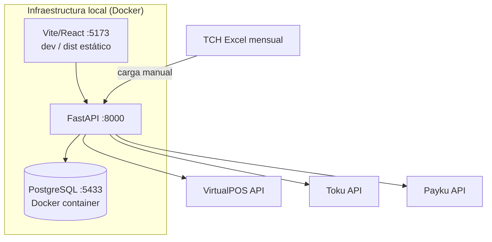

# Plan de Disponibilidad — SynkmetriX CRM

**Última actualización:** 2026-10-20
**Propósito:** Estrategia para asegurar la disponibilidad del sistema y los procedimientos de recuperación ante fallas.

---

## 1. Arquitectura de disponibilidad actual



**Estado actual:** Sistema monolítico en Docker local. No hay redundancia de instancias ni balanceo de carga. La disponibilidad depende de un único host.

---

## 2. Puntos únicos de fallo (SPOF)

| SPOF | Impacto si falla | Mitigación actual |
|------|-----------------|------------------|
| Host Docker (máquina local) | Sistema completo no disponible | Ninguna — SPOF sin mitigación |
| Contenedor PostgreSQL | BD no accesible; API falla | Restart automático Docker (`restart: always`) |
| Servicio FastAPI | API no disponible | Restart automático Docker |
| Credenciales de proveedor | Sync falla silenciosamente | Alertas en logs de SyncRun |
| Red de internet | Sync no puede conectar a APIs externas | Retry automático con backoff |

---

## 3. Procedimientos de recuperación

### 3.1 Contenedor PostgreSQL caído

```bash
# Verificar estado
docker compose ps

# Reiniciar
docker compose up -d postgres

# Verificar logs
docker compose logs postgres --tail 50
```

**Tiempo esperado de recuperación:** < 2 minutos.

### 3.2 FastAPI no responde

```bash
# Verificar estado
docker compose ps

# Reiniciar API
docker compose restart api

# Verificar que la BD esté disponible primero
docker compose ps postgres
```

**Tiempo esperado de recuperación:** < 1 minuto.

### 3.3 Pérdida de datos por migración fallida

```bash
# NO ejecutar DOWN de migración si hay datos en producción
# Identificar la migración problemática
.venv/Scripts/alembic.exe current
.venv/Scripts/alembic.exe history

# Restaurar desde backup (ver sección 4)
# Luego re-ejecutar migraciones desde el punto correcto
.venv/Scripts/alembic.exe upgrade head
```

### 3.4 Sync fallida por credenciales expiradas

1. Identificar el proveedor afectado: `GET /sync/runs?status=failed&limit=5`
2. Actualizar credenciales en `.env`
3. Reiniciar el servicio: `docker compose restart api`
4. Re-ejecutar sync: `POST /sync/{provider}`

### 3.5 ETL produce datos incorrectos

1. Identificar el EtlRun problemático: `GET /etl/runs?status=error`
2. NO ejecutar ETL de nuevo hasta identificar la causa
3. Si los datos en Core están corruptos: truncar solo las tablas Core del proveedor afectado
4. Re-ejecutar ETL desde staging: `POST /etl/core/{provider}`

**Regla:** Las tablas de staging (`source_records`, `vp_*`, `tk_*`, `p_*`, `tch_*`) son la fuente de verdad — Core siempre se puede reconstruir desde staging.

---

## 4. Estrategia de backup

### 4.1 Backup de PostgreSQL

```bash
# Backup completo (ejecutar diariamente)
docker exec crm-postgres-1 pg_dump -U crm crm > backup_$(date +%Y%m%d).sql

# Verificar integridad del backup
wc -l backup_$(date +%Y%m%d).sql  # debe ser > 1000 líneas
```

**Retención recomendada:**
- Backups diarios: 7 días
- Backups semanales: 4 semanas
- Backups mensuales: 12 meses

### 4.2 Restauración desde backup

```bash
# Crear BD limpia
docker exec crm-postgres-1 psql -U crm -c "DROP DATABASE IF EXISTS crm_restore; CREATE DATABASE crm_restore;"

# Restaurar
docker exec -i crm-postgres-1 psql -U crm crm_restore < backup_YYYYMMDD.sql

# Verificar
docker exec crm-postgres-1 psql -U crm crm_restore -c "SELECT COUNT(*) FROM core_payments;"
```

### 4.3 Backup de configuración

Los archivos de configuración que deben estar en respaldo (no en git):
- `.env` — credenciales y flags (en repositorio seguro separado)
- `docker-compose.yml` — versionado en git
- Scripts operativos en `scripts/` — versionados en git

---

## 5. Mantenimiento planificado

### Ventana de mantenimiento recomendada

- **Día:** Domingo
- **Hora:** 06:00–08:00 CLT
- **Aviso mínimo:** 24 horas al equipo operativo

### Checklist pre-mantenimiento

- [ ] Backup de BD verificado
- [ ] Notificación enviada al equipo operativo
- [ ] Último SyncRun completado exitosamente
- [ ] No hay ETL en ejecución

### Checklist post-mantenimiento

- [ ] Docker compose up exitoso
- [ ] `GET /health` retorna 200
- [ ] Última migración aplicada: `alembic current`
- [ ] Sync de prueba ejecutado: `POST /sync/toku`
- [ ] Notificación de fin de mantenimiento enviada

---

## 6. Evolución hacia mayor disponibilidad

Cuando el sistema migre a infraestructura cloud (Railway u otra), considerar:

| Mejora | Beneficio | Prerequisito |
|--------|-----------|-------------|
| PostgreSQL managed (Railway/Supabase) | Backups automáticos, replicas | Migración de conexión en `.env` |
| Múltiples instancias API | Eliminar SPOF de la API | Separar estado de la sesión |
| Healthcheck en sync | Alertas automáticas por falla | Endpoint `/health/sync` |
| Scheduled backups automáticos | RPO < 24h garantizado | Cron en host o servicio cloud |

---

*Documento generado el 2026-10-20.*
