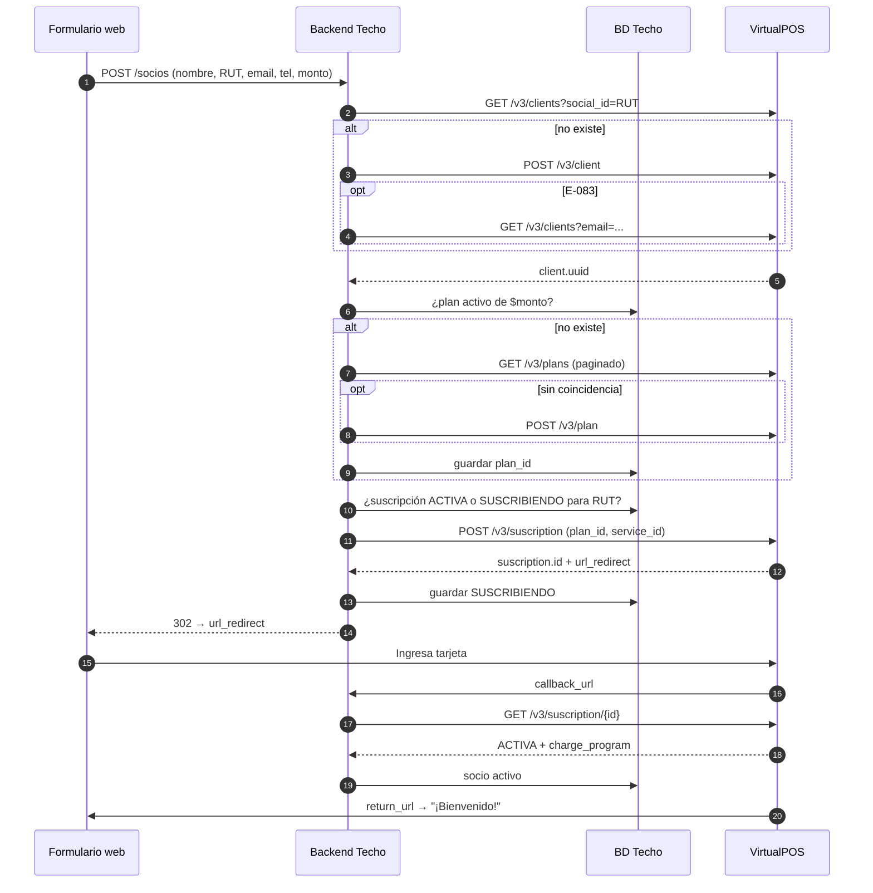

# Flujo: alta de un nuevo socio desde un formulario web

**Objetivo:** un socio completa el formulario web → queda con su **Client** (sin duplicados), en el **Plan** de su monto (se reutiliza o se crea) y con una **Suscription** activa tras ingresar su tarjeta en VirtualPOS.
**Recursos:** Client · Plan · Suscription · **Postman:** carpeta `00 · Alta de socio (flujo)`
**Relacionados:** [create-client.md](create-client.md) · [create-subscription.md](create-subscription.md) · [plans.md](../plans.md) · [subscriptions.md](../subscriptions.md)

> **Modelo operativo:** solo se usan planes `MONTO_FIJO`. Los montos del formulario deben corresponder a un plan fijo existente o a uno creado una sola vez para ese monto. Una suscripción activa no admite cambio de monto, plan, frecuencia ni día de cobro: ver [gestionar-suscripcion-monto-fijo.md](gestionar-suscripcion-monto-fijo.md).
>
> **Supuesto pendiente de confirmar:** membresía indefinida con `num_charges: 12` + `automatic_renewal: "T"`. La doc no muestra una forma explícita de plan sin término. Verificar en sandbox o con soporte@virtualpos.cl.

## 1. Idea clave

La suscripción **no se vincula al Client por `uuid`** (confirmado: *Crear Suscription* pide email, RUT y nombre directamente). El Client es tu ficha maestra; la unión entre socio, cliente y suscripción la haces **tú**, con el RUT normalizado y el `service_id`.

```text
Socio Techo (id interno) ──service_id──> Suscription ──plan_id──> Plan
        │                                    │
        └──── RUT ────> Client (cli_…) <──── RUT/email (relación débil)
```

## 2. Flujo completo

```text
PASO 0 · Formulario recibido en TU backend
↓  Validar y normalizar: RUT "12.345.678-9" → "12345678-9", email en minúsculas, teléfono 569XXXXXXXX
↓  Lock por RUT (evita que un doble clic cree todo dos veces)
↓
PASO 1 · ¿Existe el cliente?                         GET  /v3/clients?social_id={rut}
↓  ├─ Existe → client.uuid (opcional: PUT /v3/client/{uuid} si cambió teléfono o email)
↓  └─ No existe → PASO 2
↓
PASO 2 · Crear cliente                               POST /v3/client
↓  ├─ OK → client.uuid
↓  └─ E-083 (ya existe, p. ej. por email) → GET /v3/clients?email={email} → client.uuid
↓       (si ese email pertenece a OTRO RUT → revisión manual; no pisar datos)
↓
PASO 3 · ¿Existe el plan del monto?
↓  3a. TU tabla vpos_plans_catalog (amount, CLP, Mensual, activo) → plan_id
↓  3b. Si no está: GET /v3/plans?limit=100&page=N (la API no filtra por monto: recorrer páginas)
↓      → si coincide: guardarlo en tu tabla → plan_id
↓  └─ No hay → PASO 4
↓
PASO 4 · Crear plan                                  POST /v3/plan → plan.id → guardar en tu tabla
↓
PASO 5 · Antidoble cobro
↓  TU tabla de suscripciones: ¿hay una ACTIVA, o SUSCRIBIENDO de hace menos de 30 min, para este RUT?
↓  ├─ ACTIVA → NO crear (responder "ya eres socio" o pasar a un flujo de "cambiar monto")
↓  ├─ SUSCRIBIENDO reciente → reutilizar su url_redirect
↓  └─ Ninguna → PASO 6
↓
PASO 6 · Crear suscripción                           POST /v3/suscription
↓  Usa: plan_id, RUT SIN puntos ni guion, email, nombre, teléfono, service_id = <id socio>,
↓       return_url y callback_url en Base64
↓  Obtiene: suscription.id + url_redirect
↓  → GUARDAR suscription.id como SUSCRIBIENDO ANTES de redirigir
↓
PASO 7 · Redirección                                 HTTP 302 → url_redirect (el socio ingresa su tarjeta)
↓
PASO 8 · Confirmación (dos vías + respaldo)          GET  /v3/suscription/{id}
↓  a) VirtualPOS → callback_url (asíncrono)
↓  b) Navegador → return_url (página de resultado)
↓  c) Respaldo: consultas a los 15 min, 1 h y 24 h mientras siga SUSCRIBIENDO
↓  ├─ ACTIVA → socio activo + guardar charge_program[] (cargos programados)
↓  ├─ SUSCRIPCION_FALLIDA → ofrecer reintentar (se crea una suscripción NUEVA)
↓  └─ FINALIZADA (30 días sin terminar) → marcar como abandonada
↓
RESULTADO: socio ⇄ client.uuid ⇄ suscription.id ⇄ plan_id, con calendario de cobros
```



## 3. Endpoints, métodos e IDs

| Paso | Método | Endpoint | IDs y datos clave | Obtiene |
| --- | --- | --- | --- | --- |
| 1 | `GET` | `/v3/clients?social_id=` | RUT **con** guion | `clients[].uuid` |
| 2 | `POST` | `/v3/client` | `type: PERSONA`, `social_id_type: 1`, `gender_id` numérico | `client.uuid` |
| 2b | `GET` | `/v3/clients?email=` | email | `clients[].uuid` |
| 3 | `GET` | `/v3/plans?limit=100&page=N` | — | `plans[]` |
| 4 | `POST` | `/v3/plan` | `amount`, `currency`, `frequency_type`, `fixed_amount_day_charge` | `plan.id` |
| 6 | `POST` | `/v3/suscription` | `plan_id`, RUT **sin** guion, URLs en Base64, `service_id` | `suscription.id`, `url_redirect` |
| 8 | `GET` | `/v3/suscription/{suscription_id}` | `suscription.id` | `status`, `charge_program[]` |

## 4. Requests de ejemplo

**Paso 4. Crear plan** (solo si no existe):

```json
POST /v3/plan
{
  "name": "Socio Mensual $7.500",
  "description": "Aporte socio Techo - alta web",
  "type": "MONTO_FIJO",
  "currency": "CLP",
  "amount": 7500,
  "trial_days": 0,
  "num_charges": 12,
  "frequency_type": "Mensual",
  "fixed_amount_day_charge": "05",
  "automatic_renewal": "T",
  "show_in_terminal": "F",
  "shipping_address": "F"
}
```

**Paso 6. Crear suscripción:**

```json
POST /v3/suscription
{
  "email": "socio@mail.com",
  "social_id": "123456789",
  "first_name": "Ana",
  "last_name": "Perez",
  "phone_number": "56912345678",
  "plan_id": "fd53ead26f78b56113312609b668411b",
  "service_id": "SOCIO 000123",
  "channel": "WEB",
  "return_url": "aHR0cHM6Ly93d3cudGVjaG8ub3JnL2dyYWNpYXM=",
  "callback_url": "aHR0cHM6Ly9hcGkudGVjaG8ub3JnL3dlYmhvb2svdnBvcw=="
}
```

**Respuesta (resumida):**

```json
{
  "status": "OK",
  "code": 200,
  "url_redirect": "https://pat.virtualpos.cl/suscripcion-integrada/3a4d77f2e4",
  "suscription": { "id": "3a4d77f2e4", "status": "SUSCRIBIENDO", "plan_id": "fd53…" }
}
```

## 5. Implementación backend (Node, referencia)

```js
// POST /socios
async function altaSocio(form) {
  const rut = normalizarRut(form.rut);                       // "12345678-9"
  return withLock(`alta:${rut}`, async () => {               // p. ej. advisory lock en Postgres / Redis SETNX
    const clientUuid = await upsertClient({ ...form, rut });
    const planId     = await getOrCreatePlan(form.monto);

    const viva = await db.suscripciones.findViva(rut);       // ACTIVA, o SUSCRIBIENDO < 30 min
    if (viva?.status === 'ACTIVA') throw new YaEsSocio(viva.id);
    if (viva) return viva.url_redirect;

    const r = await vpos.post('/v3/suscription', {
      email: form.email, social_id: rut.replace('-', ''),
      first_name: form.nombre, last_name: form.apellido, phone_number: form.telefono,
      plan_id: planId, service_id: form.socioId, channel: 'WEB',
      return_url: b64(process.env.VPOS_RETURN_URL), callback_url: b64(process.env.VPOS_CALLBACK_URL),
    });
    await db.suscripciones.insert({
      id: r.suscription.id, rut, service_id: form.socioId, plan_id: planId,
      client_uuid: clientUuid, status: 'SUSCRIBIENDO', url_redirect: r.url_redirect,
    });
    await jobs.schedule('vpos-sus-check', { id: r.suscription.id }, ['15m', '1h', '24h']);
    return r.url_redirect;                                   // el controlador responde 302
  });
}

async function upsertClient(f) {
  const found = await vpos.get('/v3/clients', { social_id: f.rut, limit: 1 }).catch(ignore('E-082'));
  if (found?.clients?.length) return found.clients[0].uuid;
  try {
    const c = await vpos.post('/v3/client', {
      type: 'PERSONA', first_name: f.nombre, last_name: f.apellido, email: f.email,
      phone_number: f.telefono, social_id_type: 1, social_id: f.rut,
    });
    return c.client.uuid;
  } catch (e) {
    if (e.code !== 'E-083') throw e;
    const byEmail = await vpos.get('/v3/clients', { email: f.email, limit: 1 });
    const c = byEmail.clients?.[0];
    if (c && c.social_id !== f.rut) await alertas.revisionManual('email de otro RUT', { f, c });
    return c?.uuid;
  }
}

async function getOrCreatePlan(monto) {
  const key = { amount: monto, currency: 'CLP', frequency: 'Mensual' };
  const local = await db.planes.find(key);
  if (local) return local.plan_id;
  for await (const p of paginate(vpos, '/v3/plans', {}, 'plans')) {        // ver pagination.md
    if (Number(p.amount) === monto && p.currency === 'CLP' && p.frequency_type === 'Mensual'
        && p.type === 'MONTO_FIJO' && p.is_active === 'T') {
      await db.planes.insertIgnore({ ...key, plan_id: p.id });
      return p.id;
    }
  }
  const r = await vpos.post('/v3/plan', { name: `Socio Mensual $${monto}`, description: 'Aporte socio Techo',
    type: 'MONTO_FIJO', currency: 'CLP', amount: monto, trial_days: 0, num_charges: 12,
    frequency_type: 'Mensual', fixed_amount_day_charge: '05', automatic_renewal: 'T',
    show_in_terminal: 'F', shipping_address: 'F' });
  await db.planes.insertIgnore({ ...key, plan_id: r.plan.id });             // UNIQUE(amount,currency,frequency)
  return r.plan.id;
}
```

**Handler del callback / return_url:** recibe el aviso → `GET /v3/suscription/{id}` → *upsert* del estado → si `ACTIVA`, activa al socio en el CRM y guarda `charge_program[]`. Ver [webhooks.md](../webhooks.md#3-callback-de-suscription).

## 6. Qué guardar

| Tabla | Campos | Clave |
| --- | --- | --- |
| `vpos_plans_catalog` | amount, currency, frequency, plan_id, is_active | `UNIQUE(amount, currency, frequency)`: evita planes duplicados |
| `socios` | id, rut, email, …, `vpos_client_uuid` | `UNIQUE(rut)` |
| `vpos_suscriptions` | id, rut, service_id, plan_id, client_uuid, status, url_redirect, created_at, activated_at | PK `id`; índice `(rut, status)` |
| `vpos_charges` | desde `charge_program[]` | PK `charge_id` |

## 7. Manejo de errores

| Paso | Error / estado | Qué hacer |
| --- | --- | --- |
| 1 | `E-082` | "No hay clientes": continuar a crear |
| 2 | `E-083` | Buscar por email; si el RUT no coincide → revisión manual |
| 2 | `E-084` | RUT inválido (en Client va **con** guion) |
| 2 | `E-102` / `E-103` | Nombre o apellido con números o símbolos → limpiar |
| 4 | `E-061`…`E-065` | Parámetro del plan inválido (revisar enums) |
| 6 | `E-044` / `E-047` | `plan_id` inválido o inexistente |
| 6 | `E-046` | Sin contrato PAT → escalar |
| 6 | `E-084` | RUT mal formado (en Suscription va **sin** guion) |
| 6 | `E-104` | `service_id` con caracteres no permitidos (la doc dice solo letras y espacios; verificar) |
| 6 | Timeout | **No** reintentar a ciegas: revisar `GET /v3/suscriptions?status=SUSCRIBIENDO` o tu tabla antes de crear otra |
| 8 | `SUSCRIPCION_FALLIDA` | Ofrecer reintentar = nueva suscripción |

## 8. Riesgos de duplicidad

| Riesgo | Mitigación |
| --- | --- |
| Doble clic o doble envío del formulario | Lock por RUT + reutilizar la suscripción SUSCRIBIENDO reciente |
| Dos suscripciones completadas = **doble cobro** | Paso 5 + control diario: ≥ 2 ACTIVAS por RUT → alerta |
| Dos planes del mismo monto | `UNIQUE(amount, currency, frequency)` en tu catálogo + lock |
| Explosión de planes (no hay endpoint para editar ni borrar) | Montos predefinidos y "otro monto" redondeado |
| Callback perdido | Polling de respaldo 15 min / 1 h / 24 h |

## 9. Catálogo de montos fijos

| Decisión | Implementación | Consecuencia |
| --- | --- | --- |
| Montos predefinidos | Crear y registrar de antemano un plan `MONTO_FIJO` por cada monto ofrecido. | Evita proliferación de planes y simplifica el alta. |
| Monto excepcional | Buscar el plan fijo equivalente; si no existe, crearlo y guardarlo en el catálogo. | Los planes no se pueden editar ni eliminar por API. |
| Cambio de monto | Cancelar la suscripción actual y crear una nueva contra el plan fijo de destino. | El socio debe inscribir su tarjeta nuevamente; no existe migración de token. |

**Recomendación:** ofrecer solo montos predefinidos y limitar los montos excepcionales a un proceso administrativo. No usar `POST /v3/charge` ni `POST /v3/charge/online`: la documentación los asocia a planes `MONTO_VARIABLE`. Nota: en la prueba V-5 (sandbox, 2026-10-27) `POST /v3/charge` sí fue aceptado sobre un plan `MONTO_FIJO`; ver `VALIDATION-PLAN.md`. En producción sigue sin validar.

## 10. Probarlo en Postman

Carpeta **`00 · Alta de socio (flujo)`**, pensada para **Run folder** (Collection Runner):

| Request | Qué hace | Siguiente |
| --- | --- | --- |
| AS-1 Buscar Client por RUT | Reinicia variables y busca por `test_social_id` | Existe → AS-3 · No → AS-2 |
| AS-2 Crear Client | Crea el cliente | OK → AS-3 · E-083 → AS-2b |
| AS-2b Buscar Client por email | Recupera el cliente que choca | AS-3 |
| AS-3 Buscar Plan del monto | Recorre `/v3/plans` página a página buscando `alta_monto` | Encontrado → AS-5 · No → AS-4 |
| AS-4 Crear Plan del monto | Crea el plan | AS-5 |
| AS-5 Verificar suscripción activa | Busca una ACTIVA del mismo RUT | Existe → **FIN** (no duplica) · No → AS-6 |
| AS-6 Crear Suscription | Crea la suscripción y muestra `url_redirect` en consola | AS-7 |
| AS-7 Confirmar Suscription | Muestra el estado | FIN |

**Variables:** en el entorno, `test_social_id`, `test_email`, `test_first_name`, `test_last_name` y `test_phone`. En la colección, `alta_monto`, `alta_frecuencia`, `alta_dia_cobro` y `alta_service_id`.

**Paso manual:** tras AS-6, abre el link de la consola, inscribe la VISA de prueba `4051 8856 0044 6623` (CVV 123) y vuelve a enviar **AS-7** a mano.

> `setNextRequest` (el salto entre pasos) solo funciona en el Collection Runner. Si envías los requests a mano, la consola te indica cuál sigue.
