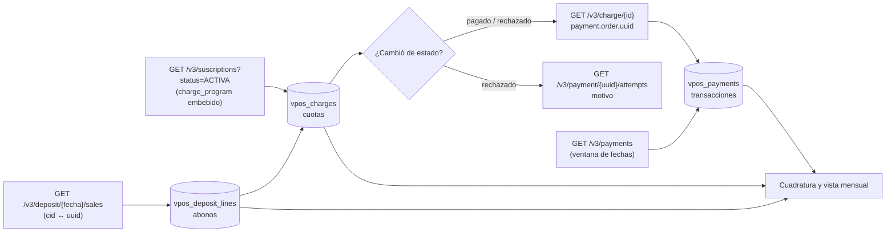

# Flujo: seguimiento de los cobros recurrentes (cuotas y transacciones)

**Objetivo:** saber, para cada socio y cada mes, **qué se le debía cobrar** (la cuota), **si se pagó** (la transacción), **por qué no** (los intentos) y **cuándo llegó la plata** (el abono), con la menor cantidad de llamadas posible.
**Recursos:** Suscription · Charge · Payment · Abono (Deposit) · **Postman:** carpeta `05 · Seguimiento de cobros`
**Relacionados:** [charge-subscription.md](charge-subscription.md) · [reintento-cobro-rechazado.md](reintento-cobro-rechazado.md) · [sync-virtualpos.md](sync-virtualpos.md) · [exportar-objetos-completos.md](exportar-objetos-completos.md) · [charges.md](../charges.md) · [payments.md](../payments.md) · [deposits.md](../deposits.md) · [capa común (comparación con Toku y Payku y modelo unificado)](../../../../Transversal/docs/transversal/workflows/seguimiento-cobros.md)

## 1. Cuota no es lo mismo que transacción

| Concepto TECHO | Objeto VirtualPOS | Qué representa | Campos clave | Lo crea |
| --- | --- | --- | --- | --- |
| **Cuota** (deuda del mes) | **Charge** (`cid_…`) | Lo que **se debe cobrar**: monto y fecha programados | `charge_date`, `amount`, `status`, `description` ("Cargo 3 de 12") | VirtualPOS, al activarse la suscripción (`charge_program`) ✅ |
| **Transacción** (pago efectivo) | **Payment** (`order.uuid`) | El **cobro realizado** a la tarjeta: autorización, monto cobrado y medio | `order.status`, `authorized_at`, `auth_code`, `amount`, `payment_type_code`, `card_number` | VirtualPOS, al intentar cobrar la cuota (**inferencia**: los cobros de suscripción también generan un Payment; validar en sandbox — ver V-3) |
| **Intentos** | Payment `/attempts` | Cada intento de autorización y el **motivo del rechazo** | `rejected_object.code`, `authorization_attempts_cards[]` | VirtualPOS |
| **Abono** | Deposit `sales[]` (y `order.deposits[]` del Payment) | Cuándo y cuánto **llegó a la cuenta**, descontada la comisión | `sales[]`: `net_amount`, `comission_and_taxes`, `suscription_charge.cid` · `order.deposits[]`: `payout_amount`, `payout_date` | VirtualPOS, días después del pago |

```text
Suscription ──1:N──> Charge (cuota del mes)
                        │ payment.order.uuid
                        ▼
                     Payment (transacción) ──/attempts──> intentos y motivo de rechazo
                        │ order.deposits[] / deposit sales[]
                        ▼
                     Abono (plata en la cuenta)  ── sales[].suscription_charge.cid ──> vuelve a la cuota
```

**Regla práctica:**
- La **cuota** responde "¿cuánto le correspondía pagar este mes y en qué quedó?".
- La **transacción** responde "¿qué se le cobró efectivamente, cuándo y con qué tarjeta?".
- Una cuota `pagado` **debe** tener una transacción `pagado` del mismo monto. Si no, hay una inconsistencia que revisar (§ 5).

## 2. ¿Masivo o uno a uno?

| Necesito… | Endpoint | ¿Masivo? | Llamadas para 5.000 socios activos |
| --- | --- | --- | --- |
| **Todas las cuotas** de todas las suscripciones activas, con su estado | `GET /v3/suscriptions?status=ACTIVA&limit=100&page=N` → `suscriptions[].charge_program[]` | ✅ **Sí** (embebido en el listado) ✅ ejemplo oficial | ~50 |
| Las cuotas de **una** suscripción, con `created_at` y filtro por estado | `GET /v3/suscription/{id}/charges?status=&limit=100` | Por suscripción | 1 por suscripción |
| El **detalle de una cuota** y su transacción (`payment.order.uuid`) | `GET /v3/charge/{charge_id}` | ❌ **Uno a uno** | 1 por cuota (solo las que cambiaron) |
| **Todas las transacciones** de un período | `GET /v3/payments?authorization_from=&authorization_to=&limit=100` (o `created_from/to`, `status`) | ✅ **Sí** | Pocas páginas por día |
| El detalle de una transacción | `GET /v3/payment/{uuid}` | ❌ Uno a uno | Solo si falta algo del listado |
| El **motivo de un rechazo** | `GET /v3/payment/{uuid}/attempts` | ❌ Uno a uno | Solo cuotas rechazadas |
| **Qué cuota pagó cada transacción abonada** | `GET /v3/deposit/{fecha}/sales` → `sales[].suscription_charge.cid` + `uuid` | ✅ **Sí** (por día de abono) | 1 por día |

**No existe** un listado global de cargos (`GET /v3/charges`) ✅ ni un filtro de "actualizado desde" en suscripciones ✅. El listado de suscripciones con `charge_program` embebido es la forma más barata de tener **todas las cuotas**.

**El puente cuota → transacción se arma de dos formas:**

| Vía | Cuándo | Costo |
| --- | --- | --- |
| `GET /v3/charge/{id}` → `charge.payment.order.uuid` | Apenas la cuota cambia a `pagado` o `rechazado` | 1 llamada por cuota que cambió (~1/30 de las activas por día) |
| `GET /v3/deposit/{fecha}/sales` → `suscription_charge.cid` ↔ `uuid` | Cuando VirtualPOS abona (días después) | 1 llamada por día, todas las cuotas abonadas |

## 3. Job diario de seguimiento

> **Observado en sandbox 2026-10-27** [CLAIM:VP-C01] (CONFIRMADO): `GET /v3/suscriptions` trae `charge_program[]` completo; coincide con `GET /v3/suscription/{id}/charges` (probado con 5 suscripciones). El PASO 1 no necesita un `GET /v3/suscription/{id}` adicional por suscripción. En la misma prueba, `amount` de `charge_program[]` llegó como número entero y no como string [CLAIM:VP-C19] (PARCIAL); el "castear" del PASO 1 queda como precaución.

```text
PASO 1 · Cuotas (masivo)                            GET /v3/suscriptions?status=ACTIVA&limit=100&page=1..N
↓  Por cada suscripción → charge_program[] → upsert vpos_charges (charge_id, suscription_id, charge_date, amount, status)
↓  amount viene como string ("6990") → castear
↓  Semanal: lo mismo con status=CANCELADA y FINALIZADA (sus cuotas pasan a cancelado)
↓
PASO 2 · ¿Qué cuotas cambiaron?                     (en NUESTRA base, comparando con el día anterior)
↓  ├─ pendiente/procesando → pagado      → PASO 3
↓  ├─ pendiente/procesando → rechazado   → PASO 3 + flujo de reintento
↓  ├─ → cancelado                         → registrar (pausa, baja o cambio de monto)
↓  └─ pendiente con charge_date < hoy - 2 → ALERTA "cuota atrasada sin cobrar"
↓
PASO 3 · Puente cuota → transacción (uno a uno, solo las que cambiaron)
↓  GET /v3/charge/{charge_id} → charge.payment.order.uuid → vpos_charges.payment_uuid
↓  Rechazada → GET /v3/payment/{uuid}/attempts → motivo → reintento-cobro-rechazado.md
↓
PASO 4 · Transacciones (masivo)                     GET /v3/payments?authorization_from=D-2&authorization_to=D&limit=100
↓  y GET /v3/payments?created_from=D-2&created_to=D&limit=100 (pagos aún no autorizados)
↓  → upsert vpos_payments por order.uuid  (`payments` puede venir como objeto o arreglo: aceptar ambos)
↓
PASO 5 · Abonos (masivo)                            GET /v3/deposit/{D-1}/sales
↓  sales[] con suscription_charge → enlaza cid ↔ uuid y completa el neto (net_amount, comission_and_taxes)
↓  sales[] sin suscription_charge → pago spot (donación única)
↓
PASO 6 · Cuadratura (§ 5) y vista mensual por socio (§ 6)
↓
RESULTADO: para cada socio y mes → cuota (monto y estado) · transacción (cobro real) · motivo si falló · abono
```



## 4. Estados de la cuota y de la transacción

| Cuota (Charge) | Transacción (Payment) esperada | Lectura |
| --- | --- | --- |
| `pendiente` | (ninguna todavía) | Programada, aún no llega su fecha |
| `procesando` | `pendiente` / `autorizando` | Se está cobrando |
| `pagado` | `pagado` | Cobrada ✅ |
| `rechazado` | `rechazado` / `reintentando` | No se pudo cobrar: ver intentos |
| `cancelado` | (ninguna) o `cancelado` | No se cobrará (pausa, baja, cambio de monto) |

⚠️ La doc no publica la equivalencia exacta entre ambos estados: esta tabla es la **esperada** (inferencia) y la cuadratura detecta las excepciones.

## 5. Cuadratura (controles diarios)

| Control | Regla | Si falla |
| --- | --- | --- |
| Cuota pagada sin transacción | `vpos_charges.status = pagado` y `payment_uuid IS NULL` tras el paso 3 | Revisar: ¿la cuota no trae `payment`? (V-2) |
| Montos | `charge.amount == payment.order.amount` | Alerta: cobro distinto de la cuota |
| Estados | Combinación fuera de la tabla del § 4 | Alerta |
| Transacción recurrente huérfana | Payment cuyo abono trae `suscription_charge.cid` desconocido | Upsert de esa suscripción (cambió fuera de nuestro sistema) |
| Cuotas atrasadas | `pendiente` con `charge_date < hoy - 2` | Alerta operativa: VirtualPOS no intentó cobrar |
| Doble cobro | Dos cuotas `pagado` del mismo socio en el mismo mes (dos suscripciones) | Alerta: revisar alta o cambio de monto |

## 6. Vista mensual por socio

```sql
CREATE VIEW v_vpos_cuotas_mensuales AS
SELECT s.service_id                               AS socio,
       date_trunc('month', c.charge_date)::date   AS periodo,
       c.charge_id, c.amount                      AS monto_cuota, c.status AS estado_cuota,
       pl.currency                                AS moneda_cuota,   -- CLP hoy; UF posible en el futuro
       p.payment_uuid, p.status                   AS estado_pago,
       p.amount                                   AS monto_cobrado,  -- siempre en CLP
       -- ⚠️ Si moneda_cuota = 'UF', monto_cuota está en UF y monto_cobrado en CLP (monto equivalente al día del cobro)
       p.authorized_at, p.payment_type_code,
       r.reject_code, r.decision                  AS decision_reintento,
       d.net_amount                               AS neto_abonado, d.deposit_date AS fecha_abono
FROM vpos_charges c
JOIN vpos_suscriptions s       ON s.suscription_id = c.suscription_id
LEFT JOIN vpos_plans pl        ON pl.plan_id       = s.plan_id
LEFT JOIN vpos_payments p      ON p.payment_uuid  = c.payment_uuid
LEFT JOIN LATERAL (                                          -- solo la última decisión de reintento
       SELECT reject_code, decision FROM vpos_charge_retries x
       WHERE x.charge_id = c.charge_id ORDER BY decided_at DESC LIMIT 1) r ON true
LEFT JOIN vpos_deposit_lines d ON d.charge_id     = c.charge_id AND d.kind = 'sale';
```

**Indicadores del mes:**

| Indicador | Cálculo |
| --- | --- |
| Tasa de cobro | cuotas `pagado` / cuotas con `charge_date` vencida (sin `cancelado`) |
| Recuperación | cuotas `pagado` que antes estuvieron `rechazado` / total rechazadas |
| Monto esperado vs cobrado vs abonado | Σ `monto_cuota` · Σ `monto_cobrado` · Σ `neto_abonado` |
| Cuotas atrasadas | `pendiente` con fecha vencida |
| Motivos de rechazo | conteo por `reject_code` |

## 7. Qué guardar

Las tablas ya definidas en [sync-virtualpos.md § 5](sync-virtualpos.md#5-tablas-sugeridas-central): `vpos_charges` (cuotas, con `payment_uuid`), `vpos_payments` (transacciones), `vpos_deposit_lines` (abonos, con `charge_id`) y `vpos_charge_retries` (motivos). Agregar a `vpos_charges` las columnas `status_prev` y `status_changed_at`, para que el paso 2 pueda detectar cambios.

## 8. Pendientes por validar en sandbox

| # | Pregunta | Cómo validarla |
| --- | --- | --- |
| V-1 | ¿El listado `GET /v3/suscriptions` trae el `charge_program` **completo** de cada suscripción (como el ejemplo oficial)? | Postman SC-1: comparar con `GET /v3/suscription/{id}/charges`. **Resuelta 2026-10-27 [CLAIM:VP-C01]: sí, trae el `charge_program[]` completo.** |
| V-2 | ¿Una cuota `pagado` o `rechazado` trae `payment.order.uuid` en `GET /v3/charge/{id}`? (el ejemplo del endpoint no lo muestra) | Postman SC-3 |
| V-3 | ¿`GET /v3/payments` incluye las transacciones de cuotas recurrentes, o solo los pagos spot? ¿Con qué `merchant_internal_code`? | Postman SC-6: buscar el `uuid` de SC-3 |
| V-4 | Un reintento de una cuota rechazada, ¿reutiliza el mismo Payment (más intentos) o crea otro? | Rechazar una cuota en sandbox, reintentar y comparar `payment.order.uuid` |

## 9. Probarlo en Postman

Carpeta **`05 · Seguimiento de cobros`** de `VirtualPOS API v2.postman_collection.json` (sandbox), para **Run folder**:

| Request | Qué hace | Siguiente |
| --- | --- | --- |
| SC-1 Cuotas de las suscripciones activas | Recorre todas las páginas y resume las cuotas por estado y mes (V-1) | SC-2 |
| SC-2 Cuotas de una suscripción | `/charges` de `suscription_id`; elige una cuota cobrada o rechazada | SC-3 |
| SC-3 Detalle de la cuota | `payment.order.uuid` = puente a la transacción (V-2) | Con uuid → SC-4 · FIN |
| SC-4 Transacción de la cuota | Compara monto y estado cuota ↔ transacción | Rechazada → SC-5 · SC-6 |
| SC-5 Intentos del rechazo | Motivo del rechazo | SC-6 |
| SC-6 Transacciones del período | Listado masivo; ¿aparece la transacción de SC-4? (V-3) | SC-7 |
| SC-7 Abono del día | Separa ventas recurrentes (`suscription_charge`) de spot | FIN |

**Variables de colección:** `suscription_id`, `sc_desde`, `sc_hasta` (ventana de transacciones) y `sc_deposit_date` (día de abono). Los scripts llenan `sc_page`, `sc_resumen`, `sc_charge_id` y `sc_payment_uuid`.
